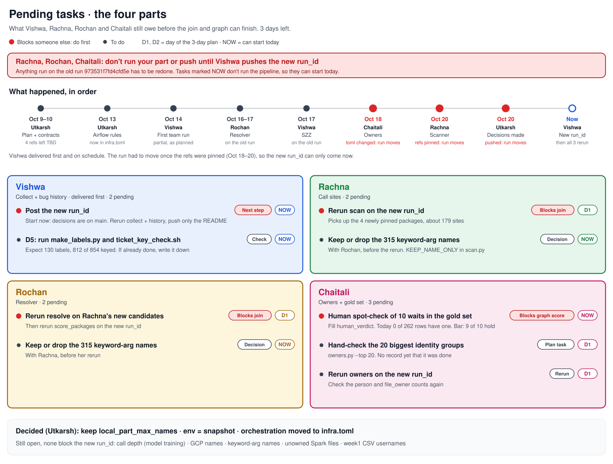

# Pending tasks · the four parts · 3 days left

What Vishwa, Rachna, Rochan and Chaitali still owe before the join (Utkarsh) and the graph (Aniket) can finish. From a review of every commit up to `4790da1`, checked against [PIPELINE-PLAN.md](PIPELINE-PLAN.md) and [CONTRACTS.md](CONTRACTS.md).



> **✅ Oct 23: the new team run is `70dd1dabfed544b8`.** Built by Utkarsh and Aniket after dynamic-config, every part rerun on it (collect, history, scan, resolve, owners), all bars met, 145 of 145 tests pass on it. **Use it; don't build your own.** Details: [shared-snapshot/README.md](shared-snapshot/README.md).
> What's left for the four is only the human checks marked below.

**Order:** ✅ decisions → ✅ new `run_id` → ✅ all parts rerun → join (Utkarsh) → graph (Aniket).

🔴 = blocks someone else, do first. D1, D2 = day of the 3-day plan it's due.

> **⛔ Don't rebuild the run or change `meridian.toml`.** Pull `main` and pass `--run-id 70dd1dabfed544b8` to anything you run.

## Decisions

### ✅ Made · by Utkarsh, Oct 20

Already in `meridian.toml` and `infra.toml`, pushed with this doc. dynamic-config ([FIXES.md](FIXES.md)) changes `meridian.toml` once more; that is the last change before the freeze.

| What | Decision | Change made |
|---|---|---|
| Chaitali's `[identity] local_part_max_names = 2` | **Kept.** Without it, 112 different people merge into one | None, already in |
| Rochan's resolver environment | **Accepted.** The packages resolve against the snapshot's `django/django` checkout. Per-repo lockfiles can't work: none of the 16 packages has one | `[resolver] env`: `"per_repo_lockfile"` → `"snapshot"` |
| `[orchestration]` (Airflow, GCP, schedule) | **Moved out** to [infra.toml](infra.toml). It's where the pipeline runs, not what it computes, so it no longer counts toward the `run_id` | Section removed from `meridian.toml` |
| Call depth | **Left open on purpose**, for model training. Stays at 3 for v1 | Comment on `call_edge_depth` |
| Aniket's dynamic-config logic changes ([FIXES.md](FIXES.md)) | **Approved** (Utkarsh + Aniket, Oct 23). The rerun on `70dd1dabfed544b8` meets every bar | None |
| The 315 keyword-argument names (`[scanner] keep_name_only`) | **Kept** (`true`), Oct 23. Nothing silently dropped; the join leaves `role = reference` rows out of `call_site` | None |

### ⏳ Still open · none of these block the new `run_id`

| What | Who decides | By when |
|---|---|---|
| Call depth: `call_edge_depth`, `blocked_by_max_depth`, `blast_radius_max_depth` | Utkarsh + Aniket | During model training. A change then means a new `run_id` and a rerun. To look deeper than 3, raise `call_edge_depth` too: the graph can't use edges the resolver never collected |
| GCP names: `image`, `snapshot_bucket` in [infra.toml](infra.toml) | Utkarsh | When GCP is set up. Placeholders today, no rerun when they change |
| The 21,787 Spark files with no owner (180-day rule): accept, and count them in the coverage report | Utkarsh | Before the join |
| ~~GitLab usernames in `week1/cross-team/gitlab/xt_cross_team_blocks.csv`: remove~~ Done in dynamic-config (still in git history at `ebe68b8`) | Aniket | ✅ |

## What happened, in order

| When | Who | What | Effect on the run |
|---|---|---|---|
| Oct 9–10 | Utkarsh | Plan and contracts. 4 package refs left `TBD-day4` for Rachna | Planned: the first run will be `partial` |
| Oct 13 | Utkarsh | Airflow rules. `image` and `snapshot_bucket` left `TBD` | Now in `infra.toml`, outside the `run_id` |
| Oct 14 | Vishwa | Collect, writer, tickets. Team run `973531f7fd4cfd5e` and the zip | First run, `partial` as planned |
| Oct 16–17 | Rochan | Resolver on Vishwa's run, with stand-in candidates | Old run |
| Oct 17 | Vishwa | SZZ and `file_bug_fixes` | Old run |
| Oct 18 | Chaitali | Owners and gold set. Added `local_part_max_names` to `meridian.toml` | **Run changes** |
| Oct 20 | Rachna | Scanner. Pinned the 4 package refs | **Run changes** (planned) |
| Oct 20 | Utkarsh | ✅ Decisions made, pushed with this doc | **Run changes**, for the last time |
| **Now** | Vishwa | Posts the new `run_id` | Everyone is on one run |
| **Then** | Rachna, Rochan, Chaitali | Rerun on it | Ready for the join |

**Vishwa didn't miss the `run_id`.** Vishwa delivered first, on the plan's schedule. The run had to change once the 4 refs were pinned, and Vishwa's README already said a new one would be posted then. It couldn't come earlier because the other changes only landed Oct 18–20.

## Why we need a new run_id

- The `run_id` is a hash of the inputs: the pinned repo SHAs, the raw Jira and GitLab pulls, and all of `meridian.toml`. Any change to them gives a new `run_id`.
- The team run `973531f7fd4cfd5e` is out of date:
  - It was made while 4 package refs were still `TBD`, so it's `partial`. Rachna has since pinned them, adding about 179 sites.
  - `meridian.toml` has changed since: Chaitali's identity setting, and Utkarsh's decisions.
- Every table carries `run_id`, and the join only matches rows with the same `run_id`. If one part runs on the old run and another on the new one, nothing joins.
- So: one new run, everyone reruns on it, and `meridian.toml` doesn't change again until the freeze.

## Vishwa · how to post the new run_id

**Start now.** Utkarsh's `meridian.toml` changes are on `main`, pushed with this doc.

1. `git pull` on `main`.
2. Keep the same zip. The Jira and GitLab pulls haven't changed, so there's nothing to download again.
3. Build the run:
   ```
   cd "DATA PIPELINE"
   python3 -m meridian.collect --run-id new --config meridian.toml
   ```
   `--run-id new` is right here, and only here: you're making the new team run. The last line prints `run_id=<new id>`.
4. Check it: run collect again with `--run-id <new id>`. It must print the same ID.
5. Build the history tables:
   ```
   python3 -m meridian.history --run-id <new id> --config meridian.toml
   ```
6. Update [shared-snapshot/README.md](shared-snapshot/README.md). This is the only file you push:

   | What | Change |
   |---|---|
   | `run_id` | `973531f7fd4cfd5e` → the new ID, in the table, steps 5–7 and the "Pass `--run-id`" rule. **Not** in the zip filename: the zip stays `meridian-raw-973531f7fd4cfd5e.zip` |
   | status | `partial` → `complete` (no `TBD` refs left) |
   | Row counts (step 7 table) | The new numbers from step 5. `git_commit` and `commit_file` go up (4 package repos added). Ticket counts should stay the same; if they don't, stop and tell Utkarsh |
   | Zip name and sha256 | No change |

7. Push with the commit message `New team run_id: <new id>`, then message the team with the ID.

Your data (`snapshots/`, `out/`) is git-ignored. Don't push it. The D5 label check goes in its own push.

## Vishwa · Collect + bug history · 1 pending

Delivered first: collect, writer, tickets (94.0% keyed, 3 dead keys) and SZZ (beats churn, 9.7x lift reproduced).

| | Task | Due | Done when |
|---|---|---|---|
| ✅ | ~~Post the new `run_id`, with collect + history rerun on it~~ Done Oct 23 by Utkarsh + Aniket: `70dd1dabfed544b8` | D1 | Steps above done, [shared-snapshot/README.md](shared-snapshot/README.md) pushed |
| | D5: run `week1/pair3/defects4j/make_labels.py` and `ticket_key_check.sh` once. If you already did, just write down the result. **Can start now** | D1 | Same 130 labels and 812 of 854 keyed |

## Rachna · Call sites · done

| | Task | Due | Done when |
|---|---|---|---|
| ✅ | ~~Rerun scan on the new `run_id`~~ Done Oct 23: 3,196 candidates, Django 265 of 265 | D1 | Includes the 4 newly pinned packages (about 179 sites) |
| ✅ | ~~Keep or drop the 315 keyword-argument and parameter names, with Rochan.~~ Decided Oct 23: kept. It's `[scanner] keep_name_only` in `meridian.toml`, so changing it changes the `run_id`. **Can start now** | D1 | Decided before Vishwa makes the new run_id (it's in `meridian.toml`), and written in [SCANNER.md](SCANNER.md) |

## Rochan · Resolver · done

| | Task | Due | Done when |
|---|---|---|---|
| ✅ | ~~Rerun resolve on Rachna's new candidates~~ Done Oct 23: packages 1,236 of 1,236, 542 of 542, 2,288 call edges | D1 | `score_packages` rerun on the new `run_id` |
| ✅ | ~~Keep or drop the 315 keyword-argument names, with Rachna.~~ Decided Oct 23: kept | D1 | Decided before Vishwa makes the new run_id |

## Chaitali · Owners + gold set · 2 pending

| | Task | Due | Done when |
|---|---|---|---|
| 🔴 | Human spot-check of 10 waits in the GitLab gold set. **Can start now** | D2 | `human_verdict` filled (0 of 262 today), ≥ 9 of 10 hold |
| | Hand-check the 20 biggest identity groups (`owners.py --top 20`) | D1 | Reviewed on the new `run_id`, result written down |
| ✅ | ~~Rerun owners on the new `run_id`~~ Done Oct 23: Spark 3,048 people, owner 37.3% vs last toucher 35.3% | D1 | `person` and `file_owner` counts checked again |
