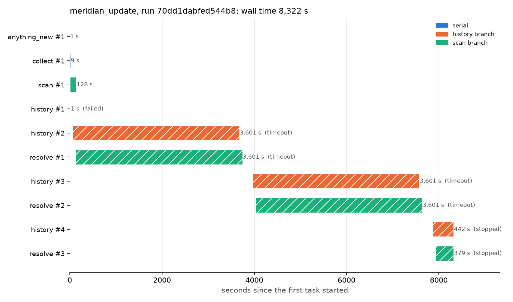
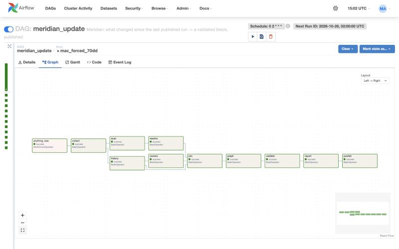
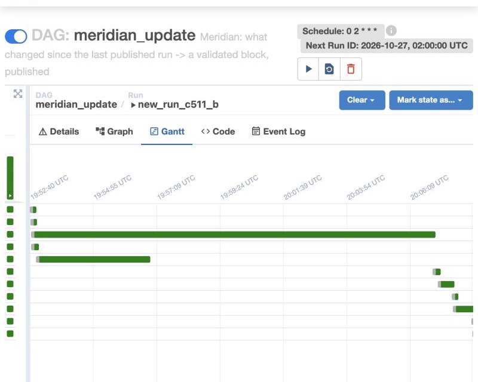
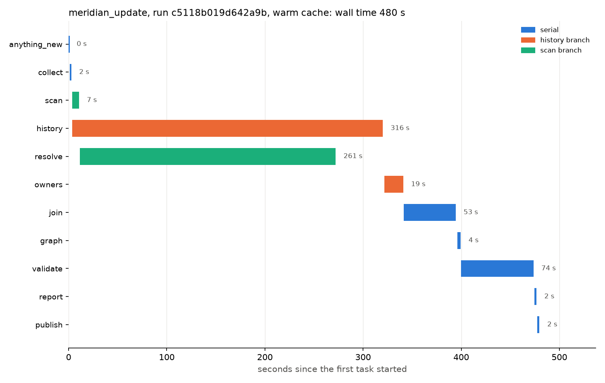
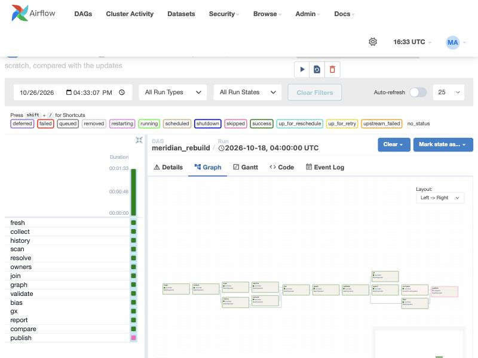

# Appendix A: Airflow run and Gantt

We ran the daily DAG (Airflow's graph of tasks), `meridian_update`, in Docker Desktop on an Apple-silicon Mac for team run `c5118b019d642a9b`, built from scratch: `{"run_id": "c5118b019d642a9b", "prev_run": "c5118b019d642a9b", "force": true}` (a prev_run equal to the run means no previous run). Every task passed on its first try, and the run was published after 943 s.



*Each bar is one try of one task, and history (orange) runs alongside scan and resolve (green).*

| Task | Time | What it did |
|---|---:|---|
| anything_new | 0 s | Forced by the trigger |
| collect | 1 s | Snapshot already there, checked and replayed, `run_id=c5118b019d642a9b` |
| scan | 10 s | Call sites in Django and Spark |
| history | 854 s | Commits, tickets and SZZ (tracing each bug fix back to the commit that caused it), through the folder mount |
| resolve | 236 s | Jedi, in parallel with history |
| owners, join, graph | 10 s, 29 s, 2 s | |
| validate | 39 s | 1,788,375 rows in 25 tables, 0 errors, 1 warning (289 Spark tickets with invalid dates in the years 0010–0012, Apache Jira's own) |
| report, publish | 1 s, 1 s | `published/c5118b019d642a9b.sqlite`, `latest.json` |

Back to back the tasks take 1,183 s, so running scan and resolve beside history saved 240 s (20%). History is the longest branch, so it caps the saving.





*The update DAG in the Airflow UI, graph view and then Gantt view.*

## Why it takes 943 s

Natively the same parts take about 7 minutes. In Docker every git and file read goes through the folder mount, which is several times slower on macOS and Windows, and history reads the most (`git log --numstat`, blame for SZZ). A Linux host or a Docker volume (`-f docker-compose.volumes.yaml`) removes that cost. A warm SZZ cache also brings history from 312 s to 74 s natively.

An earlier run on a Windows laptop never finished:

| What we saw | Cause | Fix |
|---|---|---|
| history failed after 1 s on the first try | Never found. On the Mac the same failure (3 tries each) was an absolute host path in `.git/objects/info/alternates`. On Windows that link was already relative (`../../../../../_cache/repos/<repo>.git/objects`), and the retry got past it | The link is now relative (`collect.borrow_relative`), and collect repairs it in older snapshots. Test: `test_checkouts_work_wherever_the_data_root_is_mounted` |
| Later tries killed at the 60-minute timeout | The Windows folder mount, slower still than the Mac's | `docker-compose.volumes.yaml`, or a longer timeout. history's is now 180 minutes (`settings.toml`), because the weekly rebuild runs it cold |

The error handling still worked: timeouts, retries 5 minutes apart, a log per try, and the last good block stayed live.

## Fixing the bottleneck: the SZZ cache

The chart above has one long bar: `history`, 854 of 943 s, mostly SZZ re-blaming every Spark bug-fix commit. So we turned on the SZZ cache (`settings.toml [cache] szz = true`) and ran the update twice more on the same run, `c5118b019d642a9b`. The first run fills the cache (`cache_cold_c511`) and the second reuses it (`cache_warm_c511`):



*The warm run: `history` is 316 s, and `resolve` (beside it) is now about as long.*

| Task | Before: cache off, 10 SZZ processes | Filling the cache, 4 processes | **Warm cache, 4 processes** |
|---|---:|---:|---:|
| scan | 10 s | 11 s | 7 s |
| resolve | 236 s | 195 s | 261 s (resolve cache on; turned off after this) |
| history | 854 s | 1,072 s (3rd try) | **316 s** |
| owners, join, graph, validate | 10, 29, 2, 39 s | 19, 54, 4, 80 s | 19, 53, 4, 74 s |
| **Whole DAG** | **943 s** | about 1,250 s, counting only the try that passed | **480 s** |

- The warm `history` log says `9757 reused from the cache`: no fix commit was blamed again.
- The warm run's 24 output files match `golden/c5118b019d642a9b.json` byte for byte, as `tests/test_cache.py` requires of every cache.
- With the cache on, ten SZZ processes ran Docker's 7.7 GB out of memory twice (exit -9, then a killed worker), so `[history] szz_workers` is now 4. The saving is despite fewer processes. Filling the cache costs a slower first run once.
- The resolve cache was slower, not faster (195 s to 261 s): reusing a file means checking every file Jedi read for it, through the folder mount. It's off again. `report/airflow_run_warm.csv` has the warm run's tries.

## The weekly rebuild

`meridian_rebuild` (run `rebuild_c511`) rebuilds `c5118b019d642a9b` from scratch in its own data folder with every cache off, then compares the result with the update's outputs. Every task passed on its first try, in 902 s:

| Task | Time | Note |
|---|---:|---|
| fresh, collect, scan | 0 s, 1 s, 11 s | collect replays the run's SHAs and snapshot time |
| resolve | 344 s | Cold, no resolver cache |
| history | 803 s | Cold SZZ, with the 180-minute timeout |
| owners, join, graph, validate, report | 8, 28, 2, 37, 1 s | |
| bias ∥ gx | 13 s, 17 s | Side by side, after validate. GX: 308 expectations, 0 failed ([Appendix B §4](appendix-quality.md#4-the-weekly-gx-audit)) |
| compare | 2 s | 0 differences between the rebuild and the update |
| publish | skipped | Nothing to correct, so nothing republished, as designed |



*The rebuild run, all green except publish, which is pink because compare found nothing to correct.*

## Rerun it

```
docker compose up -d --build                                    # from Data-Pipeline/, with .env from .env.example
# UI at http://localhost:8080: trigger meridian_update with {"run_id": "c5118b019d642a9b", "force": true}
python report/gantt.py                                          # redraws the chart from report/airflow_run.csv
```

`report/airflow_run.csv` holds the update's per-task tries (`new_run_c511_b`), exported from the Airflow API. The Gantt chart and the 1,183 s and 20% above come from it.
