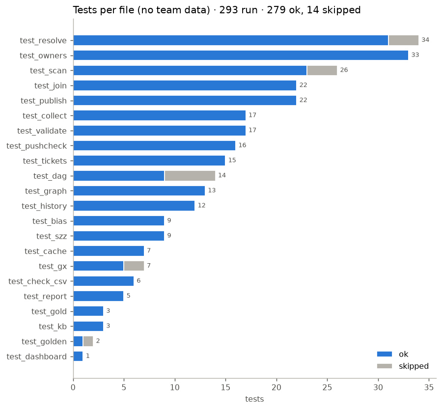
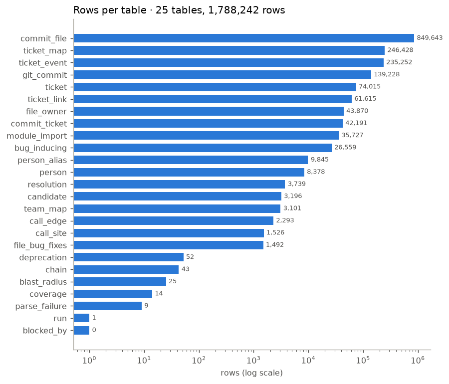
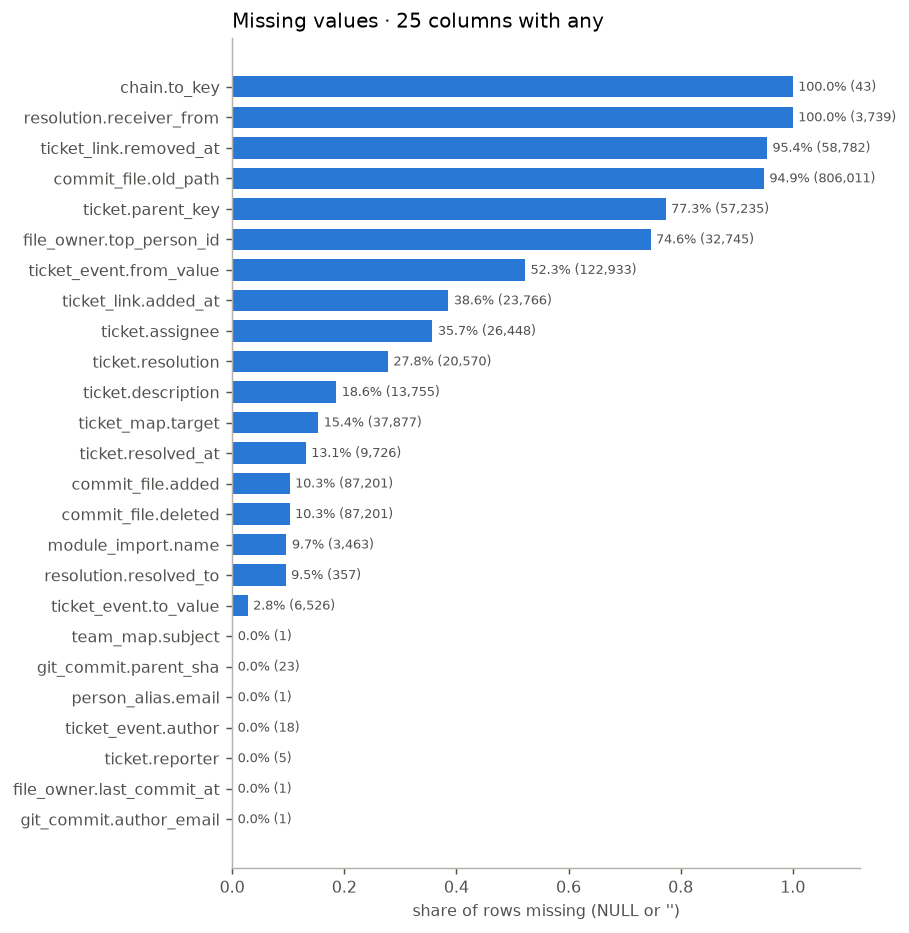
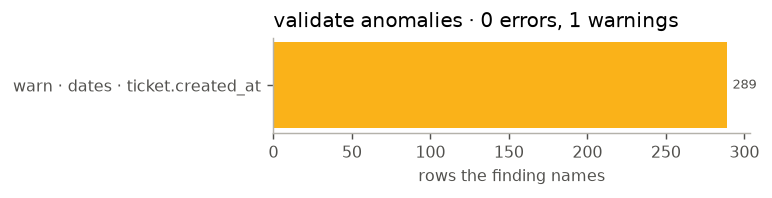
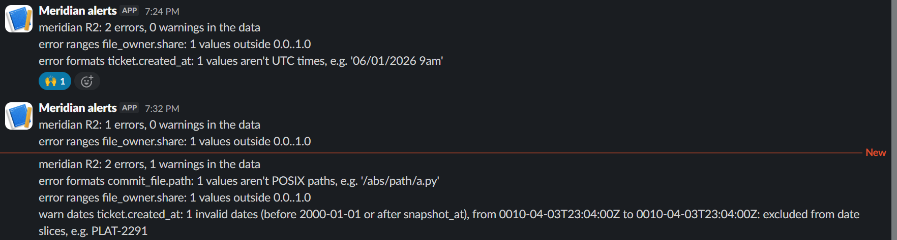
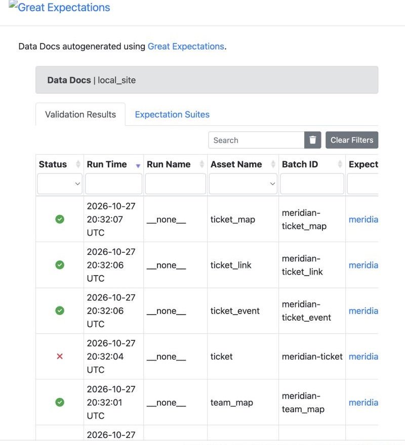
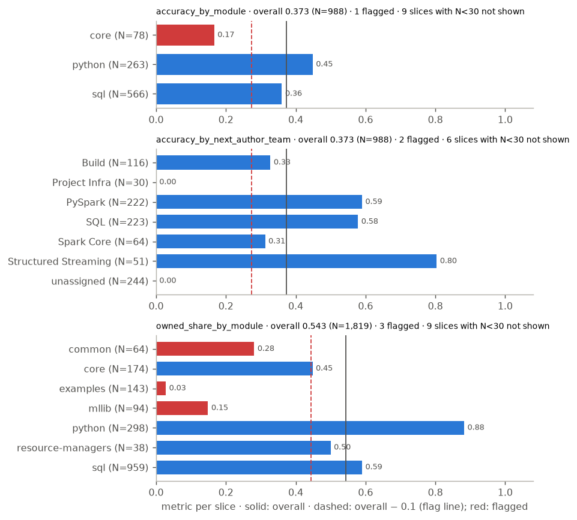
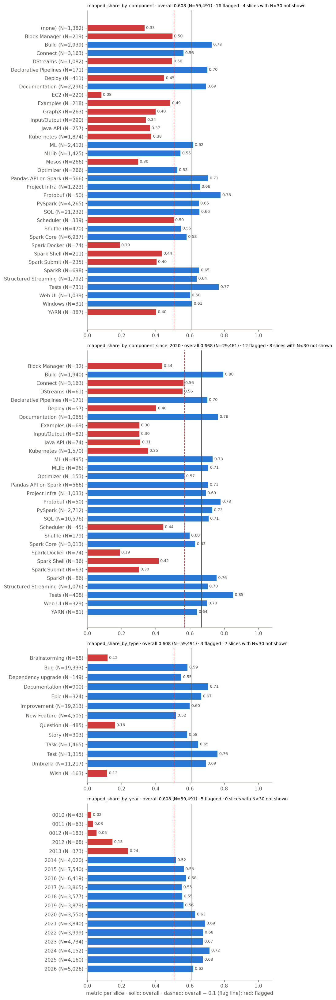
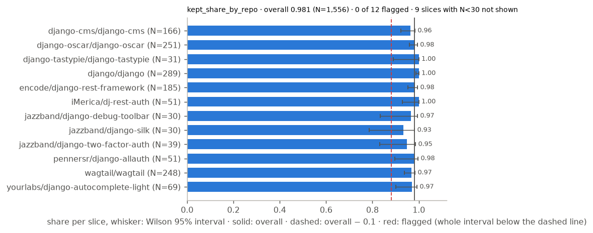
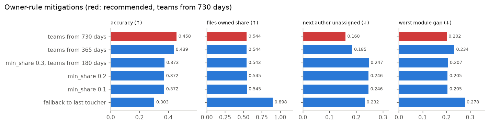

# Appendix B: Data quality and bias

Everything here comes from team run `c5118b019d642a9b` in the Airflow runs of Oct 27 ([Appendix A](appendix-airflow.md)): its `stats.json`, `anomalies.json`, `bias.json` and `meridian.sqlite`, plus the unit tests run the same day. The charts come from `python report/figures_quality.py <dir with the three json files>`, run from `Data-Pipeline/`.

## 1. Tests

From `Data-Pipeline/`, `python -m unittest discover -s tests -t .` runs 340 tests: OK, 0 failures, 0 errors. Without the team data a Windows machine skips 19, and Mac and Linux skip 18 ([TESTING.md](../../TESTING.md)).

*Tests per file, passed in blue and skipped in grey. Drawn from the verbose log `tests_light.txt` of Oct 26 on v1, when the suite had 293 tests and 14 skips.*

There's one test file per pipeline part, plus files for the DAG (Airflow's task graph), push checks, cache equivalence and golden hashes (md5 sums of a known-good run's outputs). The fixtures inside them carry the edge cases ([REPORT §2.3](REPORT.md)). We ran each skipped test in its own environment:

| Skipped here | N | Why | Run where | Result |
|---|---:|---|---|---|
| `test_dag.Dag.*` (DagBag load, spec, settings, trigger, templates) | 5 | Airflow isn't on the host | Airflow 2.10.5; CI's `airflow` job in the Docker image | ✅ 15 of 15 in `test_dag` |
| `test_gx.Audit.*` (suite on a block, Data Docs) | 2 | GX has its own `[gx]` environment | GX 1.24.1; CI's `gx` job | ✅ 7 of 7 in `test_gx` |
| `test_golden.TeamRun`, `test_resolve.DjangoAnswerKey` ×2, `test_resolve.PackagesScore`, `test_resolve.TeamRunEdges` ×4, `test_scan.DjangoAnswerKey` ×3 | 11 | Need the private team data | With `MERIDIAN_RUN_ID=c5118b019d642a9b` | ✅ below |
| `test_resolve.ReexportLoop` | 1 | A re-export loop overflows Windows' C stack | Mac and Linux, CI's Linux job | ✅ |

With the team data the suite is 340 tests, OK, 7 skipped (Airflow and GX). The team-run tests:

| Test | Result |
|---|---|
| `test_scan.DjangoAnswerKey`: 265 of 265 edit lines, 0 false; 2 lines outside `.py`; no tracked name lost to parse failures | ✅ 3 of 3 |
| `test_resolve.DjangoAnswerKey`: 542 of 542 aliased `_()` calls; every edit line resolves | ✅ 2 of 2 |
| `test_resolve.PackagesScore`: precision and recall on the 20 Django packages | ✅ 1 of 1 |
| `test_resolve.TeamRunEdges`: every real call edge sits on a confirmed use, within the depth limit, never on an import line | ✅ 4 of 4 |
| `test_golden.TeamRun`: md5 of the 24 `.jsonl` outputs vs `golden/c5118b019d642a9b.json` | ✅ 24 of 24 |

On Windows on Oct 25, v1's golden check was 20 of 24. Jedi's folder order changed `resolution`, `call_edge` and `blast_radius`, the git version changed `commit_file` ([Appendix D](appendix-testing.md), round 5), and `call_site` on disk predated join's "no stolen matches" fix. The fixture half, which hashes all 25 tables, runs everywhere and passes.

## 2. Schema and statistics

`meridian.validate` checks the block against `schema.sql` (types, NOT NULL, allowed values, keys, one `run_id`) and writes statistics for each column to `stats.json`. On `c5118b019d642a9b`: 25 tables, 1,788,375 rows, 0 schema violations, 0 data errors.

*Rows per table on a log scale, where raw git and Jira history make up most of the block.*

The biggest are `commit_file` (849,643) and `ticket_map` (246,428). The output is 1,526 call sites, 25 blast-radius rows and 43 ticket chains. `blocked_by` is empty.

*Share of empty values in each of the 25 columns that have any, all within their limits.*

Limits are in `settings.toml [validate.missing]`, and unlisted columns allow none. The high shares are empty by design. `commit_file.old_path` (94.9%) is only set on renames, `file_owner.top_person_id` (74.6%) is empty for path- and repo-owned files, `ticket.parent_key` (77.3%) is only for sub-tasks, and `resolution.receiver_from` (100%) is for a call pattern that doesn't occur in this data. The near-zero ones are single real rows: 23 root commits without a parent, 1 commit with an empty author email, and 5 tickets and 18 events by deleted accounts.

Coverage floors are in `[validate.coverage]`. 1,525 of 1,526 call sites resolved (floor 0.95), 1,526 of 1,526 owned (floor 0.95), and 36,198 of 59,491 Jira tickets mapped to code, 0.61 (floor 0.50). The 14,524 GitLab tickets map to nothing by design, because GitLab is Ruby and outside the snapshot.

## 3. Anomalies

*v1's `anomalies.json`: 0 errors and 1 warning, for 289 tickets with impossible creation dates.*

On `c5118b019d642a9b`, `anomalies.json` has the same: 0 errors and 1 warning. The 289 dates are on `ticket.created_at`, from 0010-04-03 to 0012-10-19 (43 in year 0010, 63 in 0011, 183 in 0012): Spark tickets imported in 2013 from Spark's old tracker. A date before `[validate.dates] earliest` (2000) or after the snapshot is invalid, so every run warns with the count, the range and example keys, and the alert carries it. Apache Jira itself shows those dates, so the run goes on and we don't make up corrected ones, but no part uses them as dates: §5's year slices leave them out. There were no outlier, drift or row-count warnings.

The alert is shown arriving, not just written. `tests/test_validate.py` (`Alert.test_an_alert_really_reaches_slack_and_email`) and `run_demo.py` step 8 start a local Slack-style webhook server and a local SMTP server (`tests/alert_sinks.py`) and send to them with no mocks. In the demo, validate on the fixture with four injected anomalies delivers "meridian R2: 2 errors, 2 warnings in the data" to both. The team's Slack uses the same code with `MERIDIAN_SLACK_WEBHOOK` in `.env`: validate on a fixture block with two planted errors exited 4 and its alert, "meridian R2: 2 errors, 0 warnings in the data", arrived in the team's workspace ([join it](https://join.slack.com/t/meridian-flg4799/shared_invite/zt-4ekm8ksh1-WYMNCqG_ECL5jr17~Gzaxg) to see the channel). No team mailbox is set, so email is shown against the local SMTP server only.

*Validate's alerts in the team's `#meridian-alerts` channel, from fixture blocks with planted errors; the last one also carries the invalid-date warning.*

## 4. The weekly GX audit

`meridian/gx.py` turns validate's generic checks into one Great Expectations suite per table: minimum rows, missing-value allowances (`ExpectColumnValuesToNotBeNull` with `mostly`), regex formats (times, IDs, SHAs, repos, paths), numeric ranges and date bounds. Coverage floors, outliers and drift stay in validate. The audit runs in the weekly rebuild next to `bias`, in its own environment (`requirements-gx.txt`).

It never gates. A failed expectation alerts as a warning and the task succeeds. An expectation GX couldn't evaluate alerts as an error and exits 1, so a broken audit can't pass for clean data.

On `c5118b019d642a9b` it ran 308 expectations over the 25 tables. One failed, the date bounds on `ticket.created_at` for the 289 invalid dates, which now alerts as a warning. It published its Data Docs to `published/gx/c5118b019d642a9b/index.html`.

*GX marks `ticket` with a cross for the 289 invalid dates.*

## 5. Bias (data slicing)

`meridian.bias` slices the pipeline's three deciding rules with Fairlearn's `MetricFrame`. Each slice gets a Wilson 95% interval, which still behaves on small samples. A slice is judged when N ≥ 30, and flagged when its whole interval is more than 0.10 below overall, so a gap noise alone could explain isn't flagged. 133 slices were judged and 29 flagged. [BIAS.md](../BIAS.md) lists them all, with the full mitigation table. In the charts, whiskers are the intervals, the solid line is overall, the dashed line is the flag line and red bars are flagged.

*How often the owner rule names the next author's team (top) and what share of authors and files get a team (bottom), with `core/` and `Project Infra` (at 0.00, so no bar) flagged.*

Owner rule (Spark): does a file's owner team predict its next author's team? Counting authors with no team as misses gives 0.373 (N = 988). But `unassigned` scores 0.000 by construction, because the same team lookup builds both the prediction and the label. So we score accuracy on next authors who have a team, 0.496 (N = 744, CI 0.460–0.532), and report the unassigned rate (24.7%) as coverage. Flagged: module `core/` 0.228 (N = 57), and team `Project Infra` 0.000 on exactly N = 30, which is borderline. The slice by the next author's prior commits flags nothing. Owned share is 0.543 (N = 1,819), with `examples/` 0.028, `mllib/` 0.149 and `common/` 0.281 flagged.

*Share of Spark tickets that map to code by component, by component since 2020, by type and by year.*

Ticket to code mapping is 0.608 per ticket (N = 59,491), or 0.613 over N = 71,845 (ticket, component) pairs. 11 of 36 judged components are flagged, among them EC2 0.087, Spark Docker 0.209 and Kubernetes 0.390. Age explains a lot of it. Tickets from before 2014 map under 25% of the time because their files are gone, and from 2014 on 0.52–0.72. Holding age fixed doesn't close the gap, though. Since 2020 (0.677, N = 35,285), EC2 and Mesos are too few to judge, and 8 of 32 judged components stay flagged, Kubernetes 0.372 (N = 1,762) among them. Wish, Brainstorming and Question tickets (0.12–0.16) don't carry code by nature.

*Share of candidate call sites the resolver keeps per repo, where every judged repo's interval reaches the 0.981 average.*

The resolver keeps 0.981 overall (N = 1,556), and 0 of 12 judged repos are flagged (lowest: jazzband/django-silk, 0.933 on N = 30).

Our flag rule isn't corrected for multiple comparisons, so with 133 slices a few flags could be chance. Under Bonferroni (a stricter cutoff for many tests, here z = 3.56), 23 of the 29 hold. `core/`, `common/`, Deploy and Spark Shell (all time and since 2020) don't, so treat those as likely, not established. BIAS.md has Fairlearn's difference and ratio for each slicing.

### Mitigation and trade-offs

*Each candidate fix for the owner rule scored four ways, where the 730-day lookback (red) wins in-sample but not held out. The `min_share` rows are the abstain curve.*

The adopted mitigation is the owner rule's decision threshold: below `min_share` 0.30 it abstains and the file shows as "unowned, needs review". Raising it gives the curve of files owned against accuracy on next authors with a team: 0.30 owns 988 files at 0.496, 0.40 974 at 0.500, 0.50 956 at 0.501, 0.60 817 at 0.534 (N = 612, CI 0.495–0.573). Never abstaining (the last toucher's team) owns 1,634 at 0.395, and on the 511 files where only the guess names a team it's right 127 times (0.249). A wrong owner silently sends work to the wrong team, while "needs review" is seen and routed by a person, so we abstain. We kept 0.30 because accuracy is flat up to 0.50. 0.60 also wins at the earlier cut (0.560 against 0.505), but it sends 171 more files to review, so we recommend it rather than adopt it (it would change `meridian.toml`, so a new run_id).

A lower share threshold changes nothing. Falling back to the last toucher owns 65% more files but is wrong more often. Taking a person's team from the last 730 days instead of 180 looks best: 0.496 → 0.545 on next authors with a team, and unassigned 24.7% → 16.0%. So `bias.py` picks at a cut one window earlier (2025-10-06) and confirms on the current cut (2026-04-04) with a seeded paired bootstrap over the same files. It only picks among variants that own at least as many files as the configured rule, so a stricter threshold can't win by abstaining. At the earlier cut the configured 180-day rule wins (0.505 against 0.502 on 1,279 files), so the held-out delta is 0.0 (interval 0.0–0.0). The gain is in-sample only, and we didn't adopt the longer lookback.

Next authors with no team, as their own group (`owner_rule.no_team_authors`): 438 of 1,819 files (24.1%), 96 of 169 next authors. 70 of the 96 made no commit before the cut, so a newcomer can't have a team and is never scored. Their files are mostly in `sql/` (325), `core/` (33) and `python/` (32), with `connector/` the most affected (14 of 21 files). The rule names an owner for 55.7% of their files against 53.9% for the rest, so they're routed like anyone, just not checkable. Where the 730-day lookback gives them a team, the owner matches it 0.651 of the time (N = 86).

What we applied now: every slice in `bias.json` carries its N, interval and flag, so the views can show "low coverage" next to a flagged slice and "too few to judge" under N = 30. For ticket mapping we ruled out fuzzy matching, so the fix is more coverage: add `apache/spark-docker` and `apache/spark-kubernetes-operator` to the snapshot. `tests/test_bias.py` (12 tests, passed) pins the flag rule, the N = 30 edge, multi-component tickets, the prior-commits slice, a threshold above the configured one, the no-team group and the held-out scoring.
