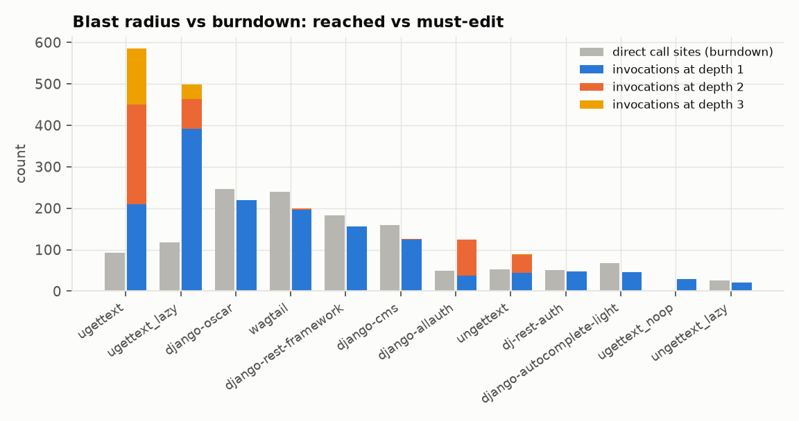
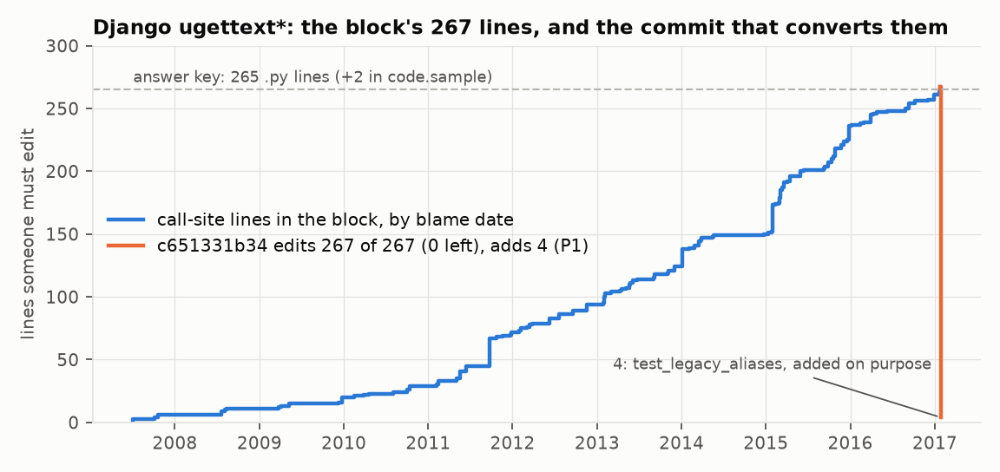
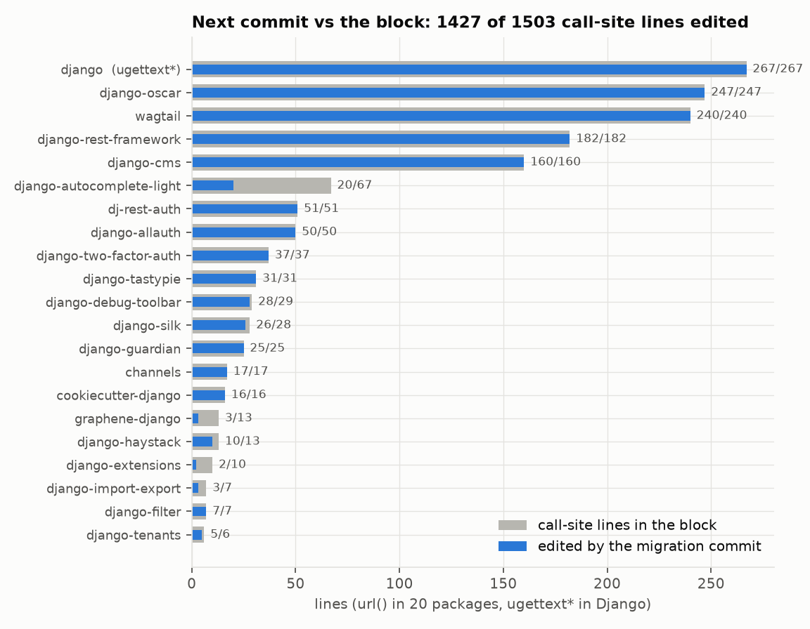
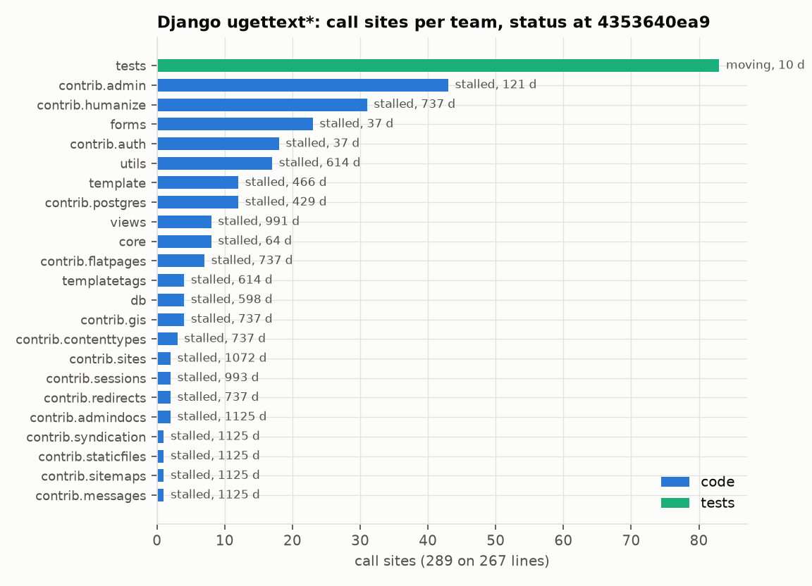
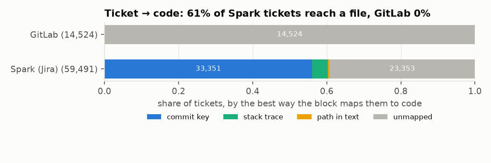
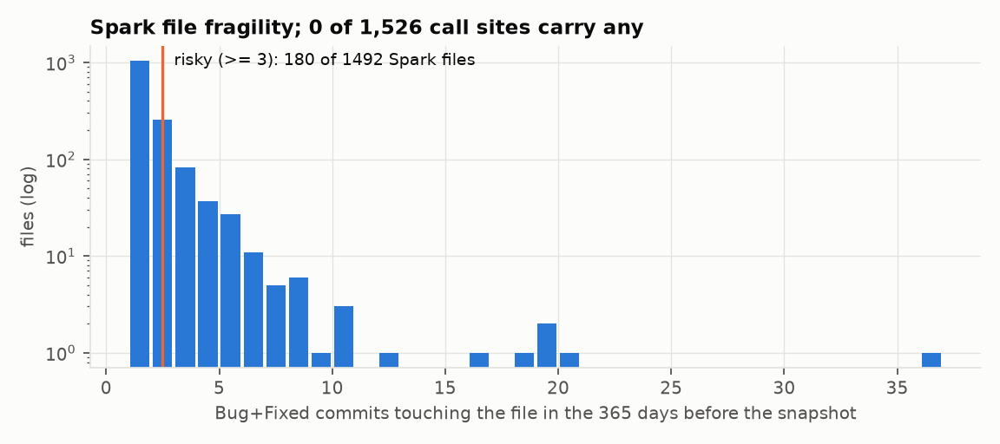
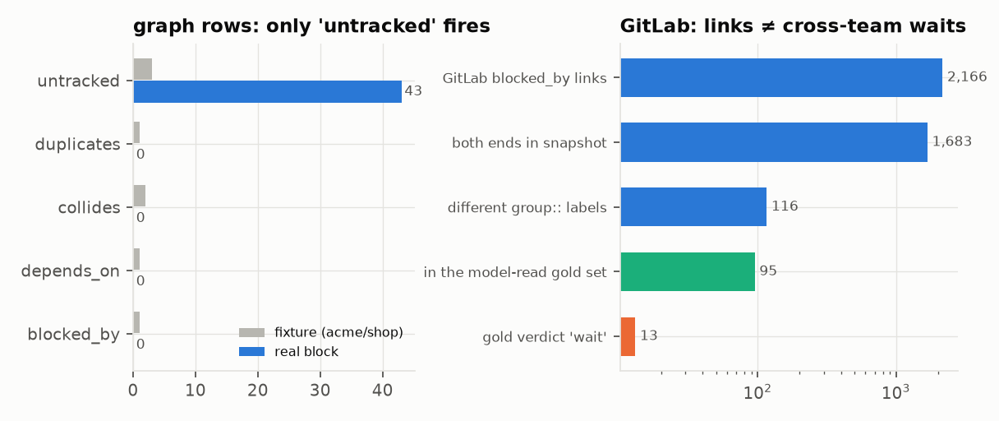
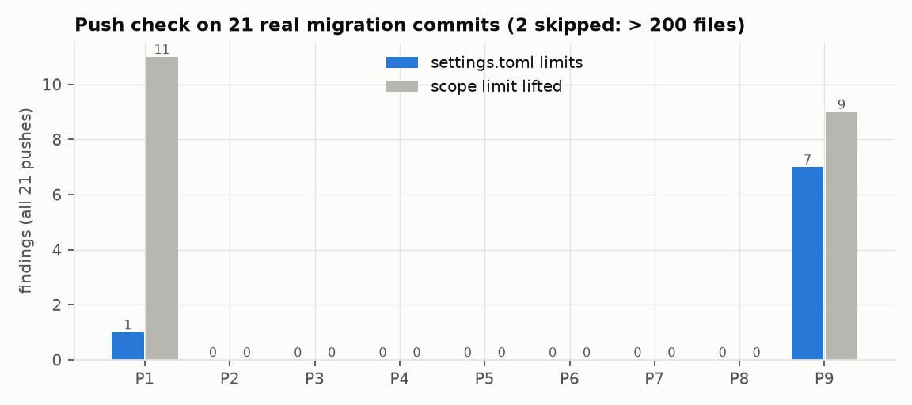
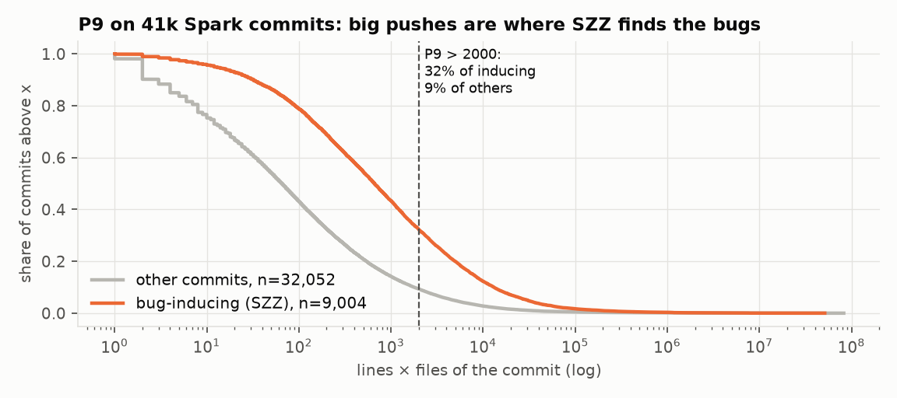
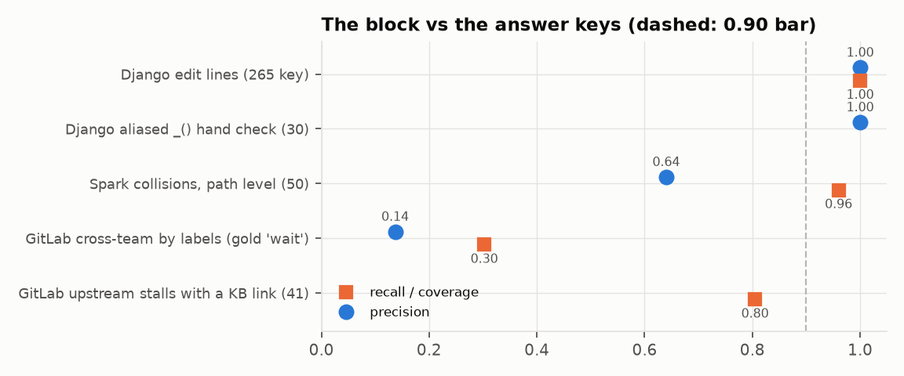

# Appendix C: The real data, feature by feature

Can the block serve each feature the team proposed ([02-product](../../docs/02-product.md), [04-architecture](../../docs/04-architecture.md), [project-scoping](../../scoping/project-scoping.md))? Each one is a named SQL query in [KNOWLEDGE-BASE.md](../KNOWLEDGE-BASE.md), tested in CI on the hand-built fixture `acme/shop`. Here we run the same queries, unchanged, on team run `70dd1dabfed544b8` (snapshot 2026-10-01: Django at `4353640ea9`, Spark with Apache Jira, 20 Django packages, GitLab issues). We also score the block against the answer keys in [labels/](../labels/) and replay real commits through the push check. Ideas the team dropped ([06-dead-ideas](../../docs/06-dead-ideas.md)) are left out.

The short version: the code side is exact and the ticket side has real signal on Spark, but the two never meet in one dataset. Django has no Jira, Spark has no tracked symbol, and GitLab has no Python (G7). So every feature that joins a ticket to a call site comes back empty on real data. That's the data's shape, not a broken feature.

## How the queries were run

```
python report/figures_scenarios.py --db <run 70dd…>/meridian.sqlite    # from Data-Pipeline/, read-only
```

It needs matplotlib, plus tree-sitter for the push replay (`--replay` reruns the cached `figures/push_replay.json`). Every number in §1–§9 is in `figures/scenarios.json`.

- On the fixture, `tests.test_kb` and `tests.test_pushcheck` pass 18 of 18: all 43 `-- expect:` queries, two KB regression tests and the 15 push-check tests. With `test_graph`, `test_join` and `test_report` it's 56 of 56.
- The checklist counts each query on the whole block, with the parameters `tests/dashboard.py` picks. §1–§9 run each dataset (`django`, `packages`, `spark`, `gitlab`) on its own through TEMP views, because the queries mixed datasets at the time. That bug and three more we found here are fixed now ([Appendix D](appendix-testing.md)). Numbers from before a fix say so.
- `asof` is the run's time (2026-10-01), so every Django team looks stalled for years. The `django@pin` scenario moves `known_at` to the pinned commit's date (2017-02-03).
- The block is one run, so no call site can be `removed` yet. We check burndown against the next real commit instead.

✅ supported: the columns are in [schema.sql](../schema.sql), the query passes on the fixture, and the real block gives a meaningful answer (or the code path is built and tested). 🟡 partial: it passes on the fixture, but the real block gives it an empty input, or only half the feature is covered. ❌ not yet: the data isn't in the block. ⛔ out of scope: a later stage does the work.

## Checklist

G1–G8 are KNOWLEDGE-BASE.md's known gaps. Every P row has its own test in `test_pushcheck`.

### Staff engineer

| Feature | Status | Evidence on 70dd | Gap |
|---|---|---|---|
| S1 · Call sites remaining | ✅ | `staff_headline`: 1,526 present ([§1](#1-finding-the-work)) | |
| S2 · Open tickets on the API | 🟡 | `staff_headline`: 0 | No real ticket maps to a call site (G7, [KNOWLEDGE-BASE.md](../KNOWLEDGE-BASE.md)) |
| S3 · Hidden chains, "Jira links N of them" | 🟡 | `staff_chains`, `derive_depends_on`; `test_graph` 13 of 13; 0 `depends_on`, 43 chain rows all `untracked` ([§6](#6-cross-team-blocks-and-chains)) | Needs `blocked_by` and S2. Cross-repo chains on fixtures only |
| S4 · Collisions | 🟡 | `derive_collides`: 0. Spark proxy: inside rule 32 of 32 pairs real, all 50 hand-checked ([§4](#4-tickets-and-their-link-to-code), [GRAPH.md](../GRAPH.md)) | As S2. Function scope only, where 04 says "function or file" |
| S5 · Duplicates | 🟡 | `derive_duplicates`: 0 | As S2. 05-test's "beats title similarity" not run |
| S6 · Untracked work | ✅ | `staff_untracked`: 1,526 sites, 43 `untracked` chains, one per team | Right but total: no code dataset has a tracker |
| S7 · Vague tickets flagged | 🟡 | `staff_vague`: 0, as it reads only tickets mapped to call sites. The data exists: 13,676 Jira tickets `desc_empty`, 6,045 open ones without "done when" | As S2. "Done when" is a `LIKE` heuristic, not yet compared with description length (05-test) |
| S9 · Link coverage, tickets unmapped | ✅ | `staff_link_coverage`: 36,138 of 74,015 (Jira 61%, GitLab 0 of 14,524) ([§4](#4-tickets-and-their-link-to-code)) | Mapping falls with ticket age and for Kubernetes/Docker ([BIAS.md](../BIAS.md)) |
| S10 · Teams not connected | ✅ | `stall_never_notified`: 43 of 43 teams | All teams, by the data. Show "unknown" for under-mapped components |
| S11 · Legacy radar: deprecated symbols with callers | 🟡 | `radar_deprecated_with_callers`: 52 `deprecation` rows (19 in Django), 0 with callers | `call_edge` only covers callers above tracked symbols (G3) |
| S12 · Legacy radar: old high fan-in files | ❌ | none | No whole-repo call graph (G3) |
| S14 · Blast radius | ✅ | `test_graph`; 25 rows, 1,526 sites → 2,331 invocations (Django `ugettext` 93 → 585) ([§1](#1-finding-the-work)) | The 5-edge Windows vs Mac gap (2,293 vs 2,288) was Jedi's folder order, now fixed ([Appendix D](appendix-testing.md)) |
| S15 · Per cross-team ticket: link, order, owners, risk, done condition | 🟡 | Composite of S3, R3, O5 | Inherits their gaps; the diff is ⛔ (C4) |

### API owner and consumer

| Feature | Status | Evidence on 70dd | Gap |
|---|---|---|---|
| O1 · N of M done | 🟡 | `owner_done`: 0 of 1,526. The next real commits edit 267 of 267 Django lines and 1,160 of 1,236 package lines ([§2](#2-burndown-at-the-next-commit)) | One run, so no `removed` version yet (top gap 3) |
| O2 · ETA | 🟡 | `owner_eta`: NULL (0 removals in 28 days, under 3) | As O1 |
| O3 · Per team: left, moving / stalled, days | ✅ | `owner_teams`: 43 teams, e.g. `contrib.admin` 43 left, stalled ([§3](#3-owner-status-by-team)) | "Blocked" can't fire (O4) |
| O4 · Per team: blocked, "waiting on X" | 🟡 | `owner_teams`, `consumer_blocked`: 0 `blocked_by` ([§6](#6-cross-team-blocks-and-chains)) | 0 `receiver_from`: `url()` and `ugettext()` are called directly (GRAPH.md) |
| O5 · Per team: risky count | 🟡 | `owner_teams`: 0 sites with `bug_fixes` > 0 ([§5](#5-fragility)) | SZZ (tracing each bug fix back to the commit that caused it) runs on Spark only, and Spark has no call sites |
| C1 · Sites per file | ✅ | `consumer_files`: 28 files for `django-oscar` | |
| C2 · Bug fixes this year per file | 🟡 | `consumer_files`: 1,492 Spark files, 0 call-site files ([§5](#5-fragility)) | As O5 |
| C3 · Blocked by a shared client; "you are blocking X" | 🟡 | `consumer_blocked`, `consumer_blocking`: 0 | As O4 |

### Developer push check ([pushcheck.py](../meridian/pushcheck.py))

| Feature | Status | Evidence on 70dd | Gap |
|---|---|---|---|
| P1 · Drift | ✅ | `p1_drift` with the resolver at push time; replay of 21 real commits: 4 of 4 hits true, and 2 of 2 on 9 held-out Django commits ([§7](#7-push-check-replay)) | The held-out set is small (9 commits) |
| P2 · Legacy use | 🟡 | `p2_legacy_use`: 0 tracked sites resolve to a deprecated qualname. `ugettext` isn't deprecation-marked at the pinned SHA; the 19 Django deprecations are other functions | Scan sees tracked names only, so it misses new calls to other deprecated functions (G3) |
| P3 · Collision | 🟡 | `p3_collision`: 0 | As S2. The path-without-repo shortcut is fixed: pushcheck sets `asof.repo` |
| P4 · New block | 🟡 | Fixture only | Sees only a new site inside F; a new receiver needs the resolver. 0 `receiver_from` |
| P5 · Ticket can move | 🟡 | `p5_ticket_can_move`: 0 | As S2 |
| P6 · Mismatch | 🟡 | `stall_ticket_mismatch`: 0 | As S2 |
| P7 · Risky edit | 🟡 | `p7_risky_edit`: 0 call-site files with bug fixes | As O5 |
| P8 · Bad key | ✅ | Python in pushcheck.py; history: 3 dead keys on Spark, where 944 of the last 1,000 commits carry a key and 0 name a missing ticket | Jira only; GitLab `#123` refs not checked. Django and the packages have no Jira keys |
| P9 · Defect risk | ✅ | `p9_defect_risk`: Spark's newest commit 633 lines × 6 files = 3,798. Flags 32% of SZZ's bug-inducing Spark commits vs 9% of the rest ([§7](#7-push-check-replay)) | No model; 05-test's time-split bar still open |
| Push scope: changed files + importers, skip > 200 | ✅ | `push_scope_importers`: 1,282 pairs | `module_import` 20-row hand check open |
| Alert bars: precision ≥ 0.80, median ≤ 1, p95 ≤ 5 min | 🟡 | Replay: median ≤ 1 alert per push met; P1 precision 4/4, was 0.36 ([§7](#7-push-check-replay)) | p95 on a free runner not measured |
| Alert outcome stored (fixed, dismissed, ignored) | ❌ | `push_alert_outcomes` on the fixture only | `push_alert` isn't in schema.sql (G1); pushcheck.py writes no row |

### Ticket tools, rules and order of work

| Feature | Status | Evidence on 70dd | Gap |
|---|---|---|---|
| T1 · Manager: facts for a rewrite | 🟡 | `manager_facts`: 0 for `SPARK-48763` | As S2 |
| T2 · Check: unmapped | ✅ | 37,877 unmapped rows | |
| T3 · Check: no done condition, bug without repro | 🟡 | `staff_vague` (done condition only). On Spark it fails all 621 open mapped tickets ([§4](#4-tickets-and-their-link-to-code)) | No repro query; as S7 |
| T4 · Check: spans teams, duplicate, wrong owner | 🟡 | `derive_duplicates`, `check_wrong_owner`: 0 | As S2; "spans teams" has no named query |
| T5 · Check: stale (30 days, code changed) | 🟡 | No query ("not in the fixture") | The data is there: 235,252 events, 208,551 path-level maps |
| T6 · Maker: untracked sites, one group per team | ✅ | `maker_drafts`: 43 team groups (23 Django, 20 packages) | "Wave" isn't defined in the KB |
| T8 · Intake: Slack, support, GitHub issues → drafts | ❌ | none | Nothing collects intake (G5) |
| R1 · Risky: `bug_fixes` ≥ 3 | 🟡 | `owner_teams`: 0 | As O5 |
| R2 · Stall: present, no change in 14 days | ✅ | `owner_teams`: stalled teams, days from blame ([§3](#3-owner-status-by-team)) | |
| R3 · Order: topological on `blocked_by`, then `bug_fixes`, then ID | 🟡 | `order_of_work`: 1,526 rows, by ID only | No cycle guard; 0 `blocked_by` |
| R4 · Fragility ships with ticket IDs | ✅ | `p7_risky_edit`; SZZ 44% vs churn 18% vs latest 16% on Defects4J; 1,492 Spark files, 26,559 `bug_inducing` ([§5](#5-fragility)) | Spark only |
| R5 · Thresholds and "done" statuses in config | ✅ | `meridian.toml [rules]` (G8, done) | |

### Stall reasons

| Feature | Status | Evidence on 70dd | Gap |
|---|---|---|---|
| #1 Upstream block | 🟡 | `stall_upstream`: 0 ([§8](#8-stall-reasons)) | As O4 |
| #2 Never notified | ✅ | `stall_never_notified`: 43 teams | As S10 |
| #3 Ticket mismatch | 🟡 | `stall_ticket_mismatch`: 0 | As S2 |
| #4 Orphaned owner | ✅ | `stall_orphaned_owner`: 141 files ([§8](#8-stall-reasons)) | Identity-group hand check open |
| #5 Semantics unclear | ✅ | `stall_semantics_unclear`: 2 sites ([§8](#8-stall-reasons)) | "No eligible diff" half is stage 6; `in_except` hand check open |
| #6 Fragility freeze | 🟡 | `stall_fragility_freeze`: 0 | As O5; the "busy elsewhere" half isn't in the query |
| #7 Test gap | ✅ | `stall_test_gap`: 250 (team, module) rows | `module_import` hand check open |
| #8 Competing load | 🟡 | `stall_competing_load`: 8 rows, all Spark teams; 0 since the fix that counts only teams owning call sites | Spark teams own no call sites (G7) |
| Ranking and verdict data | 🟡 | 3,031 `blocked_by` links (2,646 live), 111,003 status events | Ranking is stage 5. Reasons written in comments aren't kept (G2). The GitLab gold set has 50 of 262 rows human-checked, and the model agrees with 18 of them |

### Replay, outcomes and the update graph

| Feature | Status | Evidence on 70dd | Gap |
|---|---|---|---|
| A2 · Replay with `known_at` ≤ stall time | 🟡 | `replay_as_of`: 1,526 present, 0 removed. At t = 2017 it returns `[null, null]`, so the leak guard holds ([§2](#2-burndown-at-the-next-commit)) | One run: nothing to replay yet |
| A3 · Explore: same-signature twin gaining callers | ❌ | none | No function signatures (G4) |
| U1 · Suggestion used, edited, ignored | ❌ | `outcome_precision` on the fixture only | Not in schema.sql (G1). Outcomes can't be backfilled |
| U2 · Burndown before vs after, with control | 🟡 | `outcome_before_after`, `outcome_effect`: runs, 43 control teams, 0 removals | Needs U1's table and more than one run |
| U3 · Auto-apply gate, week-8 review | ❌ | `auto_apply_gate`, `outcome_week8` on the fixture only | G1 |
| G1 · Staleness line ("data 2 days old · 14 new commits") | ✅ | `meridian/status.py`; `test_publish` | |
| G2 · "Update graph" click → `meridian_update` | ✅ | `status.py --update`; `test_dag`, `test_publish`; ran end to end in Airflow on 70dd ([Appendix A](appendix-airflow.md)) | |
| G3 · Incremental collect: mirrors, cursors, branches followed | 🟡 | `meridian/collect.py`; `test_collect` | No second real run yet |
| G4 · Weekly rebuild equals the updates (0 diffs) | 🟡 | `meridian/compare.py`; `test_publish`. On 70dd in Airflow the rebuild equals the update, 0 differences ([Appendix A](appendix-airflow.md)) | Not yet compared across two real runs, where the update is incremental |
| G5 · Change report: what changed, which commit | ✅ | `meridian/report.py`; `test_report`; first run, all added | Removed edges aren't attributed to a commit, and moved lines are credited to an older one ([Appendix D](appendix-testing.md#still-open)) |
| G6 · Publish only if validate passes | ✅ | `meridian/publish.py`; `test_publish`; 1,788,242 rows, 0 errors | |
| G7 · `run_id`, `snapshot_at`, coverage on every screen | ✅ | `coverage` (14 metrics): `call_sites_resolved` 1,525 of 1,526, `files_owned` 22,060 of 43,870 | |

### Later stages (⛔)

Eight features belong to later stages, and the pipeline only supplies their facts. Stage 6 (LLM): S8 suggested rewrites, C4 one-line swaps, T7 draft text, L1 the diff drafter (needs removed sites) and L2 the Jev router. Stage 7: L3 the gate, where every fact in the text is a row and facts never include people. Stage 9: S13 radar training and A1 the auditor, whose tables aren't drafted (G1).

### Summary and top gaps

25 ✅, 35 🟡, 6 ❌ and 8 ⛔, for 74 features. Most 🟡 rows aren't missing columns. The schema and query exist and pass on the fixture, and the real block just gives the query nothing to work on.

| # | Gap | Blocks | What would close it |
|---|---|---|---|
| 1 | No real ticket maps to a call site and no call site has bug fixes: no dataset has both a tracker and tracked code, and SZZ runs on Spark only | 17 rows: S2, S4, S5, S7, S15, O5, C2, P3, P5, P6, P7, T1, T3, T4, R1, #3, #6 (and #8) | Known since week 1: the fixture carries the end-to-end story (G7, [02-product](../../docs/02-product.md) Known gaps), and collisions are checked on Spark hunks instead (GRAPH.md) |
| 2 | 0 `blocked_by`, because 0 `receiver_from` on real data | 6 rows: S3, O4, C3, P4, R3, #1 (plus S15, and O3's "blocked" state) | A tracked method symbol (the week-1 "method-call benchmark"). Hand-check 20 `receiver_from` rows on Django to confirm 0 is right |
| 3 | Only one run: no `removed` versions, no history | 7 rows: O1, O2, A2, U2, L1, G3, G4 (and P1's replay bar) | A second real run with `--prev-run` once the nightly Airflow run has a later snapshot (JOIN.md), or 05-test's Django weekly burndown replay |
| 4 | Tracking tables not in schema.sql (`suggestion`, `outcome`, `push_alert`; `policy`, `match` not drafted) | 6 rows: U1, U3, push alert outcomes, S13, A1, C4 (and U2) | Move the three tested DDLs into schema.sql the day stage 6 offers its first suggestion, since outcomes can't be backfilled |
| 5 | `call_edge` covers only callers above tracked symbols; no function signatures | 4 rows: S11, S12, A3, P2 | A whole-repo call graph, a second resolver pass (G3), and a `function(repo, path, scope, params)` table from scan's tree-sitter pass (G4) |

Intake (T8, G5) is ❌ on its own: it needs its own collect source.

## 1. Finding the work

On Django the block matches both answer keys exactly ([Appendix B §1](appendix-quality.md#1-tests)). `staff_headline` gives [289, 0]: 289 present sites on 267 lines (265 in `.py` files, 2 in `code.sample`), and 0 open mapped tickets, since Django uses Trac. The 265 lines split into 113 imports, 151 calls and 1 alias. The resolver finds 542 aliased `_()` calls on 485 lines in 96 files, and 30 of 30 rows in `alias_hand_check_30.csv` resolve to the checker's symbol. Both match the key. On the packages, `staff_headline` gives [1237, 0] url() sites in 20 repos, with 1,236 of 1,236 recall (RESOLVER.md).

`derive_blast_radius` for `ugettext` first gave 209 / 241 / 160 at depths 1/2/3, against graph's 209 / 241 / 135. The query counted a function once per depth it's reached at, so depth 3 was too high for `ugettext` (+25), `ugettext_lazy` (+15) and `ungettext` (+3). graph.py was right, and the query now matches it.



*Call sites someone must edit (grey) next to the calls that reach them up to 3 deep (colored), which are many more.*

For `ugettext`, 93 call sites reach 585 invocations, and `ugettext_noop`'s 1 site reaches 29. The packages are flat because urlconfs are rarely called, except in `django-allauth`, where 86 calls reach `url()` through `default_urlpatterns`.

## 2. Burndown at the next commit

With one run, `owner_done` and `owner_eta` have nothing to count, so we compared the block with the next real commit. The conversion commit `c651331b34` edits 267 of 267 site lines. Its 285 changed `.py` lines are those 265 plus 20 that aren't uses. The 20 url() migration commits edit 1,160 of 1,236 lines, and cover 12 of the 20 repos fully.



*The block's 267 Django call-site lines by the date each was last written (blue), and the conversion commit that removes them all (orange).*

A second run there would show 0 old sites and 4 new ones added on purpose: `test_legacy_aliases` (tests/i18n/tests.py:60–64) calls all four legacy names, and the push replay flags exactly these 4 as P1. So 05-test's "0 at conversion" holds for the 267, not for the file after the commit.



*Per repo, the block's call-site lines (grey) next to how many the next migration commit edited (blue).*

Where a migration commit finished the job, the match is exact: oscar 247/247, wagtail 240/240, DRF 182/182, cms 160/160. The gaps are in 8 packages (worst: autocomplete-light 20/67, graphene 3/13, extensions 2/10, import-export 3/7), whose migrations probably took more than one commit. We didn't hand-check the 76 leftover lines for scanner false positives.

## 3. Owner status by team

| Scenario | `owner_teams` |
|---|---|
| `django@pin` | 23 path-prefix teams: 22 stalled, `tests` moving (10 d), 0 risky, 0 blocked. contrib.admin 43 left (121 d), contrib.humanize 31 (737 d), forms 23 (37 d) |
| `django` at run time | the same 23, all stalled with 3,000+ days (2026 clock) |
| `packages` | 20 repos, all stalled (1,770–3,792 d), 0 risky |

"Stalled" is right for the time. In Feb 2017 nobody was migrating off `ugettext`, which had no deprecation warning yet. But the teams are made-up path prefixes, which 02-product says the screen must admit, and "risky" is always 0 because no call site has a bug-fix count (§5).



*Call sites per Django team at the pinned commit, where only the test tree changed in the 14 days before, so every other team shows as stalled.*

## 4. Tickets and their link to code

`staff_link_coverage` gives 48.8% block-wide, pulled down by GitLab, which can't be mapped.



*How tickets reach code (commit key, stack trace or a path in the text), with about 61% of Spark tickets and no GitLab tickets reaching a file.*

Commit keys do most of the work (33,351). Stack traces map 4,435 tickets and paths in text 777, but only 2,524 and 263 of those aren't already reached by a commit key. 23,353 Spark tickets stay unmapped, and GitLab is 0 of 14,524.

Are the commit keys right? A person checked 50 random commit-to-ticket links ([labels/commit_ticket_hand_check_50.csv](../labels/commit_ticket_hand_check_50.csv), seed 1): 49 are right, 0.98 against the 0.95 bar in [05-test](../../docs/05-test.md). Follow-up and hotfix commits on a ticket's own code count as right. The one wrong link, SPARK-3723, is a typo by the commit's author: the ticket asks for DecisionTree measurements, and the commit renames PySpark type names. Links trust the key in the message, so a typo gets through. A date rule would catch this one (the commit came 2.5 years after the ticket closed), but it would also drop real late follow-ups, so we don't use one.

The mapping goes to paths, not call sites, so it can't feed P3, P5 or collisions. The best path-level collision rule scores 0.64 on the 50 Spark pairs (32 real, and 48 of 50 have both keys mapped to the file). The labels' function-level flag (`inside`) agrees with the verdict 50/50, which is why 05-test wants function scope.

The ticket check adapted to Spark (open, mapped to code, no "done when") fails all 621 of 621 open mapped tickets, because Apache Jira never writes "done when". We tried a check that fits Spark, with the bar written down first ([notes/PASS-BARS-2026-10-26.md](../notes/PASS-BARS-2026-10-26.md)): a Bug with no `{code}` or `{noformat}` block, no stack frame and no "reproduce" or "steps". On the 4,314 Spark Bugs resolved since 2020 as Fixed, Incomplete or Cannot Reproduce, it flags 58%. Of those, 8.5% end Incomplete or Cannot Reproduce, against a 13.2% base rate, and flagging the same number by shortest description gives 6.4%. So it beats description length, but both do worse than chance, and we didn't adopt it. Of the newest 500 Spark tickets, 48% have an empty description (241), 5.8% have any non-parent link (29), and 0 have `blocked_by`.

## 5. Fragility



*Spark files by number of bug-fix commits in the year before the snapshot, where 3 or more counts as risky and none of the 1,526 call sites is in a risky file.*

SZZ gives 180 of 1,492 Spark files 3 or more bug fixes (max 36), with ticket keys attached. P7, "risky" and the fragility freeze stay quiet until one dataset has both bug fixes and call sites.

## 6. Cross-team blocks and chains

| | Real block | Why |
|---|---|---|
| `blocked_by` | 0 rows | `resolution.receiver_from` is null on all 3,739 rows. `url()` and `ugettext` are module functions, called with no receiver, so the A→B rule has nothing to read |
| `chain` | 43 rows, all `untracked` (23 Django teams, 20 packages); 0 `depends_on`, `collides`, `duplicates` | needs `ticket_map` → call site (G7) and `blocked_by` |
| Cross-repo edges | 1,010 package → `django/django` edges, 0 package → package | the packages don't call each other (03-data) |



*On real data the graph has only `untracked` rows (left, grey is the fixture), and the label rule keeps 116 of GitLab's "blocked by" links, of which the model's verdicts call only 13 real cross-team waits (right).*

Real cross-team waits do exist in GitLab, at ticket level. Of its 2,166 `blocked_by` links, 1,890 are live and 1,683 have both ends in the snapshot. The doc's cheap rule ("the two issues carry different `group::` labels") keeps 116. 95 of those are in the gold set. By the model's verdicts only 13 are a real written wait (precision 0.14), and the rule finds 13 of the model's 43 waits (recall 0.30), even though 34 of the 43 have a KB link. Those numbers are against model labels, which agree with the person 18 of 50.

A person has now checked a random 50 of the 262 rows (model drafted, a person reviewed each). The rule keeps 18 of the 50. Counting `wait` or `planned` as real (the builder's `holds`), 8 of the 18 are real: precision 0.44 (Wilson 95% 0.25 to 0.66, N = 18), and 6 more are `partial`. It finds 8 of the 15 real pairs in the 50 (recall 0.53). Counting only `wait`, it's 2 of 18 and 2 of 7. The 26-row spot check in `gitlab_spot_check_model.csv` (21 hold) is a model's.

We tried adding timing to the label rule, with the bar written down first ([notes/PASS-BARS-2026-10-26.md](../notes/PASS-BARS-2026-10-26.md)): the blocker closes after the link was added, and the blocked issue closes after the blocker or is still open. Counting only `wait` against `no` and `planned`, the label rule scores 0.27 (13 of 48) and the timed rule 0.25 (10 of 40), with recall down from 0.30 to 0.23. That misses the 0.50 bar, so we didn't adopt it. On the 50 human-checked rows, with the bar's own counting, the label rule scores 2 of 12 (0.17) and the timed rule 2 of 10 (0.20, Wilson 95% 0.06 to 0.51). Counting `planned` as real too, 8 of 18 and 8 of 16 (0.50, 0.28 to 0.72): timing drops 2 checked pairs, both `no`. N is small and both intervals span the bar. Group labels and close dates can't tell a wait from a planned sequence. That needs what people write.

## 7. Push check replay

We put the next commit after each of the 21 pinned SHAs (Django's conversion and the 20 url() migrations) through `meridian.pushcheck` against this block, once with settings.toml's limits and once with the scope limit lifted. `p9_defect_risk` gives 15 lines × 3 files = 45 for `4353640ea9`, and `push_scope_importers` finds 347 Django and 167 package importer pairs.



*How often each push check fired on the 21 real migration commits, with normal limits (blue) and the file-count limit lifted (grey).*

Only P1 and P9 ever fire. With the real limits, 2 of 21 pushes are skipped (Django: 129 changed + 100 importers = 229 files; django-cms: 335), 7 get one P9 note, and 12 are silent. That meets 05-test's "median ≤ 1 alert per push". With the limit lifted, P1 fires 4 times, all true: Django's `test_legacy_aliases` really adds 4 legacy calls.

P1 used to fire 11 times here (precision 4/11 = 0.36). The 7 false hits, in DRF (`tests/test_fields.py:1832`) and django-cms (6), were each `self.url = url`, a parameter named `url`, because the push check had no resolver. Now it runs the pipeline's own resolver on the changed files and drops look-alikes, as join does. A name the resolver can't follow, such as an import with no Django checkout in CI, is kept. We wrote the pass bars down before the change ran ([notes/PASS-BARS-2026-10-26.md](../notes/PASS-BARS-2026-10-26.md)):
- The 21-commit replay: precision 4/4 = 1.00 against the 0.80 bar, with all 4 true hits kept.
- Held out: the 9 Django commits after the conversion that touch a `ugettext*` line. Two add a real new use (`6eb4996672` adds a `ugettext_noop` test, `d997ab7764` a `ugettext_lazy` import and call), and P1 flags both, 4 sites. The other 7 remove uses or rewrap an import list of names already imported, and P1 stays silent. That's recall 2/2 and precision 4/4, against 05-test's 100% and 0.95. Nine commits is a small sample. The block only holds the pinned commit, so we computed each push as 05-test defines it: the push check's sites at the commit minus at its parent.



*For 41k Spark commits, the share above each size (lines × files), split into commits SZZ blames for a later bug (orange) and the rest (grey).*

P9 is the one push check with signal outside Django. Its 2,000 threshold catches 32% of bug-inducing commits but only 9% of the others. On the 41,056 Spark first-parent commits since 2015 that have a `commit_file` row (107 of the block's 41,163 have none), a flagged commit is bug-inducing 49% of the time, against a 22% base rate. This part is weak, though. SZZ blames changed lines, so big commits are more likely to be blamed by construction. 05-test's real bar ("beats lines × files" with a time split) is still open.

## 8. Stall reasons

`stall_upstream`, `stall_ticket_mismatch` and `stall_fragility_freeze` return 0 at the pin, because there are no blocks, no tickets on code and no bug fixes. The rest:

| Query | `django@pin` result | Verdict |
|---|---|---|
| `stall_never_notified` | all 23 teams (no tracker) | ✅ true, uninformative |
| `stall_orphaned_owner` | 2 files: `contrib/auth/forms.py` (top author silent 132 d), `tests/i18n/urls_default_unprefixed.py` (90 d). At the 2026 clock: 91 files, which is everyone | ✅ at the pin |
| `stall_semantics_unclear` | 2 sites inside `except`: `contrib/auth/forms.py:35`, `template/defaultfilters.py:849` | ✅ the exact case the manager rewrite asks about |
| `stall_test_gap` | 57 Django modules (mostly `apps.py`), 196 package modules no test imports | ✅ plausible, not hand-checked |
| `stall_competing_load` | Django 0 (path teams have no people). Spark: 8 teams "busy elsewhere" | 🟡 fired only because no Spark team has call sites; fixed since, 8 → 0 |

Against `gitlab_stall_reasons.csv` (57 blocked issues, model-read), 41 are "upstream", and 33 of those 41 (0.80) have a `blocked_by` link in the block. So the most common real stall reason is in the data, at ticket level. But the KB's stall queries read call sites, and GitLab has none. The other reasons (unknown 7, other 6, owner 2, risk 1) live in comments, which we don't keep (G2).

## 9. Answer keys in one picture



*Precision (dots) and recall (squares) of the block against each answer key, with the 0.90 bar.*

The code side clears the bar, and the ticket and cross-team side doesn't yet. The Spark pairs are hand-checked (50 of 50, agreeing with the model's read on all 50). Their 0.64 here is the path-level rule; the function-level inside rule keeps 32 pairs, all real (1.00, [GRAPH.md](../GRAPH.md)). The GitLab key has 50 of 262 rows human-checked, and the figure's GitLab dot uses the model's verdicts, which agree with the person 18 of 50, so those scores are provisional.
