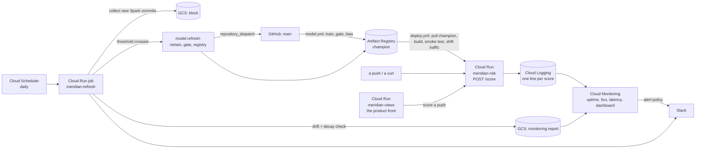
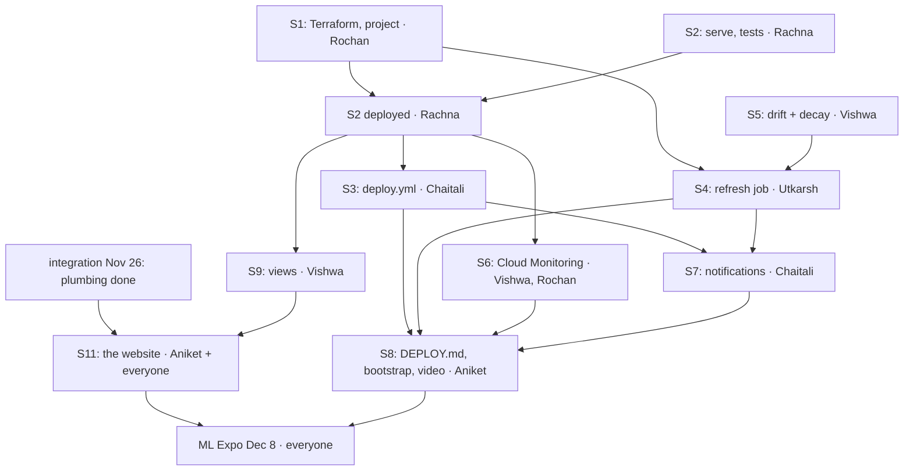

# Phase 3: deployment

Phase 1 built the data. Phase 2 built the defect-risk model and the product around it, all running locally and in GitHub Actions, with one GCP piece: the model registry. Phase 3 puts it on Google Cloud, keeps it running on its own, and watches it. It follows the course's deployment guideline section by section (§13). Most of what the guideline asks for already exists and only has to be wired up in the cloud: this plan says which.

## 1. What we have to start from

| Piece | Where | State |
|---|---|---|
| The champion model | Artifact Registry `meridian-models` (us-east1), version `85b4684…`, `model.joblib` md5 `2a0c9cc6…` | Pushed by CI on main, Workload Identity, no key |
| Turning a push into the model's features | `Data-Pipeline/meridian/p9.py` | Same code path as training, so features can't drift from the table |
| Retraining that only replaces on a real gain | `Model-Pipeline/model/refresh.py` (`--every 24`) | Built, never run in the cloud |
| Gate, bias, registry, rollback | `model/gate.py`, `model/bias.py`, `model/registry.py` | In CI on every push |
| Model image | `Model-Pipeline/Dockerfile`, `model/run_all.py` | Built in CI |
| Alerts | `Data-Pipeline/meridian/alert.py`, `MERIDIAN_SLACK_WEBHOOK` | Live in the team's Slack since Nov 15 |
| Data pipeline | Two Airflow DAGs, local Docker | Never run in the cloud |
| Views and API | `meridian.views`, standard library, read-only | Local only |

What doesn't exist yet: a serving endpoint, cloud infrastructure as code, a deploy workflow, a scheduled data refresh in the cloud, drift and decay monitoring, and replication docs.

## 2. Cloud or edge

**Cloud, on Google Cloud Platform.** Nothing about the use case is edge: the model scores pushes to a repository, next to CI, with the history of that repository. §4 of the guideline (edge) doesn't apply, and the report says so in one line.

| Service | What runs on it | Why this one |
|---|---|---|
| **Cloud Run (service)** `meridian-risk` | The model's inference endpoint | Scales to zero, so idle costs $0. Runs the container we already build. The model is a 5 MB scikit-learn forest: no GPU, no Vertex endpoint needed |
| **Cloud Run (service)** `meridian-views` | The product: the views, a front page, "score a push", the live system panel (§16) | Same container style. **Required: it's what people see at the ML Expo on Dec 8** |
| **Cloud Run job** `meridian-refresh` + Cloud Scheduler | Daily: new Spark commits → new block → drift and decay check → retrain when a threshold is crossed | A job runs to completion and costs only while it runs |
| Artifact Registry | Model versions (exists) and the serving images | Already holds the champion |
| Cloud Storage | The block and monitoring reports, private | The block has real names: never public |
| Cloud Logging + Cloud Monitoring | Request logs, uptime check, alert policies, a dashboard | Built in, free tier covers us |
| GitHub Actions | Build, deploy, smoke test, rollback | Where CI already is |
| Terraform | Everything above | Deployment isn't a manual process |

Ruled out: **Vertex AI endpoint** (always on, about $70+ a month on credits, for a 5 MB model), **GKE** (a cluster to run one container), **Cloud Composer** ($300–400 a month), **Cloud Functions** (we already ship a container; Cloud Run runs it as is).

## 3. What we build



### Steps

| Step | What | Output | Owner |
|---|---|---|---|
| **S1** | Terraform for the project: APIs, buckets, registry repos, service accounts, Workload Identity for this repo, Cloud Run services and job, Scheduler, budget | `infra/terraform/`, `terraform apply` from zero | Rochan |
| **S2** | The inference service: `GET /health`, `POST /score` (a commit's numstat, subject and author, or a known Spark SHA) → risk, its percentile on val, the P9 verdict, the model version. Loads the champion named by the registry pointer at start, checks its md5 | `Model-Deployment/serve/`, its Dockerfile, tests | Rachna |
| **S3** | Deploy workflow: on a new champion (after `model.yml` on main, a `repository_dispatch`, or by hand) pull the champion, build and push the image, deploy a new revision with no traffic, smoke test it, then move traffic. A failed smoke test leaves traffic on the old revision and alerts | `.github/workflows/deploy.yml` | Chaitali |
| **S4** | The refresh job: the data pipeline's update for Spark only, in a container, writing the new block to GCS. Then `model.refresh` when S5 says so, pushing to the registry | `Model-Deployment/refresh/`, the job image | Utkarsh |
| **S5** | Monitoring: data drift (the new commits' features against train, Evidently) and decay (PR-AUC on the newest window whose labels have matured, against lines × files). Writes a report, sets custom metrics, decides "retrain" by the thresholds in §5 | `Model-Deployment/monitor/`, tests on a planted drift | Vishwa |
| **S6** | Cloud Monitoring: uptime check on `/health`, alert policies (5xx rate, p95 latency, job failure, drift flag), a dashboard, log-based metrics from S2's log lines. All in Terraform | `infra/terraform/monitoring.tf` | Vishwa, Rochan |
| **S7** | Notifications: retrain triggered, new model deployed, deploy failed and rolled back, drift found. Through `alert.py` | Messages in Slack | Chaitali |
| **S8** | Replication: `DEPLOY.md` and one script from a fresh machine to a working endpoint. Then the video | `Model-Deployment/DEPLOY.md`, `bootstrap.sh`, the video | Aniket |
| **S9** | Views on Cloud Run, read-only, from the GCS block; a test that no person's name renders | `meridian-views` | Vishwa |
| **S11** | The product website (§16), built after the plumbing: a front page with three doors, "score a push", the live system panel, demo-ready styling | the website | Aniket leads; everyone brings ideas and builds the piece that touches their part |
| **S10** | Speed-ups: the refresh job, retraining, deploys and the self-improving loops turn faster (§15) | Timings in the pass bars | everyone, one item each |

## 4. The endpoint

```
POST /score
{"repo": "apache/spark", "sha": "<a commit in the block>"}                       # a known commit
{"repo": "apache/spark", "numstat": [[12, 3, "core/src/.../Foo.scala"], ...],
 "subject": "[SPARK-12345] Fix ...", "author_email_hash": "..."}                 # a new push

200 {"risk": 0.31, "percentile_val": 0.92, "p9": {"rule": "lines_x_files", "alert": false},
     "model": {"version": "85b4684…", "md5": "2a0c9cc6…"}, "features_version": "9c0ab220…"}
```

- **Features through `p9.py`**, from the base block, exactly as the push check computes them. No second implementation.
- **No people out.** The block has real names, so the response carries only scores and versions, and an email comes in hashed. A test checks every response field.
- **Logs:** one structured line per call: latency, model version, the feature values, the risk. Never the email. S5 reads these as the "served" distribution.
- **Auth:** public, so graders can call it, with max 2 instances and a request size cap. No names out means nothing to protect but cost.
- **Model updates** need no code change: a new champion is a new revision.

## 5. Monitoring and retraining

Labels arrive late: a commit counts as bug-inducing only once a fix blames it, up to 365 days later (decision 1). So decay is measured only on windows whose labels have matured, and drift is the early signal.

| Signal | How | Threshold to retrain | Where it's from |
|---|---|---|---|
| **Data drift** | Each new block: the last 30 days' commits against train, per feature. Evidently's drift test and PSI | PSI ≥ 0.2 on any of the top-5 SHAP features (`la`, `nf`, `prior_bug_fixes`, `nd`, `ld`), or Evidently's dataset drift (≥ 50% of features drifted) | The features S2 serves and the block's new commits |
| **Decay** | The newest calendar quarter whose 365-day window has closed and has ≥ 30 positives: model PR-AUC against lines × files, paired bootstrap | The paired interval's lower bound drops below 0 (the model no longer beats the rule), or PR-AUC falls more than 0.05 under the last measured window | The block's labels |
| **Service** | Cloud Monitoring | 5xx > 1% over 10 min, p95 > 2 s, uptime check failing | S2's logs |

When drift or decay crosses its threshold, the job runs `model.refresh`: roll the split forward, rebuild the features, retrain all three models, gate, bias, and the registry. **The registry replaces the champion only on a gain above 2 seed-noise SDs on the same fresh val rows.** If it does, the job sends `repository_dispatch` and S3 deploys it. If not, production keeps the old model and Slack says why. Service alerts page Slack and never retrain.

**The demo needs a real trigger.** Drift on today's data is real: the 7,238 commits from 2025–26 sit outside every split. S5 runs on them first, and the plan records the result before anything is tuned. If nothing drifts, the demo uses `monitor --simulate`: a planted shift (every commit 10× larger) that must cross the drift threshold, retrain, and get "not better, kept the old model". That shows both branches of the loop on camera.

## 6. Pass bars, written before the run

| What | Bar | Measured by |
|---|---|---|
| From zero | `bootstrap.sh` on a fresh project and a fresh machine gives a working `/score` with no manual step but the login and the project id | the video, and one teammate who wasn't involved |
| Endpoint correct | `/score` gives the same risk as `p9.py` locally for 20 val commits, to 1e-9 | `serve` tests |
| No names | No response or log line holds an email, a name or a person id, on 1,000 scored commits | a test |
| Latency | p95 ≤ 2 s warm, cold start ≤ 15 s | Cloud Monitoring |
| Deploy | A new champion is serving within 15 minutes of `model.yml` finishing on main, with no hands | `deploy.yml` timestamps |
| Rollback | A broken image (planted) never takes traffic; the old revision keeps serving | a planted failure on a branch |
| Drift | A planted shift crosses the threshold, a clean week doesn't | `monitor` tests |
| Retrain | Drift → retrain → "not better" keeps the old model; a better model gets deployed | a run of each |
| Alerts | Slack hears: retrain triggered, new model deployed, deploy rolled back, drift found | screenshots |
| Cost | Under $5 for the phase; budget alerts at 50, 90 and 100% of $25 | the billing page |
| Refresh speed | The daily job, new block to monitoring report, in ≤ 10 min (phase 1's full update: 480 s with the SZZ cache) | job logs |
| Retrain speed | Drift found to a new champion in the registry ≤ 15 min (refit); the full search only weekly | job logs |
| Deploy speed | Image build ≤ 3 min with cached layers; new champion serving ≤ 15 min after `model.yml` | `deploy.yml` timestamps |
| Loops turning | Replay matches give every stall policy and walk-v1 an Elo on day 1, marked as replay; the fallback-rate slice report runs on every refresh with no person in the loop | the auditor's match log, Slack |

## 7. Dependency graph



Critical path: S1 → S2 deployed → S3 → S8. S2 and S5 start on day 1 with no cloud at all: S2 runs locally against the block, S5 against the 2025–26 commits.

## 8. Roles

Each person's steps, dates, checklist and "done when" are in [packets/](packets/README.md), with the contracts between the pieces (D1–D5).

| Who | Work | Days |
|---|---|---:|
| Rochan | S1 Terraform (the project's owner, Workload Identity already set up there) 2 · S6 Cloud Monitoring, the SLO and cost panel 1 · budget and billing checks 0.5 | 3.5 |
| Rachna | S2 the endpoint, its image and tests 2.5 · the "same as p9.py" check 0.5 · front sprint: `/score` for the website 0.5 | 3.5 |
| Chaitali | S3 deploy, smoke test, rollback 2 · S7 notifications 0.5 · the planted broken image 0.5 · the canary step 0.5 | 3.5 |
| Utkarsh | S4 the refresh job, Spark-only update in a container, block to GCS 2.5 · retrain step 0.5 | 3 |
| Vishwa | S5 drift and decay 2 · S10 fallback report 0.5 · front sprint: S9 views on Cloud Run, the panel's data 1.5 (S6 moves to Rochan; C2 after the expo) | 4 |
| Aniket | Reviews and merges · integration · **leads the front sprint and builds S11 the website** · S8 `DEPLOY.md`, `bootstrap.sh`, the video · the report · the expo demo | end of the graph |

Every live GCP command that costs money goes through the project owner (Rochan) or CI, as in phase 2.

## 9. Running it

```
git clone https://github.com/Itsme-aniketghosh/Meridian && cd Meridian/Model-Deployment
./bootstrap.sh <project-id>          # gcloud login, enable APIs, terraform apply, first deploy
curl -s -X POST "$(terraform -chdir=../infra/terraform output -raw risk_url)/score" \
     -H 'Content-Type: application/json' -d '{"repo": "apache/spark", "sha": "<sha>"}'
./bootstrap.sh <project-id> --destroy   # tears it all down
```

A fresh machine needs only a browser: Cloud Shell has `gcloud`, `terraform`, `docker` and `git`. `DEPLOY.md` also lists the versions for a laptop.

## 10. Risks and cut order

- **Labels lag a year.** Decay can't be seen in days. Drift is the trigger the demo can show; decay is measured on matured windows and stated as such.
- **The data job is heavy.** Spark's history takes most of the pipeline's 16 minutes. The job keeps its clone in GCS between runs, so a daily run reads only new commits.
- **The block has real names.** Private bucket, no names in responses or logs, tests on both.
- **Credits.** Everything scales to zero, the budget alerts are in Terraform, and `--destroy` takes it all down after grading.

Cut from the top if behind: C8 docs → C4 live matches → the dashboard (keep the alert policies) → the Spark-only cloud data job (run S4 in GitHub Actions on a schedule instead). Never cut: the endpoint, automated deploy, rollback, drift → retrain → redeploy, **the product front (S9, S11)**, the video.

## 11. Schedule

**Due Mon Dec 7.** Work starts **Thu Nov 19** (day 1); Wed Nov 18 is an optional head start for the decisions and reading the packets. Code freeze is **Wed Dec 2** at the end of the day, so the fresh-machine run, the video and the report have their own days. **Plumbing first, then the front:** everything through integration on Thu Nov 26 is the deployment itself. The front-end sprint (the website, the views on Cloud Run) runs Fri Nov 27 – Tue Dec 1, through Thanksgiving, led by Aniket, with everyone's ideas. Slack: **Tue Dec 1** (front polish and catch-up only) and **Sun Dec 6** before the deadline (Sat Dec 5 is the first expo rehearsal). Anything late uses the first block, then follows the cut order (§10); it never eats the second.

| Date | Rochan | Rachna | Chaitali | Utkarsh | Vishwa |
|---|---|---|---|---|---|
| Wed Nov 18, optional | Head start: decisions (project, thresholds signed), packets read | | | | |
| Thu Nov 19, day 1 | S1 Terraform plan | S2 endpoint, local | S3 workflow on a branch, dry run | S4 job image, local | S5 drift on the 2025–26 commits |
| Fri Nov 20, day 2 | S1 apply: buckets, registry repos, service accounts | S2 tests, "same as p9.py" | S3 build and push the image | S4 Spark-only update, local | S5 thresholds checked on real data |
| Sat Nov 21, day 3 | S1 Workload Identity for deploy, budget (C7) | S2 image | S3 deploy with no traffic, smoke test | C1 walker facts | S5 decay on matured windows |
| Sun Nov 22, day 4 | S1 Cloud Run service and job, Scheduler | S2 deployed | S3 traffic shift | C1 live rerun, on Utkarsh's GCP project | S5 decay on matured windows |
| Mon Nov 23, day 5 | review, fixes | latency, cold start | rollback on a planted broken image | S4 in the Cloud Run job, block to GCS | S5 `--simulate`, the D2 report's shape |
| Tue Nov 24, day 6 | S6 uptime, alert policies | no-names test, 1,000 commits | S7 Slack messages | S4 retrain step, `repository_dispatch` | S10 fallback-rate report |
| Wed Nov 25, day 7 | S6 dashboard, log-based metrics, the SLO and cost panel | fixes | S3 triggers: `model.yml` done, dispatch | S4 retrain → deploy | S5 tests, fixes |
| Thu Nov 26, day 8 | **Integration: the plumbing end to end, drift → retrain → redeploy and one "not better, kept" (Aniket). Then front-end ideas: everyone brings two; Aniket picks** | | | | |
| Fri Nov 27, day 9 | **Front sprint.** Warm instances, the website's hosting in Terraform | `/score` for the website: CORS for its origin, example pushes | the canary step; the website deployed by `deploy.yml` | C8 docs; the demo's stalled-team story picked from the block | S9 views on Cloud Run; test: no person's name renders |
| Sat Nov 28, day 10 | first fresh-project run of `bootstrap.sh` | `/score` docs and examples for `DEPLOY.md` | planted broken image again, on main's workflow | C8 docs | the system panel's data: D2 reports, deploys, as JSON |
| Sun Nov 29, day 11 | C4: live matches wired, counted | latency and cost check | every pass bar checked, with its evidence | retrain → deploy rerun on a new block | the views' pages the website links to, checked |
| Mon Nov 30, day 12 | **Check-in: every pass bar met or cut by §10. Report sections drafted** | | | | |
| Tue Dec 1 | **Front polish and catch-up only, nothing new starts** | | | | |
| Wed Dec 2, day 13 | **Code freeze, end of day. Every report section in** | | | | |

| Date | Aniket |
|---|---|
| Nov 18 – Dec 1 | Reviews and merges. Day-5 check-in (Mon Nov 23): anything behind is cut by §10's order, not squeezed |
| Thu Nov 26 | Integration day: the plumbing end to end. Then front-end ideas from everyone; Aniket picks |
| Fri Nov 27 – Tue Dec 1 | **The front sprint: S11 the website.** C3 packets move and `DEPLOY.md`, `bootstrap.sh` drafted alongside |
| Sun Nov 29 | Video dry run in Cloud Shell, timed against 5–10 minutes |
| Wed Dec 2 | Freeze. `DEPLOY.md`, `bootstrap.sh` final. A teammate who didn't build it runs `bootstrap.sh` on a fresh project |
| Thu Dec 3 | Video, recorded from Cloud Shell on a fresh project: from zero to `/score`, then drift → retrain → redeploy, Slack, Cloud Monitoring |
| Fri Dec 4 | Report, with Utkarsh. Everyone reviews their own section |
| Sat Dec 5 | **Expo rehearsal 1**: the demo script end to end, every person on their part |
| Sun Dec 6 | **Slack** |
| Mon Dec 7 | Submit. **Rehearsal 2** on the live URL; one warm instance from the evening |
| **Tue Dec 8** | **ML Expo, 8:30–1:30, Google Cambridge** |

## 12. What phase 3 outputs

| Output | Where |
|---|---|
| Infrastructure | `infra/terraform/` |
| Endpoint | `Model-Deployment/serve/`, Cloud Run `meridian-risk` |
| Deploy workflow | `.github/workflows/deploy.yml` |
| Refresh job, monitoring | `Model-Deployment/refresh/`, `Model-Deployment/monitor/` |
| Replication | `Model-Deployment/DEPLOY.md`, `bootstrap.sh` |
| Report and video | `Model-Deployment/report/REPORT.md`, the video link |

## 13. Guideline coverage

| Guideline | Item | Step | Evidence |
|---|---|---|---|
| §2 | Cloud or edge, provider and service | §2 | GCP, Cloud Run service and job |
| §3.1 | Deployment service and its configuration | S1, S2 | Terraform: instances, memory, concurrency, traffic |
| §3.2 | Automated: pull the latest model, deploy or update, monitor and log | S3, S6 | `deploy.yml`; Cloud Logging and Monitoring |
| §3.3 | Repository connected, redeploy on a new model version | S3 | `deploy.yml` on `model.yml` success and `repository_dispatch` |
| §3.4 | Replication: setup, scripts, verifying the endpoint | S8 | `DEPLOY.md`, `bootstrap.sh`, the `curl` above |
| §4 | Edge | n/a | Cloud only, said in the report |
| §5.1 | Monitor decay and data shift over time | S5, S6 | Monitoring report per block, dashboard |
| §5.2 | Detect data shift against training data | S5 | Evidently, PSI on the top-5 features |
| §5.3 | Thresholds that trigger retraining | §5 | Written before the run |
| §5.4 | Retrain automatically: new data, train, validate, deploy only if better | S4, `model.refresh`, S3 | The registry's 2-SD rule; else keep |
| §5.5 | Notify on retraining and new deployments | S7 | Slack screenshots |
| §6.1–6.5 | Scripts, repo link, monitoring code, environment config, logs | all | The folders in §12 |
| §7 | Video, fresh environment, 5–10 minutes | S8 | Cloud Shell from zero to `/score`, then drift → retrain → redeploy |
| §8 | Evaluation: automated, documented, CI/CD, logs, retraining, video | all | §6's pass bars |

## 14. Carried over from phase 2

Open at the end of phase 2 (`Model-Pipeline/GAPS.md`, "After phase 2"). None blocks deployment, and the first three are small. Deploying the views (S9, now required) is what lets the last ones move at all: the auditor and the walkers only learn from real users.

| # | Open point | What we do | Owner | When |
|---|---|---|---|---|
| C1 | ✓ Nov 21. **Graph walkers' texts fell back** 19 of 20 times (gap 27). The cause was the reason label "Test gap", read as the team `tests`; the labels are facts now and all 20 pass (`Model-Pipeline/reports/c1-walkers/RUN-LOG.md`) | Put the teams the walk visits into its facts, then rerun the walk tasks. Needs about 20 new live LLM calls, on Utkarsh's GCP project as in phase 2 | Utkarsh | Sat Nov 21 – Sun Nov 22 |
| C2 | **The gate rejects 14 correct line lists** written without their path, "formsets.py at lines 9, 344 and 351" (gap 23) | Teach the gate "path at lines a, b", with planted-error tests like #122's; re-gate the cache at $0. The planted-error tables must not change | Vishwa | After the expo: the front comes first |
| C3 | **The packets folder** still holds the contracts, decision logs and report sections, under people's names; code reads three files from it | Move what matters to `docs/model/` and `Model-Pipeline/report/sections/`, the data files and scripts next to the code, update every path and CI's mount; delete the task READMEs | Aniket | Fri Nov 27 – Sat Nov 28, so `DEPLOY.md` links the final paths |
| C4 | **walk-v1 and the auditor's policies have 0 live matches** | Once the views run on Cloud Run (S9), stall verdicts start the matches. Promotion needs 30, so phase 3 reports the count, not a winner | Rochan | Sun Nov 29, after S9 |
| C5 | **No policy writer** (gap 22) | Stays cut until C4 has matches: every new challenger is another chance at a lucky promotion | Rochan | Not this phase |
| C6 | **Package diffs at 73.2%** against the 90% bar (gap 3) | Learning from owners' edits (decision 15) needs real outcomes, which come only with users. Reported, not worked | Utkarsh | Not this phase |
| C7 | **No shared spend alert** (gap 11) | `budget.tf` in S1 closes it | Rochan | Sat Nov 21, with S1 |
| C8 | **Docs that disagree:** Spark's "Incomplete" ticket count (141 in `03-data.md`, 145 in `05-test.md`); `03-data.md`'s schema sketch vs `schema.sql`; "replay equivalence" in 02 and 05 has no test or result | Settle each from the block or mark it as a design note | Utkarsh | Fri Nov 27 – Sat Nov 28 |

C1 and C2 change texts the phase 2 report quotes (205 LLM texts, 19 templates; the writer comparison's pass rates), so their PRs also update those numbers in `Model-Pipeline/report/REPORT.md` and say the date they changed.

## 15. Speed-ups (S10)

Phase 2's loops are built but slow to turn: the model retrains only when someone runs it, the auditor and walk-v1 wait for 30 live matches, and a gate problem waits for a person to notice the fallback rate. Phase 3 makes each turn on its own, and faster. One item per person, Nov 27–28, after integration.

| Loop or stage | Today | Speed-up | Owner |
|---|---|---|---|
| **Data refresh** | Full update 480 s (phase 1, SZZ cache); every repo | Spark only, the clone and the SZZ cache kept in GCS between runs, so a daily run reads only new commits. Target ≤ 10 min end to end, monitoring report included | Utkarsh |
| **↻1 Model** | `model.refresh` by hand; the full Optuna search took 27.7 min on a runner | Runs inside the daily job on drift or decay. Refit with the committed best parameters (minutes); the full search only on a weekly schedule. The champion is still replaced only on a 2-SD gain | Rachna |
| **Deploy** | Image built from scratch | Cached base layers; only the model and serve layers rebuild. The model is baked into the image, so a cold start doesn't download it | Chaitali |
| **↻2 Auditor, ↻3 walk-v1** | 0 live matches; promotion needs 30 | Replay matches on past stalls (04 §9: rows known by the stall time only, half K) run nightly, so every policy and walk-v1 has an Elo now. Replays are marked and never promote alone: the 30 live matches still decide | Rochan |
| **↻4 Agents** | A person read the fallback rate and found the `#6921` bug (41 of 68) | The fallback-rate slice report runs on every refresh and posts to Slack when a slice is flagged. A person still makes the fix; finding it is automatic | Vishwa |

None of these changes a model, a threshold or a reported number. Each one is timed before and after, and the report gives both.

## 16. The ML Expo, Tue Dec 8: the product people see

The expo (8:30–1:30, Google Cambridge, about 30 teams) asks for **working systems, not slides**: canary and rollback, drift detection, dashboards for latency and cost, data contracts, and failure cases with how they were fixed. A visitor has a few minutes. They should leave knowing what Meridian does for a team retiring an API, and that it runs and watches itself.

**The front: built after the plumbing (Nov 27 – Dec 1). Aniket leads and builds the website (S11); everyone brings ideas on Nov 26 and builds the piece that touches their part: the views on Cloud Run (Vishwa), `/score` from the browser (Rachna), hosting and warm instances (Rochan), deploys and the canary (Chaitali), the demo's stories from the block (Utkarsh).**

| Door | What a visitor does | What's behind it |
|---|---|---|
| **Front page** | Reads one line: every call to an API you're retiring, who owns it, how risky it is, and who's stuck waiting on whom. Picks a door | The block's run_id and snapshot, the model version |
| **A stalled team** | Opens a team that's stuck: its stall reasons (ranked by the auditor), the orchestrator's plan, the writer's text with an LLM or template badge, what the graph walkers found upstream | Phase 2's views (staff, owner, consumer, tickets) on the real block |
| **Score a push** | Pastes or picks a push and sees its risk, its percentile on val, and P9's verdict | `POST /score` on `meridian-risk` |
| **The system, live** | Sees the model in production, the last deploy, the last drift report and why it did or didn't retrain, Slack's last messages, the Cloud Monitoring link | D2 reports, the registry, deploy logs |

- **No person's name renders**, anywhere: a test on the real block before the views go public (the block has real names).
- **Read-only, public, max 2 instances**, like the endpoint. One warm instance from the evening of Dec 7 to the end of the expo, so nobody waits on a cold start (cost: cents).
- **Styling for a projector and a laptop:** readable at a distance, the same look on every page.
- **The website calls `/score` from the browser**, so the endpoint sends CORS headers for the website's origin only. The system panel reads JSON the views service serves: D2 reports and deploys, no names.

**What else the expo asks for:**

| Expo theme | Ours | Gap closed by |
|---|---|---|
| Canary and rollback | Smoke test, then traffic; a failed test keeps the old revision | **A canary step:** 10% for a few minutes, checked on errors and latency, then 100% (Chaitali) |
| Drift detection | Real drift on the 2025–26 commits (#139) | Already there; the system panel shows it |
| Latency, cost and SLO dashboards | Cloud Monitoring (S6) | **An SLO and cost panel:** latency budget, error budget, cost per 1,000 scores (Rochan) |
| Data contracts, reproducibility | D1–D5, phase 2's Contracts 1–6, golden md5s | Shown on the system panel |
| Failure cases and fixes | Real ones | **A "what broke and how we fixed it" board** on the front: the `#6921` gate bug (41 of 68 → 0), the CI break when two PRs met, the Windows 413 flake, the negative Content-Length (Aniket) |

**The demo (Aniket):** a 3-minute script for visitors and a 6-minute one for judges, each walking three real stories: a stalled team whose cause is upstream (the walkers), a risky push scored live, and drift → retrain → "kept the old model" from the panel. Rehearsal 1 on Sat Dec 5, rehearsal 2 on the live URL on Mon Dec 7. Everyone can run the demo.

**On track?** Yes, if the plumbing passes integration on Nov 26 and the website works by Dec 1, a day before the freeze. C2 (the gate's line lists) moves after the expo to make room, and S6 moves to Rochan.
