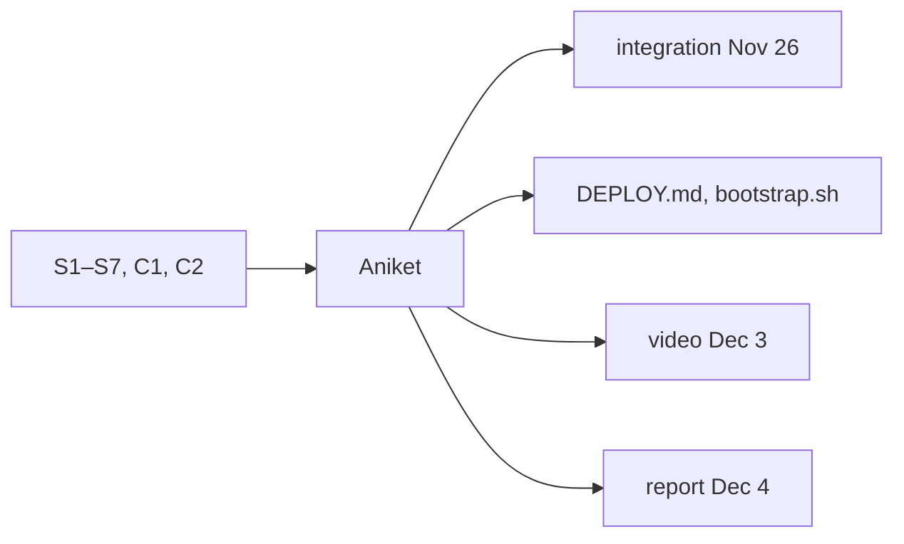

# Aniket: lead, integration, replication, the video

> You sit at the end of the graph. Review and merge until Nov 25, run the whole loop on Nov 26, make it reproducible from zero, record the video and write the report.

| | |
|---|---|
| Owns | the decisions, reviews and merges, integration, C3 packets move, S8 `DEPLOY.md` and `bootstrap.sh`, the video, the report |
| Waits on | every step by Nov 25 |
| Hands to | the course: `Model-Deployment/report/REPORT.md` and the video, Dec 7 |

| Date | Due |
|---|---|
| Wed Nov 18 | Decisions: the project; thresholds signed by everyone |
| Nov 19 – 24 | Reviews and merges. Check-in Mon Nov 23: anything behind is cut by PLAN §10's order |
| Thu Nov 26 | **Integration**: a planted shift → retrain → deploy, and one → retrain → keep. Owners fix the same day |
| Fri Nov 27 – Sat Nov 28 | C3: the phase 2 packets move to `docs/model/` and `report/sections/`. `DEPLOY.md` and `bootstrap.sh` drafted |
| Sun Nov 29 | Video dry run in Cloud Shell, timed |
| Mon Nov 30 | Check-in: every pass bar met or cut. Report sections drafted |
| Tue Dec 1 | Slack: catch-up only |
| Wed Dec 2 | Code freeze. A teammate who didn't build it runs `bootstrap.sh` on a fresh project |
| Thu Dec 3 | The video |
| Fri Dec 4 | The report, with Utkarsh |
| Sat Dec 5 – Sun Dec 6 | Slack |
| Mon Dec 7 | Submit |

## 1. Integration (Nov 26)

- [ ] From a clean clone: `terraform apply`, deploy, `/score`, the dashboard
- [ ] Planted shift → D2 `retrain` → `model.refresh` → promoted → D3 → `deploy.yml` → new revision serving, Slack at each step
- [ ] A second planted shift where the new model isn't better: old model kept, Slack says why
- [ ] Anything that breaks goes to its owner the same day, with the command to reproduce it

## 2. Replication (S8)

- [ ] `bootstrap.sh <project-id>`: login, APIs, `terraform apply`, first deploy, prints the URL. `--destroy` tears it down
- [ ] `DEPLOY.md`: Cloud Shell first (nothing to install), then laptop versions; setup, permissions, running, verifying with `curl`
- [ ] A teammate who didn't build it runs it on a fresh project (Dec 2)

## 3. The video (Dec 3, 5–10 minutes)

- [ ] A fresh project, Cloud Shell: clone, `bootstrap.sh`, `/score` with `curl`
- [ ] Cloud Monitoring and logs
- [ ] The loop: drift (real or planted) → retrain → redeploy, and the Slack messages
- [ ] A rollback: the broken image that never takes traffic

## 4. The report (Dec 4)

- [ ] `Model-Deployment/report/REPORT.md`, in the order of PLAN §13, each row with its evidence
- [ ] Each owner's numbers next to their pass bars; before and after timings for S10
- [ ] The carried-over points (§14), done or stated

## Done when

- [ ] The whole loop ran on Nov 26 and again on the fresh project
- [ ] The video and the report are submitted on Dec 7
