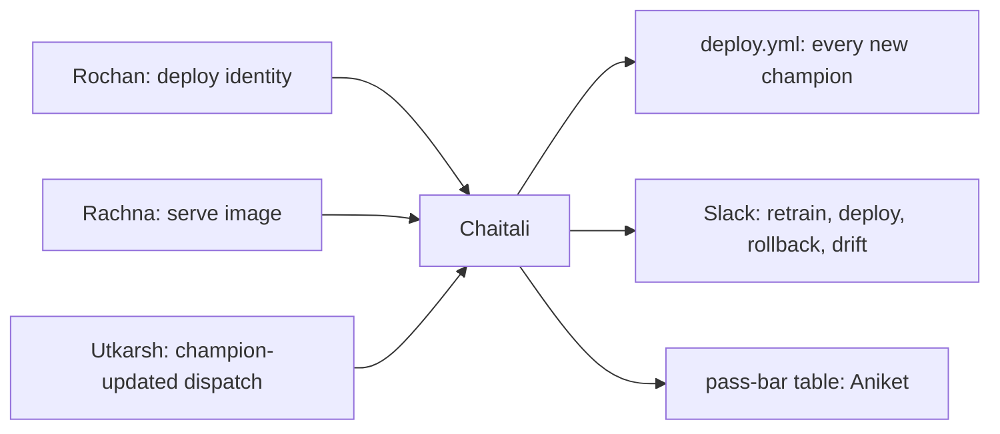

# Chaitali: deploy, rollback, notifications

> Make a new champion reach production with no hands, and make a bad one never take traffic. Everyone hears about it in Slack.

| | |
|---|---|
| Steps | S3 `deploy.yml` · S7 Slack · S10 deploy speed · the planted failures · the pass-bar check. About 3 days |
| Code | `.github/workflows/deploy.yml`, the smoke test, `Data-Pipeline/meridian/alert.py` (new message kinds) |
| Waits on | Rochan's deploy identity (Nov 20), Rachna's image (Nov 20), Utkarsh's dispatch (D3, Nov 23) |
| Hands to | everyone: a deployed endpoint on every new champion. Aniket: rollback evidence, Slack screenshots, the pass-bar table |

| Date | Due |
|---|---|
| Wed Nov 18 | `deploy.yml` on a branch, dry run: pull the champion pointer, build, no deploy |
| Thu Nov 19 | Build and push the image to the Docker repo |
| Fri Nov 20 | Deploy a new revision with **no traffic**, smoke test it (D1's `/health` and a known `/score`) |
| Sat Nov 21 | Move traffic only after the smoke test passes |
| Sun Nov 22 | Rollback: a planted broken image never takes traffic. Check-in |
| Mon Nov 23 | S7: the four Slack messages |
| Tue Nov 24 | Triggers: `model.yml` success on main, `repository_dispatch` (D3), by hand |
| Wed Nov 25 | Integration |
| Thu Nov 26 | Fixes. S10: cached layers |
| Fri Nov 27 | The planted broken image again, on main's workflow |
| Sat Nov 28 | Every pass bar in PLAN §6 checked, with its evidence |

## 1. Deploy and rollback (S3)

- [ ] Pull the champion from the registry pointer, check its md5 against `registry/champion.json`
- [ ] New revision tagged with the model version, no traffic, smoke test, then 100% traffic
- [ ] A failed smoke test: traffic stays on the old revision, the job fails red, Slack hears it
- [ ] Deploy status in the job summary and as a D5 `deploy` log line

## 2. Notifications (S7)

- [ ] Retrain triggered (with the D2 report's `why`) · new model deployed (version, md5, URL) · deploy rolled back · drift found
- [ ] Through `alert.py`; a broken channel never changes a deploy's outcome

## 3. Speed (S10)

- [ ] Cached base layers; only the model and serve layers rebuild. Build ≤ 3 min
- [ ] New champion serving ≤ 15 min after `model.yml` finishes

## Done when

- [ ] A new champion serves with no hands; a broken image never takes traffic
- [ ] All four Slack messages seen, with screenshots
- [ ] The pass-bar table in PLAN §6 has a number and a source for every row
