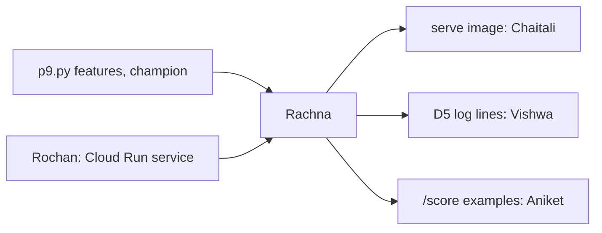

# Rachna: the endpoint

> Put the champion behind `POST /score`. Same features as training, through `p9.py`, so serving can't drift from the table. Fast, small, and never a name out. Then make retraining in the job quick.

| | |
|---|---|
| Steps | S2 the endpoint · S10 retrain speed. About 3 days |
| Code | `Model-Deployment/serve/` (app, Dockerfile, tests), `Model-Pipeline/model/refresh.py` (refit mode in the job) |
| Waits on | nothing for the local build. Rochan's Cloud Run service (Nov 22) to deploy |
| Hands to | Chaitali: an image `deploy.yml` builds and smoke-tests. Vishwa: D5 log lines. Aniket: the `/score` examples for `DEPLOY.md` and the video |

| Date | Due |
|---|---|
| Thu Nov 19 | `serve/` app: `/health`, `/score` for a known SHA and for a numstat push (D1), local |
| Fri Nov 20 | Tests: the same risk as `p9.py` locally on 20 val commits, to 1e-9 |
| Sat Nov 21 | The image: the champion baked in at build, md5 checked at start |
| Sun Nov 22 | Deployed to `meridian-risk` |
| Mon Nov 23 | Latency: p95 warm, cold start. Check-in |
| Tue Nov 24 | No-names test over 1,000 scored commits |
| Thu Nov 26 | Integration |
| Fri Nov 27 | **S11 "score a push" page** for the front: pick or paste a push, see risk, percentile, P9. S10: refit in the job |
| Sat Nov 28 | `/score` examples and expected outputs for `DEPLOY.md` |
| Sun Nov 29 | Latency and cost check against the bars |

## 1. The endpoint (S2)

- [ ] Features only through `meridian/p9.py`: no second implementation. A repo other than `apache/spark` gets 422 (the model only scores the repo it was trained on)
- [ ] `percentile_val`: where the risk falls among val's 4,113 scores (`reports/champion/champion_val_scores.csv`)
- [ ] The block is read-only, from GCS. The response holds scores and versions only; an email comes in hashed
- [ ] One D5 log line per call: latency, model version, feature values, risk
- [ ] Request size cap; 400 with a clear message on a bad body

## 2. Retrain speed (S10)

- [ ] In the refresh job, `model.refresh --refit` (the committed best parameters): minutes, not the 27.7-minute search
- [ ] The full Optuna search on a weekly schedule only
- [ ] Time both and put the numbers in the PR

## Done when

- [ ] `/score` matches `p9.py` to 1e-9 on 20 val commits
- [ ] No email, name or person id in any response or log line over 1,000 commits
- [ ] p95 ≤ 2 s warm, cold start ≤ 15 s
- [ ] Drift found → a new champion in the registry ≤ 15 min (refit)
