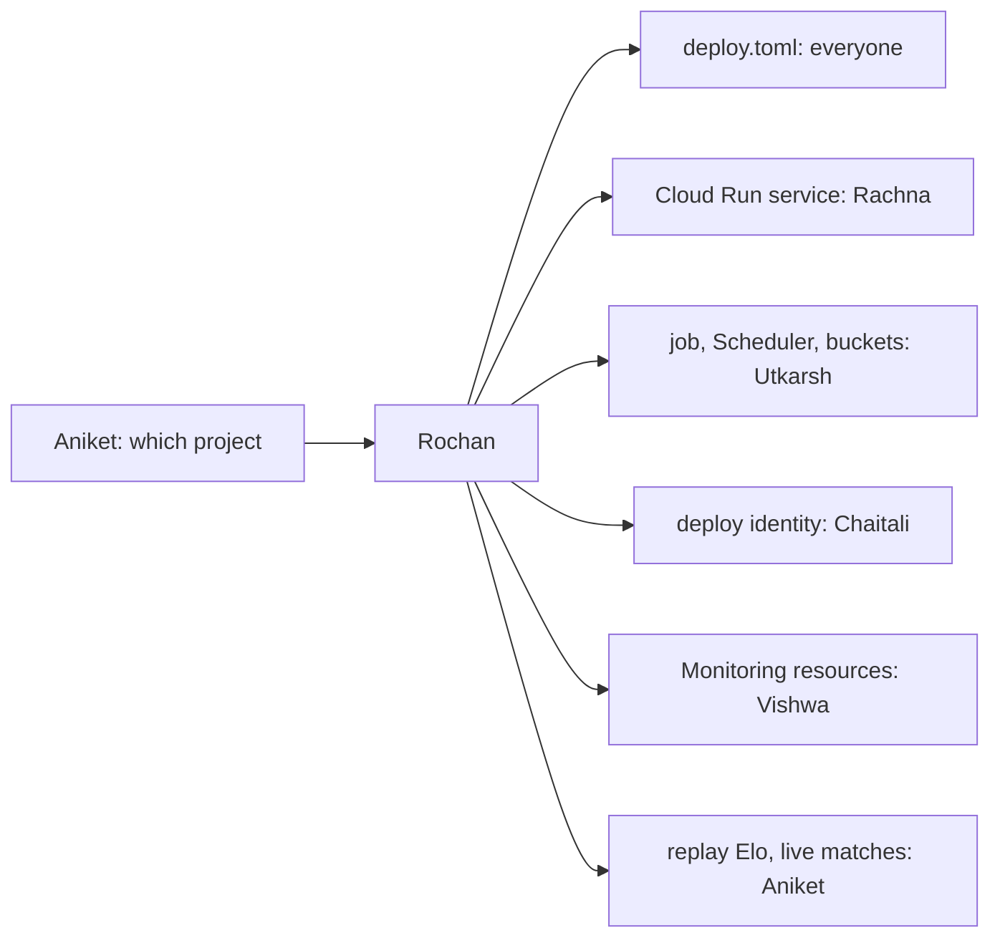

# Rochan: infrastructure, Terraform, the GCP project

> You own the project, so every cloud step starts with you. Put all of it in Terraform, set up deploy's Workload Identity, keep the bill near zero, and turn the auditor's loop with replay matches.

| | |
|---|---|
| Steps | S1 Terraform · S6 Cloud Monitoring in Terraform (with Vishwa) · C7 spend alert · C4 live matches · S10 replay matches · the first fresh-project run. About 3 days |
| Code | `infra/terraform/`, `Model-Deployment/deploy.toml`, `Data-Pipeline/meridian/auditor.py` (replay schedule) |
| Waits on | Aniket's call on the project (Nov 17) |
| Hands to | everyone: `deploy.toml` (D4) and a project to deploy into. Rachna: the service. Utkarsh: the job and its bucket. Chaitali: deploy's identity. Vishwa: Monitoring resources |

| Date | Due |
|---|---|
| Wed Nov 18 | `deploy.toml` (D4) merged. `terraform plan` for APIs, buckets, registry repos, service accounts |
| Thu Nov 19 | `terraform apply`: buckets (private, uniform access), Docker repo, service accounts |
| Fri Nov 20 | Workload Identity for `deploy.yml`, limited to this repo's main. `budget.tf`: $25, alerts at 50, 90, 100% (C7) |
| Sat Nov 21 | Cloud Run service `meridian-risk` (max 2 instances), job `meridian-refresh`, Cloud Scheduler daily |
| Sun Nov 22 | Review and fixes. Check-in |
| Mon Nov 23 – Tue Nov 24 | S6 with Vishwa: uptime check, alert policies, dashboard, all in Terraform |
| Wed Nov 25 | Integration |
| Thu Nov 26 | Fixes from integration. S10: replay matches nightly |
| Fri Nov 27 | **First fresh-project run** of `bootstrap.sh`, from a project with nothing in it |
| Sat Nov 28 | C4: live matches counted once the views run |

## 1. Terraform (S1)

Start from PLAN.md phase 2 §11's tree and cut what we don't need:
- [ ] `apis.tf`, `storage.tf` (block, monitoring reports, the job's clone cache), `registry.tf` (Docker repo, keep the last 3 images), `iam.tf`, `wif.tf`, `run.tf` (service and job), `scheduler.tf`, `budget.tf`, `monitoring.tf` (S6), `variables.tf`, `outputs.tf` (`risk_url`)
- [ ] The existing `meridian-models` repo and Workload Identity pool: **import** them, don't recreate them. CI's push must keep working through the change
- [ ] `terraform.tfvars.example` only; the billing account id and emails stay out of git
- [ ] `terraform destroy` leaves only the registry's model versions (they're the phase 2 record)

## 2. Replay matches (S10)

- [ ] The auditor already plays replay matches on past stalls at half K (04 §9). Run them nightly in the refresh job, for the stall policies and for walk-v1
- [ ] Replays are marked in the match log and never promote on their own: promotion still needs 30 live matches
- [ ] Report each policy's replay Elo and its live-match count

## 3. Live matches (C4)

- [ ] Once Vishwa's views run on Cloud Run, a stall that ends produces verdicts; count the live matches per policy
- [ ] The report gives the count, not a winner (promotion needs 30)

## Done when

- [ ] `terraform apply` from an empty project gives everything in PLAN §2, and `destroy` removes it
- [ ] CI's registry push still works after the import
- [ ] Budget alerts exist; the billing page shows under $5 for the phase
- [ ] Every policy and walk-v1 has a replay Elo; the live count is in the report
