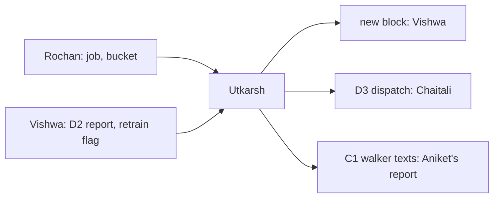

# Utkarsh: the refresh job, new data, retraining

> New data in every day, cheaply. Run the data pipeline for Spark in a Cloud Run job, hand the new block to monitoring, retrain when it says so, and tell deploy when there's a new champion. Also fix the walkers' facts from phase 2.

| | |
|---|---|
| Steps | S4 the refresh job · C1 walker facts · C8 docs that disagree · S10 refresh speed. About 3 days |
| Code | `Model-Deployment/refresh/` (job image, entrypoint), `Data-Pipeline/meridian/walkers.py` (C1), `docs/02`, `03`, `05` (C8) |
| Waits on | Rochan's job and bucket (Nov 21), Vishwa's D2 report (Nov 20) |
| Hands to | Vishwa: the new block. Chaitali: the `champion-updated` dispatch (D3). Aniket: a retrain → deploy run |

| Date | Due |
|---|---|
| Wed Nov 18 | Job image, local run |
| Thu Nov 19 | Spark-only update, local: collect new commits, history, the block |
| Fri Nov 20 | C1: the teams the walk visits go into its facts |
| Sat Nov 21 | C1: rerun the ~20 walk tasks live (your GCP project, as in phase 2) |
| Sun Nov 22 | The job on Cloud Run, block to GCS. Check-in |
| Mon Nov 23 | Retrain step: on D2's `retrain: true`, `model.refresh`; on a promotion, D3 dispatch |
| Tue Nov 24 | Retrain → deploy end to end with Chaitali |
| Wed Nov 25 | Integration |
| Thu Nov 26 – Fri Nov 27 | C8 docs. S10: clone and SZZ cache in GCS |
| Sat Nov 28 | Rerun on a new block, timed |

## 1. The job (S4)

- [ ] Spark only: `collect` the new commits since the last block, then `history` and the steps the features need. The block to GCS, private
- [ ] Then Vishwa's monitor; then, if `retrain`, `model.refresh` and the registry; on a promotion, D3
- [ ] "Not better, kept": no dispatch, a Slack message with the reason
- [ ] D5 `refresh` and `retrain` log lines

## 2. Walker facts (C1)

- [ ] The teams a walk visits go into its facts, so the gate can find the team a walk text names
- [ ] Rerun the walk tasks; report the new fallback count against 19 of 20
- [ ] Update the phase 2 report's numbers that change (205 LLM texts, 19 templates), with the date

## 3. Docs (C8)

- [ ] Spark's Incomplete count: 141 in `03-data.md`, 145 in `05-test.md`. Settle it from the block
- [ ] `03-data.md`'s schema sketch vs `schema.sql`: align it or mark it a design sketch
- [ ] "Replay equivalence" in 02 and 05: a test and a result, or mark it a design note

## 4. Speed (S10)

- [ ] The clone and the SZZ cache kept in GCS between runs, so a run reads only new commits
- [ ] Daily run, new block to D2 report, ≤ 10 min (phase 1's full update: 480 s)

## Done when

- [ ] The job runs daily on its own and writes a block and a D2 report
- [ ] A drift → retrain → deploy and a drift → retrain → keep both ran end to end
- [ ] Walker fallbacks re-measured and the report updated
