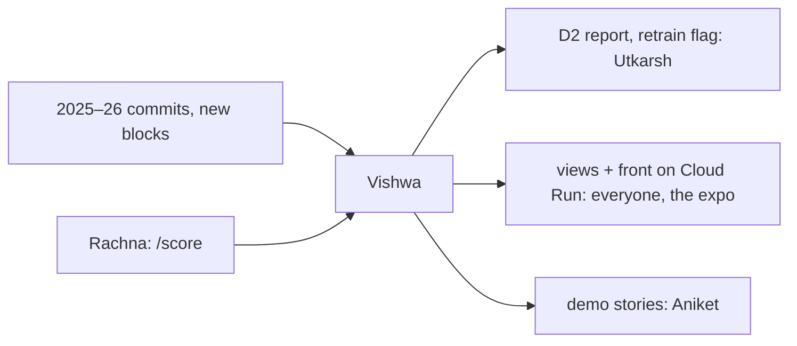

# Vishwa: drift and decay, then the views on Cloud Run

> Decide, by rules written first, when the model needs retraining. After integration, in the front sprint, put the views on Cloud Run and serve the data Aniket's website shows.

| | |
|---|---|
| Steps | S5 drift and decay · S10 fallback-rate report · front sprint: S9 views on Cloud Run, the system panel's data. About 4 days. S6 moved to Rochan; C2 moves after the expo |
| Code | `Model-Deployment/monitor/`, `Data-Pipeline/meridian/views.py` and the views' image, the front's pages |
| Waits on | nothing for S5 (it starts on the 2025–26 commits). Rochan's Cloud Run service style (Nov 22) for S9. Rachna's `/score` (Nov 22) for "score a push" |
| Hands to | Utkarsh: the D2 report and its `retrain` flag. Rochan: drift metrics for the dashboard. Aniket: the drift result, the front, the demo stories |

| Date | Due |
|---|---|
| Thu Nov 19 | **S5 drift on the 7,238 commits from 2025–26** against train. Recorded before tuning ✓ (#139) |
| Fri Nov 20 | Thresholds checked on real data (PLAN §5), signed by the team, on val 2023 only |
| Sat Nov 21 – Sun Nov 22 | Decay on the newest matured window against lines × files |
| Mon Nov 23 | `--simulate` (every commit 10× larger) crosses the threshold. The D2 report's exact shape. Check-in |
| Tue Nov 24 | S10: the fallback-rate report on every refresh |
| Wed Nov 25 | S5 tests and fixes |
| Thu Nov 26 | Integration; bring two ideas for the website |
| Fri Nov 27 | **Front sprint:** S9 the views on Cloud Run; a test that no person's name renders |
| Sat Nov 28 | The system panel's data for the website: D2 reports and deploys as JSON, no names |
| Sun Nov 29 | The views' pages the website links to, checked with Aniket |
| Sat Dec 5, Mon Dec 7 | Expo rehearsals |
| **Tue Dec 8** | **ML Expo** |

## 1. Drift and decay (S5)

- [ ] Drift: PSI per feature and the drift tests, the last 30 days' commits against train. Flag: PSI ≥ 0.2 on `la`, `nf`, `prior_bug_fixes`, `nd` or `ld`, or ≥ 50% of features drifted
- [ ] Decay: the newest calendar quarter whose 365-day window has closed with ≥ 30 positives; model vs lines × files, paired bootstrap. Flag: interval lower bound < 0, or PR-AUC > 0.05 under the last window
- [ ] D2 report to GCS (D2's exact field names); custom metrics for Rochan's dashboard
- [ ] Tests: a planted shift flags, a clean sample doesn't
- [ ] With Utkarsh: is the drop in `prior_bug_fixes` real, or fixes not yet found at the snapshot?

## 2. The views on Cloud Run (S9, front sprint)

- [ ] phase 2's `meridian.views` in an image, reading the block from the private bucket, read-only
- [ ] **No person's name renders on any page**: a test over every page on the real block (the block has real names)
- [ ] Public, max 2 instances, like the endpoint; one warm instance for the expo window (Rochan sets it)

## 3. Data for the website's system panel (front sprint)

- [ ] JSON from the views service: the last D2 reports (drift, decay, retrain and why), the deploys, the model in production
- [ ] No person's name, like every page

## 4. Fallback-rate report (S10)

- [ ] The LLM bias slice report on every refresh, posting to Slack when a slice is flagged

## Done when

- [ ] The 2025–26 drift result is recorded, and the demo's trigger is decided from it
- [ ] A planted shift retrains; a clean week doesn't
- [ ] The views run on Cloud Run with no name on any page, and the website's links and panel data work in rehearsal 1 (Dec 5)
- [ ] C2 (the gate's line lists): after the expo
