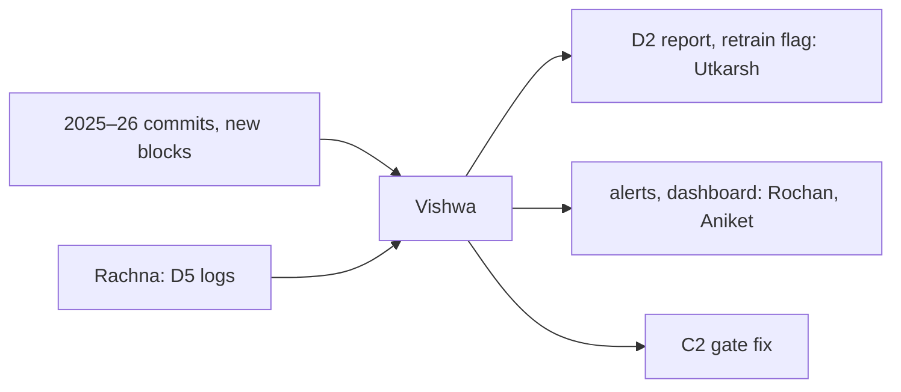

# Vishwa: drift, decay, monitoring

> Decide, by rules written first, when the model needs retraining, and make the deployment visible: drift and decay checks, Cloud Monitoring, alerts. Then fix the gate's line lists and, as stretch, put the views online.

| | |
|---|---|
| Steps | S5 drift and decay · S6 Cloud Monitoring (with Rochan) · C2 gate line lists · S9 views (stretch) · S10 fallback-rate report. About 3 days |
| Code | `Model-Deployment/monitor/`, `infra/terraform/monitoring.tf` (with Rochan), `Data-Pipeline/meridian/fact_gate.py` (C2), the views' image |
| Waits on | nothing for S5 (it starts on the 2025–26 commits). Rachna's D5 logs (Nov 22) for S6 |
| Hands to | Utkarsh: the D2 report and its `retrain` flag. Rochan: Monitoring resources. Aniket: the drift result for the demo, the dashboard |

| Date | Due |
|---|---|
| Thu Nov 19 | **S5 drift on the 7,238 commits from 2025–26** against train. Record the result before tuning anything |
| Fri Nov 20 | Thresholds checked on real data (PLAN §5), signed by the team |
| Sat Nov 21 | Decay on the newest matured window against lines × files. D2 report written |
| Sun Nov 22 | C2: the gate reads "path at lines a, b" |
| Mon Nov 23 | `--simulate` (every commit 10× larger) crosses the threshold. C2 re-gated at $0. Check-in |
| Tue Nov 24 | S6: uptime check on `/health`, alert policies (5xx, p95, job failure, drift) |
| Wed Nov 25 | Log-based metrics from D5 lines |
| Thu Nov 26 | Integration |
| Fri Nov 27 – Sat Nov 28 | S9 views on Cloud Run (stretch). S10: fallback-rate report |
| Sun Nov 29 | Dashboard has every signal |

## 1. Drift and decay (S5)

- [ ] Drift: PSI per feature and Evidently's drift test, the last 30 days' commits against train. Flag: PSI ≥ 0.2 on `la`, `nf`, `prior_bug_fixes`, `nd` or `ld`, or ≥ 50% of features drifted
- [ ] Decay: the newest calendar quarter whose 365-day window has closed with ≥ 30 positives; model vs lines × files, paired bootstrap. Flag: interval lower bound < 0, or PR-AUC > 0.05 under the last window
- [ ] D2 report to GCS; custom metrics for the dashboard
- [ ] Tests: a planted shift flags, a clean sample doesn't

## 2. Monitoring (S6)

- [ ] Uptime check, alert policies, a dashboard (requests, latency, errors, drift per feature, decay per window, retrains, deploys), all in Terraform with Rochan
- [ ] Alerts go to Slack

## 3. Gate line lists (C2)

- [ ] "formsets.py at lines 9, 344 and 351": each line checked against its path
- [ ] Planted-error tests like #122's; the 200 of 200 planted errors still caught
- [ ] Re-gate the cache at $0; update the phase 2 numbers that change, with the date

## 4. Fallback-rate report (S10)

- [ ] The LLM bias slice report on every refresh, posting to Slack when a slice is flagged. Finding a gate problem no longer waits for a person

## Done when

- [ ] The 2025–26 drift result is recorded, and the demo's trigger is decided from it
- [ ] A planted shift retrains; a clean week doesn't
- [ ] The dashboard and alert policies exist in Terraform
- [ ] C2 merged with its tests
