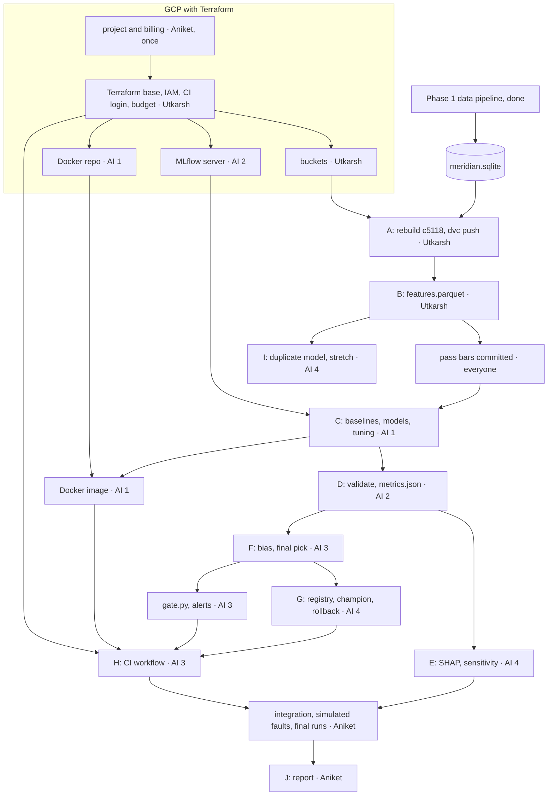
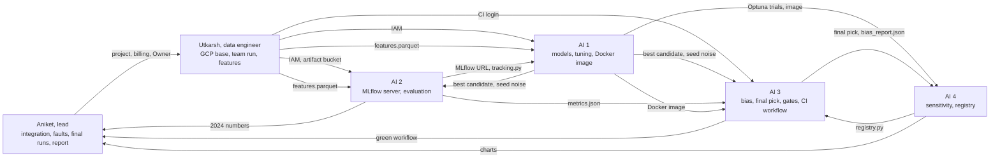

# Phase 2: model pipeline

Phase 1 built the data. Phase 2 trains a model on it, checks it for bias, and ships it through CI to a registry on GCP. This file says where we are, what we build next, who builds what, and in what order.

## 1. The pipeline we have

Meridian joins code, git history and Jira to find every call to an API that's being retired, who owns each call, how risky it is, and which teams wait on each other ([01-problem](../docs/01-problem.md), [02-product](../docs/02-product.md)). The data side is two Airflow DAGs in [Data-Pipeline/](../Data-Pipeline/README.md):

```
meridian_update (daily 02:00 UTC, or on click)
anything_new ── collect ──┬── history ───────── owners ──┐
                          │                              ├── join ── graph ── validate ── report ── publish
                          └── scan ──── resolve ─────────┘

meridian_rebuild (Sunday): fresh ── collect ── … ── validate ──┬── report ── compare ── publish (only if they differ)
                                                              ├── bias (never gates)
                                                              └── gx   (never gates)
```

| Task | What it does |
|---|---|
| collect | Freezes 22 repos at pinned SHAs plus the raw Jira and GitLab pulls into one `run_id` |
| history | Commits, changed files, tickets, commit-to-ticket keys, SZZ (which commit caused each bug fix) |
| scan | tree-sitter finds every place a tracked old name appears |
| resolve | Jedi checks what each name really is, and who calls whom |
| owners | Merges a person's emails, gives people teams, gives each file an owner team |
| join | Call sites with owner and bug-fix count, tickets mapped to code, coverage |
| graph | Which site waits on which, blast radius, ticket chains |
| validate | Schema, statistics, anomalies. Builds `meridian.sqlite`. The only gate |
| publish | Makes the block live: `published/<run_id>.sqlite` and `published/latest.json` |
| bias, gx | Fairlearn slices of the three rules; a Great Expectations audit. Neither gates |

## 2. What phase 1 did

All numbers are from the team run `c5118b019d642a9b` ([REPORT.md](../Data-Pipeline/report/REPORT.md)).

- Both DAGs ran in Airflow on the real data. The update took 943 s. The SZZ cache cut that to 480 s with the same bytes out. The rebuild matched the update with 0 differences.
- Same inputs give the same bytes: all 24 output files match `golden/c5118b019d642a9b.json`.
- 342 unit tests, CI on Linux and Windows, 27 injected faults and 42 scenario tests.
- Answer keys: Django 265 of 265 edit lines with 0 false hits, 542 of 542 aliased `_()` calls, packages 1,236 of 1,236. Commit-to-ticket links 49 of 50 right by hand.
- validate: 0 errors, 1 warning (289 Spark tickets dated in the years 0010–0012, Apache Jira's own data). Alerts reach the team Slack.
- Bias: 133 slices judged, 29 flagged, 23 still flagged under Bonferroni ([BIAS.md](../Data-Pipeline/BIAS.md)).

The week-1 case studies decided which data to trust ([week1/](../week1/)):

| Study | What it settled |
|---|---|
| Pair 1, Django `ugettext` | The scanner and resolver are exact. Method calls don't resolve (5 of 30) |
| Pair 2, Spark + Apache Jira | 94% of commits carry a ticket key, 10,980 fixed bugs to learn from, and risky files really do break more (9.7x). Spark can't show cross-team blocks or stalls |
| Pair 3, packages + Defects4J | 19 of 20 `url()` migrations found. 130 hand-checked bug-inducing commits from Fonte, our check on SZZ |
| Cross-team, GitLab and others | GitLab has real written cross-team waits (30+) and stall reasons (50 of 57). Debian and OpenStack had none. A model read most of it, so it's not gold |

## 3. What the data pipeline outputs

One SQLite file, the block: `published/<run_id>.sqlite`, 1,788,375 rows in 25 tables, with `published/latest.json` naming the live run. Next to it in `out/<run_id>/` sit `stats.json` (per-column statistics), `anomalies.json` and `bias.json`. DVC pins every table's hash in `dvc.lock`.

Phase 2 reads these tables:

| Table | Rows | Phase 2 uses it for |
|---|---:|---|
| `git_commit` | 139,228 (45,312 Spark first-parent) | one row per commit to score, author, time |
| `commit_file` | 849,643 | lines added and deleted, files and directories touched |
| `bug_inducing` | 26,302 | the label: SZZ says this commit caused a later bug |
| `file_bug_fixes` | 1,492 | past bug fixes per file (today's fragility rule) |
| `commit_ticket`, `ticket` | 42,191 · 74,015 | linked ticket type and component |
| `file_owner`, `team_map` | | owner team, for bias slices |

The other tables (call sites, blast radius, chains) feed the product views. The model doesn't need them.

## 4. What we do now

We train a defect-risk model. It's push check P9 in [04-architecture §10](../docs/04-architecture.md): "lines × files above threshold, unless a model beats it". The same features, summed per file, give fragility: "the `bug_fixes` count unless a model beats it". We chose it because it's the one target with thousands of labels that a person has spot-checked.

| Dataset | Use in phase 2 |
|---|---|
| Spark git + SZZ | Train and test the model |
| Spark Jira | Features (ticket type), and an optional duplicate-ticket model: 2,094 usable duplicates against title similarity |
| Defects4J + Fonte | Checks SZZ's labels, not the model |
| Django, packages | Not used. The resolver is a rule and already exact |
| GitLab | Not used. 262 gold pairs, mostly model-read. A trained stall model is in [06-dead-ideas](../docs/06-dead-ideas.md) |

### The label problem

Recent bugs haven't been found yet, so recent commits look safer than they are. Share of Spark commits SZZ blames, by year (v1 block):

| 2015 | 2018 | 2021 | 2023 | 2024 | 2025 | 2026 |
|---:|---:|---:|---:|---:|---:|---:|
| 38% | 28% | 18% | 17% | 11% | 8% | 5% |

05-test's split, train before 2025 and test on 2025, would test on labels that are mostly still missing. So:

- A commit is positive only if a fix within 365 days blames it.
- Only commits with a full 365 days after them count, which means authored before 2025-10-01 (the snapshot is 2026-10-01).
- Train 2015–2022, validate on 2023, test on 2024. SZZ has fix commits from 2015 on, so nothing earlier.

This changes a pass bar in 05-test, so it goes in a commit that says why, before anyone trains.

### Steps

| # | Step | What it means here |
|---|---|---|
| A | Run the data pipeline | Rebuild `c5118b019d642a9b`. collect must print that run_id and `test_golden` must pass 24 of 24 |
| B | Load the data | `data.py` reads `published/latest.json`, then that run's block. Builds one row per Spark commit: size, spread across files, file history, author experience, ticket type. Drops emails, so the table holds no names |
| C | Train and select | Baselines: lines × files, `bug_fixes`, churn. Models: logistic regression, random forest, LightGBM. Optuna tunes on time-ordered folds. Best by PR-AUC on 2023 |
| D | Validate | On 2024 only: PR-AUC, ROC-AUC, F1, recall at 20% of changed lines. Confusion matrix and PR curve |
| E | Sensitivity | SHAP for features, Optuna's parameter importance for hyperparameters |
| F | Bias | Fairlearn slices by module, Jira component, author experience (newcomers have no history features), commit size, year. Same rule as `bias.py`: judged at N ≥ 30, flagged when the whole Wilson interval sits 0.10 below overall. Mitigation by re-weighting or per-group thresholds |
| G | Registry and rollback | MLflow registry with a `champion` alias. A new model takes it only if it beats the champion on the same test and passes bias. The champion is also pushed to Vertex AI Model Registry |
| H | CI/CD and Docker | GitHub Actions on changes under `Model-Pipeline/`: train, validate against the bar, bias check, register, Slack alert through `meridian/alert.py` on any failure or blocked model |
| I | Optional | Spark duplicate-ticket model with a pretrained sentence embedder |
| J | Write-up | A phase 2 report in the style of `report/REPORT.md`, every number with its N |

### Pass bars, written before the run

Proposed. The team agrees on them and commits them before step C, like `notes/PASS-BARS-2026-10-26.md`.

- The model ships only if its PR-AUC on 2024 beats lines × files, with the paired bootstrap interval of the difference above 0. If it doesn't, we keep the rule and say so.
- No judged slice flagged without a mitigation tried and written down.
- CI blocks registration if PR-AUC falls below the champion's.

## 5. What phase 2 outputs

| Output | Where |
|---|---|
| Feature table and its schema | `features.parquet`, in DVC, plus a copy small enough for CI in git |
| Every training run: parameters, metrics, charts, model | MLflow on GCP |
| The champion model | MLflow registry and Vertex AI Model Registry |
| Bias report, SHAP and sensitivity charts | `Model-Pipeline/reports/` and MLflow |
| Model image | Artifact Registry |
| CI workflow | `.github/workflows/model.yml` |
| Phase 2 report | `Model-Pipeline/report/REPORT.md` |

## 6. Dependency graph

Each box names its owner. Phase 1's tasks are in §1; here the pipeline is one box.



The critical path is A → B → C → D → F → G → H → integration → J. The Terraform base comes first, and the MLflow server has to be up before C. Dates are in §10.

Two things keep the AI engineers from waiting on Utkarsh. On day 1 Utkarsh ships a first feature table from v1 (`70dd1dabfed544b8`), which is already on Aniket's machine: the SZZ tables barely differ between v1 and c5118 (26,559 against 26,302 rows). Then the schema file is the contract. When the c5118 table lands, nothing downstream changes.

## 7. Roles

Six people. Utkarsh, the data engineer, at the start; four AI engineers in the middle; Aniket, the lead, at the end. Each person owns the infrastructure their step needs, and Utkarsh owns the GCP base. Aniket does integration, the simulated-fault tests, the final runs and the report. Each person's packet is in [packets/](packets/README.md).

Who hands what to whom:



| Who | Owns | Terraform file | Hands off | Due |
|---|---|---|---|---|
| Utkarsh, data engineer | GCP base and access, CI login, budget, buckets. A, B: the team run, `dvc push`, `data.py`, label window, feature schema | `backend.tf`, `apis.tf`, `iam.tf`, `wif.tf`, `budget.tf`, `storage.tf` | project ready, `features.parquet` | base Nov 4, final table Nov 6 |
| AI engineer 1 | C: baselines, three models, Optuna, best candidate, seed noise. The model Dockerfile | `registry.tf` | best candidate, the image | Nov 8 |
| AI engineer 2 | D: MLflow server, `tracking.py`, `evaluate.py`, the one 2024 run, result charts | `mlflow.tf` | MLflow URL, `metrics.json` | server Nov 5, eval Nov 7 |
| AI engineer 3 | F: bias, mitigation, final pick. `gate.py`, Slack alerts, the `model.yml` workflow | none | final pick, green workflow | pick Nov 9, workflow Nov 10 |
| AI engineer 4 | E: SHAP and sensitivity. G: `registry.py`, champion, rollback, Vertex AI copy. I, if time allows | none | charts, `registry.py` | Nov 10 |
| Aniket, lead | Project and billing (once). Reviews and merges. Integration, simulated-fault tests, final runs, the go or no-go call, the report | none | the report | integration Nov 11, final runs Nov 12, report Nov 15 |

- The pass bars are everyone's: AI engineers 1–3 draft them, the team signs off, and Aniket merges them by Nov 5, before anyone trains.
- Each owner writes their own report section by Nov 12. Aniket edits them into one report.

## 8. GCP with Terraform

Every GCP resource lives in Terraform under `infra/terraform/`, so the setup is reviewed in a PR and can be torn down in one command. Each owner writes their own `.tf` file (§7) and opens a PR. Utkarsh reviews and runs `terraform apply`. Aniket makes the project and links billing once, by hand, since the credits are on that account.

```
infra/terraform/
├── backend.tf        Utkarsh. State in gs://meridian-tfstate (that one bucket is made by hand first)
├── apis.tf           Utkarsh. storage, compute, artifactregistry, aiplatform, iam, iamcredentials, sts, billingbudgets
├── storage.tf        Utkarsh. DVC remote bucket, MLflow artifact bucket
├── registry.tf       AI 1. Docker repo, cleanup policy keeps the last 3 images
├── mlflow.tf         AI 2. e2-micro VM, MLflow on startup, firewall open to IAP only
├── iam.tf            Utkarsh. team group roles, ci-trainer service account
├── wif.tf            Utkarsh. Workload Identity pool, limited to this GitHub repo
├── budget.tf         Utkarsh. $25 budget, alerts at 50, 90 and 100%
├── variables.tf, outputs.tf
└── terraform.tfvars.example   real emails and the billing account id stay out of git
```

Choices:

- Buckets in `us-east1`, uniform access, public access blocked. The raw Jira pulls carry real names, so they're never public.
- The DVC bucket keeps the name `.dvc/config` already has, `meridian-pipeline-snapshots`, if it's free (bucket names are global). That closes the open DVC remote item in [HANDOVER](../Data-Pipeline/notes/HANDOVER.md).
- MLflow has no login of its own, so its port is never open to the internet. People reach it through an IAP tunnel (`gcloud compute start-iap-tunnel`), and CI does the same with its service account.
- Roles go to a Google Group, not to each person. Only Aniket and Utkarsh are Owner. Utkarsh gets Billing Account Costs Manager for the budget, nothing more on billing.
- GitHub Actions signs in through Workload Identity Federation. No JSON key in repo secrets.

### Cost

Estimates from GCP list prices. Check them in the pricing calculator before applying.

| Item | Monthly |
|---|---:|
| GCS, 5–10 GB, inside or near the free tier | $0–0.20 |
| e2-micro MLflow VM (free tier) plus its IPv4 address | $0–3.65 |
| Artifact Registry, 3–5 GB | $0.30–0.50 |
| Vertex AI Model Registry, storage only | $0 |
| CI on GitHub's runners | $0 |
| Total | about $1–5 |

Over a semester that's about $10–40. We have a $300 trial credit (90 days, then resources stop unless upgraded) and $50 of education credit. Start the project on the trial account and move it to the education account before the trial ends.

Not in Terraform, on purpose, because each one could use up the budget:

| Service | Cost | Instead |
|---|---|---|
| Cloud Composer | $300–400 a month | Airflow in Docker, or on a VM started only for the run |
| Vertex AI endpoint | about $70+ a month, always on | The guideline doesn't ask for serving. Registry only |
| Large VMs left on | e2-standard-4 about $98 a month | Stop after each run, or use Spot |
| Cloud SQL | from about $10 a month | SQLite on the MLflow VM |
| GPUs | | Nothing here needs one |

## 9. Open risks

- collect may not rebuild c5118 without the team zip. If it can't, step A waits for the zip from Drive.
- Lines × files is a hard baseline here: SZZ blames changed lines, so big commits get blamed by construction ([appendix C §7](../Data-Pipeline/report/appendix-real-data.md)). The model may not beat it. That's still a result, and 05-test says what to do: keep the rule.
- The yearly label shares in §4 come from v1. c5118 has 257 fewer SZZ rows, so they'll move a little.
- The free-tier limits and the IPv4 charge are the least certain parts of the cost table.

## 10. Schedule

The deadline is Sun Nov 15. Aniket needs Nov 13–15 for the report, so all work and all report sections are due Thu Nov 12.

| Date | Milestone | Who |
|---|---|---|
| Tue Nov 3 | Packets read. Project made, billing linked, Utkarsh made Owner | everyone, Aniket |
| Wed Nov 4 | Terraform base and buckets applied. v1 feature table posted. Pass bars drafted | Utkarsh, AI 1–3 |
| Thu Nov 5 | Pass bars merged. MLflow server up. CI login works | Aniket, AI 2, Utkarsh |
| Fri Nov 6 | c5118 rebuilt, final feature table in DVC. First untuned candidate. `evaluate.py` on val | Utkarsh, AI 1, AI 2 |
| Sun Nov 8 | Tuned candidate and seed noise. Docker image pushed. Bias and SHAP on the first candidate | AI 1, AI 3, AI 4 |
| Mon Nov 9 | Final pick. `gate.py` and `registry.py` working locally | AI 3, AI 4 |
| Tue Nov 10 | Whole workflow green on main. Code freeze at the end of the day | AI 3, everyone |
| Wed Nov 11 | Integration and simulated faults. Owners fix what breaks, same day. Go or no-go for 2024 | Aniket, owners |
| Thu Nov 12 | The one 2024 run, champion registered, final charts. Every report section in | AI 2, AI 4, everyone |
| Fri Nov 13 – Sun Nov 15 | Report | everyone mostly aniket and utkarsh |

Anything not done by Nov 10 is cut, not squeezed in: the duplicate model first, then extra sensitivity charts. The report says what was cut.
