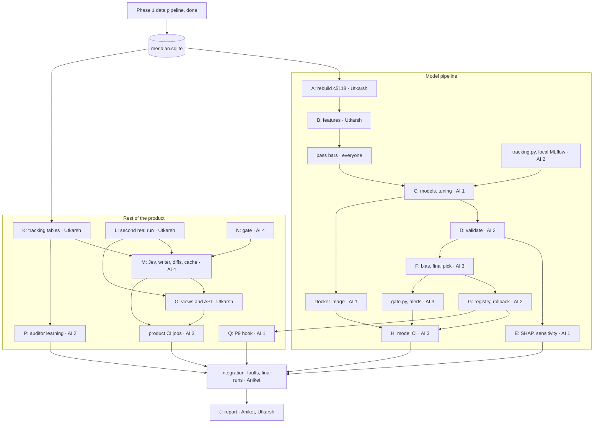
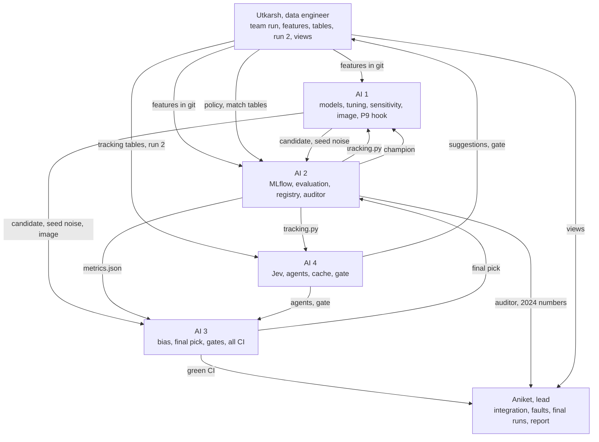

# Phase 2: the model pipeline and the rest of the product

Phase 1 built the data. Phase 2 finishes the product: the defect-risk model through the course's model-pipeline guideline, and every stage of [04-architecture](../docs/04-architecture.md) still missing (rules served as views, the LLM agents, the gate, auditor learning). Everything runs and is tested locally, plus GitHub Actions. The one exception is the model registry push the guideline requires, which goes to a single GCP Artifact Registry repo (§8). Phase 3 deploys the rest: Terraform, hosting, monitoring (§11). §12 maps every item in the course guideline to the step that covers it. This file says where we are, what we build, who builds what, and by when.

## 1. The pipeline we have

Meridian joins code, git history and Jira to find every call to an API that's being retired, who owns each call, how risky it is, and which teams wait on each other ([01-problem](../docs/01-problem.md), [02-product](../docs/02-product.md)). The data side is two Airflow DAGs in [Data-Pipeline/](../Data-Pipeline/README.md):

```
meridian_update (daily 02:00 UTC, or on click)
anything_new ── collect ──┬── history ───────── owners ──┐
                          │                              ├── join ── graph ── validate ── report ── publish
                          └── scan ──── resolve ─────────┘

meridian_rebuild (Sunday): fresh ── collect ── … ── validate ──┬── report ── compare ── publish (only if they differ)
                                                              ├── bias (never gates)
                                                              └── gx   (never gates)
```

| Task | What it does |
|---|---|
| collect | Freezes 22 repos at pinned SHAs plus the raw Jira and GitLab pulls into one `run_id` |
| history | Commits, changed files, tickets, commit-to-ticket keys, SZZ (which commit caused each bug fix) |
| scan | tree-sitter finds every place a tracked old name appears |
| resolve | Jedi checks what each name really is, and who calls whom |
| owners | Merges a person's emails, gives people teams, gives each file an owner team |
| join | Call sites with owner and bug-fix count, tickets mapped to code, coverage |
| graph | Which site waits on which, blast radius, ticket chains |
| validate | Schema, statistics, anomalies. Builds `meridian.sqlite`. The only gate |
| publish | Makes the block live: `published/<run_id>.sqlite` and `published/latest.json` |
| bias, gx | Fairlearn slices of the three rules; a Great Expectations audit. Neither gates |

These are stages 1–4 of 04-architecture's nine. Stage 5's rules exist as named SQL queries in [KNOWLEDGE-BASE.md](../Data-Pipeline/KNOWLEDGE-BASE.md), tested on the fixture. The push check (§10) runs in GitHub Actions. Stages 6–9 aren't built.

## 2. What phase 1 did

All numbers are from the team run `c5118b019d642a9b` ([REPORT.md](../Data-Pipeline/report/REPORT.md)).

- Both DAGs ran in Airflow on the real data. The update took 943 s. The SZZ cache cut that to 480 s with the same bytes out. The rebuild matched the update with 0 differences.
- Same inputs give the same bytes: all 24 output files match `golden/c5118b019d642a9b.json`.
- 342 unit tests, CI on Linux and Windows, 27 injected faults and 42 scenario tests.
- Answer keys: Django 265 of 265 edit lines with 0 false hits, 542 of 542 aliased `_()` calls, packages 1,236 of 1,236. Commit-to-ticket links 49 of 50 right by hand.
- validate: 0 errors, 1 warning (289 Spark tickets dated in the years 0010–0012, Apache Jira's own data). Alerts reach the team Slack.
- Bias: 133 slices judged, 29 flagged, 23 still flagged under Bonferroni ([BIAS.md](../Data-Pipeline/BIAS.md)).
- 74 product features checked against the real block: 25 work, 35 work on the fixture but get empty input on real data, 6 aren't built, 8 belong to later stages ([appendix C](../Data-Pipeline/report/appendix-real-data.md)).

The week-1 case studies decided which data to trust ([week1/](../week1/)):

| Study | What it settled |
|---|---|
| Pair 1, Django `ugettext` | The scanner and resolver are exact. Method calls don't resolve (5 of 30) |
| Pair 2, Spark + Apache Jira | 94% of commits carry a ticket key, 10,980 fixed bugs to learn from, and risky files really do break more (9.7x). Spark can't show cross-team blocks or stalls |
| Pair 3, packages + Defects4J | 19 of 20 `url()` migrations found. 130 hand-checked bug-inducing commits from Fonte, our check on SZZ |
| Cross-team, GitLab and others | GitLab has real written cross-team waits (30+) and stall reasons (50 of 57). Debian and OpenStack had none. A model read most of it, so it's not gold |

## 3. What the data pipeline outputs

One SQLite file, the block: `published/<run_id>.sqlite`, 1,788,375 rows in 25 tables, with `published/latest.json` naming the live run. Next to it in `out/<run_id>/` sit `stats.json` (per-column statistics), `anomalies.json` and `bias.json`. DVC pins every table's hash in `dvc.lock`.

| Table | Rows | Phase 2 uses it for |
|---|---:|---|
| `git_commit` | 139,228 (45,312 Spark first-parent) | the model: one row per commit |
| `commit_file` | 849,643 | the model: lines added and deleted, files and directories touched |
| `bug_inducing` | 26,302 | the model's label |
| `file_bug_fixes` | 1,492 | the fragility baseline, and "risky" in the views |
| `commit_ticket`, `ticket` | 42,191 · 74,015 | model features; ticket tools; the writer agent's facts |
| `call_site`, `ticket_map`, `chain`, `blast_radius`, `blocked_by` | 1,526 sites | the views, the agents' facts, the diff drafter |
| `file_owner`, `team_map` | | owner team, for views and bias slices |

## 4. What we build

### 4.1 The model (the course guideline)

A defect-risk model. It's push check P9 in [04-architecture §10](../docs/04-architecture.md): "lines × files above threshold, unless a model beats it". The same features, summed per file, give fragility: "the `bug_fixes` count unless a model beats it". It's the one target with thousands of labels that a person has spot-checked.

| Dataset | Use |
|---|---|
| Spark git + SZZ | Train and test the model |
| Spark Jira | Features (ticket type) |
| Defects4J + Fonte | Checks SZZ's labels, not the model |
| Django, packages | The views, the second run and the diff drafter, not the model |
| GitLab | Not used for training. 262 gold pairs, mostly model-read. A trained stall model is in [06-dead-ideas](../docs/06-dead-ideas.md) |

#### The label problem

Recent bugs haven't been found yet, so recent commits look safer than they are. Share of Spark commits SZZ blames, by year (v1 block):

| 2015 | 2018 | 2021 | 2023 | 2024 | 2025 | 2026 |
|---:|---:|---:|---:|---:|---:|---:|
| 38% | 28% | 18% | 17% | 11% | 8% | 5% |

05-test's split, train before 2025 and test on 2025, would test on labels that are mostly still missing. So:

- A commit is positive only if a fix within 365 days blames it.
- Only commits with a full 365 days after them count, which means authored before 2025-10-01 (the snapshot is 2026-10-01).
- Train 2015–2022, validate on 2023, test on 2024. SZZ has fix commits from 2015 on, so nothing earlier.

This changes a pass bar in 05-test, so it goes in a commit that says why, before anyone trains.

### 4.2 The rest of the product

| Stage (04-architecture) | What we build | Runs on |
|---|---|---|
| 5 Rules + 8 Views | A read-only web app and JSON API serving the four views (staff, API owner, consumer, developer) and the ticket tools, from KNOWLEDGE-BASE.md's named queries. `run_id`, `snapshot_at` and coverage on every screen | the real block, and the fixture `acme/shop` for the cross-team story |
| Tracking tables | `suggestion`, `outcome`, `push_alert` moved from KNOWLEDGE-BASE.md's tested DDL into `schema.sql`; `policy`, `match` drafted | every run |
| Second real run | Django at its conversion commit and the packages at their migration commits, joined with `--prev-run c5118`: real `removed` rows, so burndown, ETA and "N of M done" get real numbers | real data |
| 6 LLM | Jev routes each task to an agent and model. Agents: the writer (ticket rewrites, maker drafts, stall-reason and consumer text) and the diff drafter (codemod first, LLM only with 2+ same-shape examples). The cache keys on hash(model, prompt, facts) | real block and fixture |
| 7 Gate | Every number, path, SHA, ID, person and team in LLM text must be in its facts. Any miss and the whole text becomes the template. Fallback rate published | every LLM output |
| 9 Auditor learning | Policy v0 (the stall-reason table) as code, ε-greedy choice, Elo from the match log, verdict rules, replay with `known_at`, the promotion guard. The explore job on the signals the block has (deprecation with callers) | fixture, replay and simulation. Live matches need users, which come after deployment |
| P9 hook | The push check uses the champion model when it shipped, else lines × files. Templates only, $0 a push | GitHub Actions |

Rules that still hold ([06-dead-ideas](../docs/06-dead-ideas.md)): LLMs write text and code, never facts. No LLM on the push check. No LLM picks auditor policies, and no LLM-written policy is promoted without a person. Every view works with the LLM off.

Product code goes in `Data-Pipeline/meridian/`, next to `pushcheck.py`, because it reads the block and `meridian.toml` the same way. Model code goes in `Model-Pipeline/model/`.

Not in phase 2: intake (no collect source, gap G5), ticket comments (G2), a whole-repo call graph and function signatures (G3, G4), so the explore job's fan-in and twin signals wait. Anything on GCP is phase 3.

### Steps

| # | Step | What it means here |
|---|---|---|
| A | Run the data pipeline | Rebuild `c5118b019d642a9b`. collect prints that run_id; `test_golden` passes 24 of 24 |
| B | Load the data | `data.py` builds one row per Spark commit, no names |
| C | Train and select | Baselines: lines × files, `bug_fixes`, churn. Models: logistic regression, random forest, LightGBM. Optuna on time-ordered folds. Best by PR-AUC on 2023 |
| D | Validate | On 2024 once: PR-AUC, ROC-AUC, F1, recall at 20% of changed lines |
| E | Sensitivity | SHAP for features, Optuna's parameter importance for hyperparameters |
| F | Bias | Fairlearn slices by module, component, author experience, commit size. Phase 1's flag rule. Bias charts. Mitigation by re-weighting, re-sampling or per-group thresholds |
| G | Registry and rollback | MLflow registry (`champion` alias) and the champion pushed to GCP Artifact Registry. Rollback |
| H | CI/CD and Docker | GitHub Actions: train, validate, bias, gate, push to the registry, Slack alerts on failure, completion and push. The whole model pipeline runs in one Docker image with one command |
| J | Report | `Model-Pipeline/report/REPORT.md`, every number with its N |
| K | Tracking tables | Into `schema.sql`, with writer and validate support |
| L | Second real run | Real `removed` rows, real burndown |
| M | LLM stage | Jev, the writer, the diff drafter, the cache. The policy writer if time allows. Every call tracked in MLflow; validated and sliced for bias like the model (the guideline's rule for pretrained models) |
| N | Gate | The fact check on every LLM output |
| O | Views and API | The four views and the ticket tools, read-only, served locally |
| P | Auditor learning | Stall job, explore job, Elo, ε-greedy, replay, promotion guard |
| Q | P9 hook | The champion model in the push check |

### Pass bars, written before the run

Proposed. The team agrees and commits them by Nov 6, like `notes/PASS-BARS-2026-10-26.md`. The product bars come from [05-test](../docs/05-test.md).

| What | Bar |
|---|---|
| Model | Ships only if its 2024 PR-AUC beats lines × files, with the paired bootstrap interval of the difference above 0. Otherwise the rule stays |
| Bias | No judged slice flagged without a mitigation tried and written down |
| Model CI | Blocks registration below the champion by more than seed noise |
| Gate | 200 injected errors: 100% caught. 200 clean texts: at most 5% rejected |
| LLM off | Every view renders |
| Determinism | Same snapshot twice, warm cache: 0 diffs, 0 LLM calls |
| Jev | Same problem twice: same pick. Jev down: rules pick. Beats the rules' pick on cost at an equal pass rate |
| Diffs | Django, drafted from the parent: at least 90% match the real after-line |
| LLM bias | Gate fallback rate and diff match rate per repo and per team: no judged slice (N ≥ 30) more than 0.10 worse than overall without a fix tried |
| Auditor | Elo simulation with known skill ranks right. Recompute twice, same result. Seeded ε within ±2% over 1,000 draws. No `known_at` leak. Promotion guard holds, 100% |
| Views | Every number on a screen traces to a row, 100% |
| Maker | Each untracked site in exactly one draft |
| Push check | Replay: median alerts per push ≤ 1, precision ≥ 0.80 |

## 5. What phase 2 outputs

| Output | Where |
|---|---|
| Feature table and its schema | `Model-Pipeline/data/`, in git (no names, a few MB) |
| Every training run, decision test and agent call | MLflow, local. The canonical runs are Aniket's final runs on Nov 12 |
| The champion model | GCP Artifact Registry (`meridian-models`), mirrored in the local MLflow registry, with `Model-Pipeline/registry/champion.json` in git |
| Bias report and charts, SHAP and sensitivity charts, model comparison charts | `Model-Pipeline/reports/` |
| Model image | Built locally from `Model-Pipeline/Dockerfile`; `python -m model.run_all` inside it runs every step |
| The product: views, API, agents, gate, auditor | `Data-Pipeline/meridian/`, run locally |
| The LLM cache | `Data-Pipeline/llm_cache/`, in git, so CI and every rerun make 0 calls |
| A second real run with real burndown | `out/<run 2>/`, pinned in `dvc.lock` |
| CI workflows | `.github/workflows/model.yml`, plus product jobs in `ci.yml` |
| Phase 2 report | `Model-Pipeline/report/REPORT.md` |

## 6. Dependency graph

Each box names its owner. Phase 1's tasks are in §1; here the pipeline is one box.



Two critical paths, both ending at integration on Nov 11:

- Model: A → B → C → D → F → G → H.
- Product: N → M → O, with K and L feeding M and O.

Two things keep people from waiting on Utkarsh. On day 1 Utkarsh ships a first feature table from v1 (`70dd1dabfed544b8`), which is already on Aniket's machine: the SZZ tables barely differ (26,559 against 26,302 rows). And AI 4 builds the gate and agents on the fixture block, which needs nothing from step A. Dates are in §10.

## 7. Roles

Six people. Utkarsh, the data engineer, at the start; four AI engineers in the middle; Aniket, the lead, at the end. Aniket does integration, the simulated-fault tests, the final runs and the report. Each person's packet is in [packets/](packets/README.md).

Who hands what to whom:



| Who | Owns | Hands off | Due |
|---|---|---|---|
| Utkarsh, data engineer | A, B, the data hand-out. K: tracking tables. L: second real run. O: views and API | features, tables, run 2, views | v1 table Nov 5, c5118 table Nov 7, run 2 Nov 8, views Nov 10 |
| AI engineer 1 | C: models, tuning, seed noise. E: SHAP and sensitivity. The Docker image and `run_all`. Q: P9 hook | candidate, image, charts, P9 | C Nov 8, E Nov 9, Q Nov 10 |
| AI engineer 2 | `tracking.py` and the local MLflow setup. D: `evaluate.py`, the 2024 run. G: registry, the GCP push, rollback, `champion.json`. P: auditor learning | `metrics.json`, `registry.py`, auditor | tracking Nov 5, D Nov 6, G Nov 9, P Nov 10 |
| AI engineer 3 | F: bias, mitigation, final pick. `gate.py`, alerts, `model.yml`. Product CI jobs (LLM off, warm cache, gate bars) | final pick, green CI | pick Nov 9, CI Nov 10 |
| AI engineer 4 | N: the gate. M: Jev, the writer, the diff drafter, the cache, LLM tracking and bias slices. The policy writer if time allows | agents, gate, `suggestion` rows | N Nov 7, M Nov 10 |
| Aniket, lead | The Artifact Registry repo and CI key, once. Reviews and merges. Integration, simulated faults, final runs, go or no-go, the report | the report | repo by Nov 9, then Nov 11–15 |

- The pass bars are everyone's: AI 1–4 draft them, the team signs off, and Aniket merges them by Nov 6.
- Each owner writes their own report section by Nov 12. Aniket and Utkarsh edit them into one report.

## 8. Running locally

Everything runs on our machines and on GitHub's free runners, except one GCP Artifact Registry repo for the model push.

| What | How |
|---|---|
| The block | Utkarsh builds c5118 from the team zip (`reproduce.py` Option 2). Anyone who needs the real block does the same. It holds real names, so it's never committed |
| The feature table | In git under `Model-Pipeline/data/`: no names, a few MB. Nobody but Utkarsh needs the block for the model |
| DVC | `dvc.lock` pins every output, as in phase 1. A local remote (`dvc remote add -d --local mine <path>`) for whoever pushes |
| MLflow | Local on each machine: `MLFLOW_TRACKING_URI=sqlite:///mlflow.db`, `mlflow ui` to look. Git ignores `mlflow.db` and `mlruns/`. Decision results go into each person's `decisions.md` with their numbers, so nobody needs another person's MLflow. The canonical runs are Aniket's final runs, which rebuild every result from code, config and seed |
| Registry | GCP Artifact Registry, one generic repo `meridian-models` in `us-east1`, made by hand with two `gcloud` commands (no Terraform until phase 3). Each promoted model is a version named by its git SHA, and `champion.json` (run id, metrics, model md5, version) is uploaded next to it. The local MLflow registry mirrors it for local work, and `Model-Pipeline/registry/champion.json` in git lets CI compare without downloading |
| Docker | Built and run locally. `python -m model.run_all` in the image runs data load to registry push. No image registry |
| CI | GitHub Actions trains on the committed feature table. One secret, a service-account key that can only write to `meridian-models`, for the push on main. Phase 3 replaces it with Workload Identity |
| Alerts | Slack through `MERIDIAN_SLACK_WEBHOOK`, as in phase 1 |
| LLM | The provider's API key in `.env` and a repo secret. Billed by the provider, not covered by any credit. Models and a spend cap pinned in `meridian.toml`. The cache is committed, so CI and reruns make 0 calls and need no key |

The registry repo is the guideline's §2.6, §7.4 and §8.7, which ask for the model on GCP. It's storage, not serving, so it isn't deployment. It costs about $0: Artifact Registry's first 0.5 GB is free, and a LightGBM model is a few MB. Aniket makes the repo and the service account on the $300 trial project on Nov 4, or by Nov 9 at the latest.

## 9. Open risks

- Scope. Eight working days (Nov 5–12) for the model and four product stages is tight. The cut order below is agreed now, so nobody argues it on Nov 9.
- collect may not rebuild c5118 without the team zip. If it can't, step A waits for the zip from Drive.
- Lines × files is a hard baseline: SZZ blames changed lines, so big commits get blamed by construction ([appendix C §7](../Data-Pipeline/report/appendix-real-data.md)). The model may not beat it. That's still a result, and the rule stays.
- No real dataset has both tickets and tracked code (gap G7), so the cross-team views, chains and most agent tasks show their full story on the fixture `acme/shop`. The real block fills what it can. Every screen says which it is.
- Auditor learning has no live matches without users. Phase 2 shows it on simulation, the fixture and replay.
- MLflow runs live on six laptops. If someone's results can't be rebuilt from code, config and seed on Nov 12, they don't go in the report.
- The yearly label shares in §4 come from v1. c5118 has 257 fewer SZZ rows, so they'll move a little.

Cut order, if the Nov 9 check-in shows we're behind. Cut from the top:

1. The policy writer agent
2. The auditor's explore job (keep the stall job)
3. The LLM path of the diff drafter (keep the codemod)
4. View polish (plain tables are fine)

Never cut: anything in the course guideline, the gate, the LLM-off fallback, determinism.

## 10. Schedule

Work starts Thu Nov 5 (day 1). Wed Nov 4 is an optional head start: anyone who starts then has a day of slack. The deadline is Sun Nov 15, and the report takes Nov 13–15, so all work and every report section are due Thu Nov 12.

| Date | Model pipeline | Product |
|---|---|---|
| Wed Nov 4, optional | Packets read. Artifact Registry repo and CI key made (Aniket) | |
| Thu Nov 5, day 1 | v1 feature table in git (Utkarsh). `tracking.py` merged (AI 2). Pass bars drafted (AI 1–4) | Gate started on the fixture (AI 4) |
| Fri Nov 6, day 2 | Pass bars merged (Aniket). Baselines and a first candidate on v1 (AI 1). `evaluate.py` on val (AI 2). c5118 rebuild running (Utkarsh) | |
| Sat Nov 7, day 3 | c5118 table in git, label checks done (Utkarsh) | Gate passes 200 + 200 (AI 4). Tracking tables in `schema.sql` (Utkarsh) |
| Sun Nov 8, day 4 | Tuned candidate, seed noise, image (AI 1). Bias on the first candidate (AI 3) | Writer agent and cache (AI 4). Second real run (Utkarsh) |
| Mon Nov 9, day 5 | Final pick (AI 3). SHAP and sensitivity (AI 1). Registry and the GCP push working (AI 2). Check-in on the cut order | Jev (AI 4). Auditor stall job (AI 2) |
| Tue Nov 10, day 6 | Model CI green on main (AI 3). Code freeze at the end of the day | Diff drafter (AI 4). Views and API (Utkarsh). P9 hook (AI 1). Product CI jobs (AI 3) |
| Wed Nov 11, day 7 | Integration and simulated faults (Aniket). Owners fix what breaks, same day. Go or no-go for 2024 | Same, for the product |
| Thu Nov 12, day 8 | The one 2024 run (AI 2), champion pushed, final charts. Every report section in | Final product run on the real block and the fixture |
| Fri Nov 13 – Sun Nov 15 | Report: Aniket and Utkarsh lead, everyone reviews their section | |

Anything not done by Nov 10 follows the cut order in §9 and isn't squeezed in. The report says what was cut.

## 11. Phase 3: deployment

Deployment only. Phase 2 leaves nothing else open.

- The views and API on Cloud Run, the pipeline on a schedule, the champion model served to the push check
- The hand-made Artifact Registry repo and CI key from phase 2 move into Terraform; the key is replaced by Workload Identity
- Monitoring: gate fallback rate, Jev's success per agent, push alert precision, suggestion outcomes, spend ([scoping §9–10](../scoping/project-scoping.md))
- Live auditor matches, once people use it

The GCP design is ready to start from. Everything goes in Terraform under `infra/terraform/`:

```
infra/terraform/
├── backend.tf        state in gs://meridian-tfstate (that one bucket is made by hand first)
├── apis.tf           storage, compute, run, artifactregistry, aiplatform, iam, iamcredentials, sts, billingbudgets, iap
├── storage.tf        DVC remote, MLflow artifacts, LLM cache
├── registry.tf       Docker repo, cleanup policy keeps the last 3 images
├── mlflow.tf         e2-micro VM, MLflow on startup, firewall open to IAP only
├── iam.tf            team group roles, ci-trainer service account
├── wif.tf            Workload Identity pool, limited to this GitHub repo
├── budget.tf         $25 budget, alerts at 50, 90 and 100%
├── variables.tf, outputs.tf
└── terraform.tfvars.example   real emails and the billing account id stay out of git
```

- Buckets in `us-east1`, uniform access, public access blocked. The raw Jira pulls carry real names.
- The DVC bucket keeps the name `.dvc/config` already has, `meridian-pipeline-snapshots`, if it's free.
- MLflow is never open to the internet. People and CI reach it through an IAP tunnel.
- Roles go to a Google Group. GitHub Actions signs in through Workload Identity Federation, with no JSON key.

Cost, from GCP list prices (check the pricing calculator before applying):

| Item | Monthly |
|---|---:|
| GCS, 5–10 GB | $0–0.20 |
| e2-micro MLflow VM (free tier) plus its IPv4 address | $0–3.65 |
| Artifact Registry, 3–5 GB | $0.30–0.50 |
| Vertex AI Model Registry, storage only | $0 |
| Total, before Cloud Run | about $1–5 |

Credits: $300 trial (90 days, then resources stop unless upgraded) and $50 education. Never turn on Cloud Composer ($300–400 a month), an always-on Vertex endpoint (about $70+ a month), Cloud SQL, GPUs, or a large VM left running.

## 12. Guideline coverage

Every item in the course's Model Development Guidelines, and where phase 2 covers it. Aniket checks this table on Nov 11, and the report follows its order.

| Guideline | Item | Step | Owner | Evidence |
|---|---|---|---|---|
| §2.1, §8.2 | Load data from the data pipeline, processed and versioned | B | Utkarsh | `model/data.py` reads `published/latest.json`; every run tagged with `block_run_id` and `features_md5`; `dvc.lock` pins the block |
| §2.2, §8.3 | Train, try several architectures, select the best by metrics | C | AI 1 | Three baselines, three models, `val` PR-AUC with intervals in MLflow |
| §2.3, §8.4 | Validate on a hold-out set not used in training | D | AI 2 | `val` 2023 for choices, `test` 2024 once; `metrics.json` |
| §2.4, §6.1–6.2 | Bias detection by slicing, metrics tracked across slices | F | AI 3 | Fairlearn `MetricFrame` by module, component, author experience, size; `bias_report.json` |
| §2.5, §8.5 | Bias-check code, disparity reports, visualizations, mitigation suggestions | F | AI 3 | `bias.py`, bias charts in `reports/`, mitigation table |
| §6.3–6.4 | Mitigate (re-weighting, re-sampling, thresholds), document trade-offs | F | AI 3 | Each fix scored on the same rows; trade-offs in the report section |
| §8.6 | Final selection after both validation and bias | F | AI 3 | The final pick, with its reasons |
| §2.6, §8.7 | Push the model to a registry on GCP | G | AI 2 | Artifact Registry `meridian-models`, a version per promoted model |
| §3 | Hyperparameter tuning, search space and process documented | C | AI 1 | Optuna, `model.toml [search.*]`, the best-so-far curve |
| §4 | Experiment tracking: hyperparameters, metrics, model versions per run | C, D | AI 1, AI 2 | MLflow with `tracking.py` tags on every run |
| §4 | Visualizations comparing models, and why the final one was picked | D | AI 2 | PR-AUC bars, confusion matrix, PR curves |
| §5 | Feature importance (SHAP or LIME) | E | AI 1 | SHAP beeswarm and dependence plots |
| §5 | Hyperparameter sensitivity | E | AI 1 | Optuna parameter importance, one-at-a-time sweeps |
| §7.1 | CI triggers training on a code push | H | AI 3 | `model.yml` on pushes and PRs touching `Model-Pipeline/**` |
| §7.2 | Automated validation against a threshold | H | AI 3 | `gate.py` against `model.toml [gate]` |
| §7.3 | Automated bias detection; significant bias alerts or blocks | H | AI 3 | `bias.py` in CI; a failed bias report blocks the push |
| §7.4 | Automatic push to the registry after validation and bias pass | G, H | AI 2, AI 3 | `registry.py` on main, after the gate |
| §7.5 | Notifications on failure, training completion, validation or bias fail | H | AI 3 | Slack through `meridian/alert.py` |
| §7.6 | Rollback if the new model is worse | G | AI 2 | `champion` moves only on a real gain; `--rollback`; the drill on Nov 11 |
| §8.1 | The whole process in Docker | H | AI 1 | `python -m model.run_all` in the image, data load to registry push |
| Note on pretrained models | Validation, bias detection and tracking for the LLMs | M, N | AI 4, AI 3 | Gate and diff bars; fallback and match rates sliced by repo and team; every call in MLflow |
