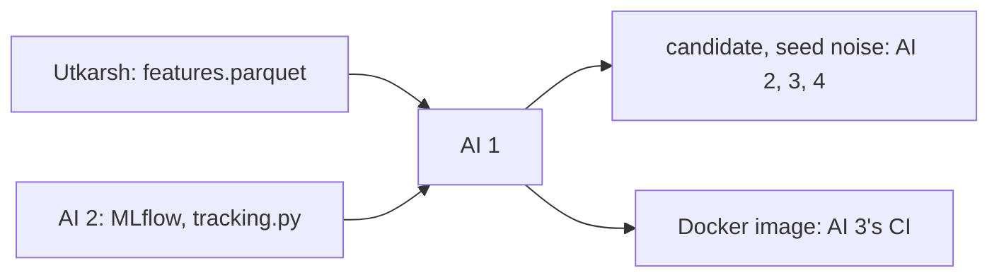

# AI engineer 1: models, tuning, Docker image

> Train the baselines and the models, tune them, pick the best candidate on 2023, measure how much results move between seeds, and package training in a Docker image. You never look at 2024.

| | |
|---|---|
| Steps | C, plus the model Docker image |
| Code | `model/train.py`, `Dockerfile`, `requirements.txt`, `tests/test_train.py` |
| Terraform | `registry.tf` (Docker repo). Utkarsh applies it |
| Waits on | Utkarsh's v1 table (Nov 4), AI 2's MLflow (Nov 5; log locally until then) |
| Hands to | AI 2, 3: the candidate. AI 3, 4: `seed_noise.json`. AI 4: Optuna trials. AI 3's CI: the image |

| Date | Due |
|---|---|
| Wed Nov 4 | Pass bars drafted with AI 2 and AI 3 |
| Fri Nov 6 | Baselines and a first untuned candidate on `val` |
| Sun Nov 8 | Tuned candidate, `seed_noise.json`, decisions 1–9, image pushed |
| Tue Nov 10 | Code freeze |
| Thu Nov 12 | Your report section |

## Read first

- [PLAN.md §4](../../PLAN.md#4-what-we-do-now): the label problem and the split
- [04-architecture §10](../../../docs/04-architecture.md), P9, and [appendix C §7](../../../Data-Pipeline/report/appendix-real-data.md): today's rule flags lines × files above 2,000, catching 32% of bug-inducing Spark commits and 9% of the rest
- [packets/README.md](../README.md): Contracts 1–4

## What to build

Baselines are scores, so no training:

| Baseline | Score |
|---|---|
| lines × files (today's P9) | `(la + ld) * nf` |
| churn | `la + ld` |
| bug fixes (today's fragility) | `prior_bug_fixes` |

Models: logistic regression (`log1p` on counts, scaled), random forest, LightGBM. Features: the numeric columns plus `ticket_type` one-hot. The slice columns (`module`, `component`, `exp_bucket`, `size_bucket`) stay out unless AI 3 agrees, since the bias check changes if they go in.

Tuning: Optuna, TPE sampler, seed from `model.toml`, folds by time inside train (decision 5), objective mean PR-AUC over folds. Search space in `model.toml [search.*]`. Every trial is a nested MLflow run, because AI 4 needs them all.

The candidate is logged with `mlflow.<flavor>.log_model`, plus its scores on every `val` row as an artifact. It's a candidate: AI 3 makes the final pick after the bias check.

Docker: `python:3.11-slim`, pinned `requirements.txt`, `python -m model.train` by default. `registry.tf`: Artifact Registry repo `meridian`, `us-east1`, cleanup keeping the last 3. Tag is the git SHA.

## Decisions

Write the test and the rule that picks before you run it, in `decisions.md` in this folder. Tag each run `decision=ai1-<n>`.

| # | Decision | Options | Test that decides | Why it matters |
|---|---|---|---|---|
| 1 | Model family | logistic regression, random forest, LightGBM | `val` PR-AUC for each with a paired bootstrap interval (AI 2's helper). The best wins; inside the interval of a simpler one, the simpler one wins | A simpler model that ties is easier to explain, faster in CI, and harder to overfit |
| 2 | Does it beat lines × files for a real reason? | | Ablation: train the winner (a) on all features, (b) without the size features (`la`, `ld`, `nf`, `nd`, `ns`, `entropy`), (c) on size features only. Compare all three with lines × files | SZZ blames changed lines, so big commits get blamed by construction. If (c) matches (a), the model is lines × files with extra steps, and the report has to say so |
| 3 | Class imbalance | none, `class_weight="balanced"`, LightGBM `scale_pos_weight` | `val` PR-AUC and Brier score for each | PR-AUC barely moves with weighting, but probabilities do. Pick what keeps PR-AUC and gives honest probabilities |
| 4 | Calibration | raw scores, isotonic, Platt, fitted on the last train year | Reliability curve and Brier score on `val` | The push check would show developers a risk. A "0.8" that's right 30% of the time destroys trust in it |
| 5 | Training window | 2015–2022 (expanding), last 4 years (2019–2022) | `val` PR-AUC for each, and the fold-to-fold spread | Spark's code and team changed over ten years. Old commits may teach patterns that no longer hold. More data isn't automatically better |
| 6 | How many trials | 50, 100, 200 | The best-so-far curve per model. Stop when the last 30 trials improve PR-AUC by less than 0.002 | Trials cost time you don't have after Nov 8. Stop when the curve is flat, and show that curve |
| 7 | Seed noise | | Train the chosen config with 5 seeds: mean and standard deviation of `val` PR-AUC, into `reports/seed_noise.json` | Any gap smaller than seed noise isn't real. AI 3's gate and AI 4's promotion rule are built on this number |
| 8 | Ticket features | keep `fix`, `ticket_type`, `has_ticket`; drop them | `val` PR-AUC with and without | Ticket type is as of the Jira pull, not the commit's time, so it can leak a little. If dropping it costs nothing, drop it |
| 9 | Determinism | | Train twice in the Docker image and once on a laptop. Same predictions? Set LightGBM `deterministic=true` and a fixed `num_threads` | LightGBM can differ across thread counts. CI and your laptop have to agree, or the gate checks a different model |

## Tests (`tests/test_train.py`)

- [ ] Two trainings with the same seed give the same predictions
- [ ] No `test` row reaches any fit, transformer or calibrator
- [ ] No time fold trains on a year it scores
- [ ] Baseline scores on a hand-made 5-row table match a hand calculation
- [ ] A missing feature column fails with a clear message, not a silent NaN model
- [ ] On a table with shuffled labels, `val` PR-AUC lands near the positive rate. This is the sanity check that the pipeline can't learn from noise

## Done when

- [ ] Three baselines, three tuned models and the candidate have `val` PR-AUC with N in MLflow
- [ ] `seed_noise.json` exists, and the search space is in `model.toml`
- [ ] Decisions 1–9 written down with their numbers
- [ ] The image builds and is pushed. Same metrics inside it as outside
- [ ] Your report section: models, search space, tuning, each decision and its test
