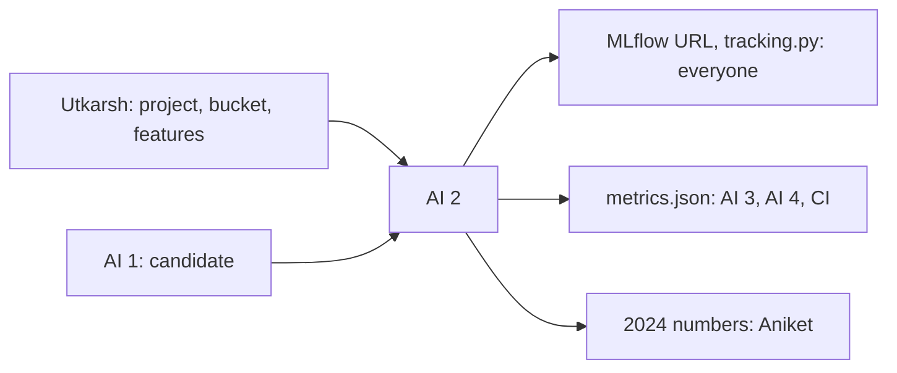

# AI engineer 2: MLflow and evaluation

> Run the team's MLflow server, set how everyone logs, and make the numbers everyone trusts. You also run the one look at 2024, on Nov 12.

| | |
|---|---|
| Steps | D, plus the MLflow server |
| Code | `model/tracking.py`, `model/evaluate.py`, `tests/test_evaluate.py` |
| Terraform | `mlflow.tf`. Utkarsh applies it |
| Waits on | Utkarsh's project and bucket (Nov 4), the v1 table, AI 1's candidate (Nov 6) |
| Hands to | everyone: MLflow URL, `tracking.py`, the bootstrap helper. AI 3, AI 4, CI: `metrics.json`. Aniket: the 2024 numbers |

| Date | Due |
|---|---|
| Wed Nov 4 | Pass bars drafted with AI 1 and AI 3. `mlflow.tf` PR open |
| Thu Nov 5 | Server up, team connected, `tracking.py` merged |
| Sat Nov 7 | `evaluate.py` and `metrics.json` on `val`, charts |
| Tue Nov 10 | Code freeze |
| Thu Nov 12 | The 2024 run, once. Your report section |

## Read first

- [PLAN.md §4](../../PLAN.md#4-what-we-do-now): the pass bars
- [05-test](../../../docs/05-test.md): bars fixed before the run, every metric with its N, split by time
- [packets/README.md](../README.md): Contracts 3 and 4

## What to build

The server (`mlflow.tf`): e2-micro in `us-east1`, MLflow pinned, run records on the VM's disk, artifacts in `gs://meridian-mlflow-artifacts`, port 5000 open only to Google's IAP range (`35.235.240.0/20`). MLflow has no login, so it's never open to the internet. People connect with `gcloud compute start-iap-tunnel <vm> 5000 --local-host-port=localhost:5000 --zone us-east1-b`. Write the how-to in this folder. Until it's up, everyone logs to a local `mlruns/` and you import those runs later.

`tracking.py`: `start_run(name, owner)` sets the Contract 3 tags and the experiment. Add a short how-to to [packets/README.md](../README.md).

`evaluate.py`: `python -m model.evaluate --run <id> --split val|test` writes `reports/metrics.json` and the charts. For the model and each baseline: PR-AUC, ROC-AUC, precision, recall and F1 at the threshold, recall at 20% of changed lines, N and positive rate. A paired bootstrap for the PR-AUC difference against lines × files. Charts: PR-AUC bars with intervals, a confusion matrix, PR curves against lines × files.

The 2024 run: after the pass bars are merged, AI 3's final pick is made, and Aniket says go on Nov 11. Once. Write down who ran it and when.

## Decisions

Write the test and the rule that picks before you run it, in `decisions.md` in this folder. Tag each run `decision=ai2-<n>`.

| # | Decision | Options | Test that decides | Why it matters |
|---|---|---|---|---|
| 1 | Main metric | PR-AUC, ROC-AUC | Both, on the three baselines and a random score, on `val`. Show how far ROC-AUC sits above chance compared to PR-AUC | With a minority of positives, ROC-AUC looks good even for weak scores. The pass bar must use the metric that shows the difference |
| 2 | Effort-aware metric | recall at 20% of changed lines, ranking by risk, ranking by risk per line | Hand-make a 10-commit example with known answers and check the code against it. Then compare both rankings for the candidate | A reviewer's time goes by lines read. A model that flags only big commits has good recall but costs the most review time |
| 3 | Threshold | best F1 on `val`, a fixed precision, a fixed alert rate | For each, alerts per push on `val` (one push = one commit here) and precision | [05-test](../../../docs/05-test.md) asks for at most a median of 1 alert per push and precision ≥ 0.80. A threshold tuned for F1 might flag a third of all commits, and people mute the check |
| 4 | Bootstrap resamples | 500, 1,000, 2,000 | Three seeds at each size. Pick the smallest size where the interval ends move by less than 0.005 between seeds | Too few and the pass bar rests on noise. Too many and CI is slow |
| 5 | Paired or unpaired bootstrap | | Both on the candidate against lines × files. Compare widths | Both scores are on the same commits. Paired is the right test and much tighter, so the pass bar can actually be met |
| 6 | Run store | SQLite on the VM, Postgres on the same VM, Cloud SQL | Load test: 6 processes each log 100 Optuna-style trials at once. Count "database is locked" errors and lost runs | Six people tuning at the same time is exactly when SQLite locks. Cloud SQL costs about $10 a month more. Postgres on the VM is free if SQLite fails |
| 7 | VM size | e2-micro (free), e2-small (about $12 a month) | The same load test: memory (`free -m`), UI response time, any crash | 1 GB of RAM is tight. Pay only if the test shows it's needed |
| 8 | Backups | none, a nightly copy of the run store to GCS | Restore drill: stop the server, restore from the bucket onto a fresh disk, check the runs are all there | Losing the VM on Nov 11 means losing every run the report cites |

## Tests

`tests/test_evaluate.py`:

- [ ] On a hand-made table with known answers, PR-AUC, F1 and recall at 20% match a hand calculation
- [ ] Same seed, same bootstrap interval. Different seed, interval within 0.005
- [ ] Every number in `metrics.json` has an N
- [ ] A perfect score gives PR-AUC 1.0. A random score gives about the positive rate
- [ ] `--split test` refuses to run unless `model.toml` says the 2024 run is allowed. This stops an early look by accident

Server, before you tell the team it's ready:

- [ ] Port 5000 isn't reachable from the internet (try from a phone hotspot)
- [ ] Two teammates log at the same time through the tunnel
- [ ] A CI workflow logs a run through the tunnel with the `ci-trainer` account
- [ ] Decision 8's restore drill done once

## Done when

- [ ] The whole team logs through `tracking.py` to the server
- [ ] `metrics.json` on `val` exists and `gate.py` reads it
- [ ] Decisions 1–8 written down with their numbers
- [ ] The 2024 numbers are in, once
- [ ] Your report section: tracking setup, metrics and why, results, comparison charts
