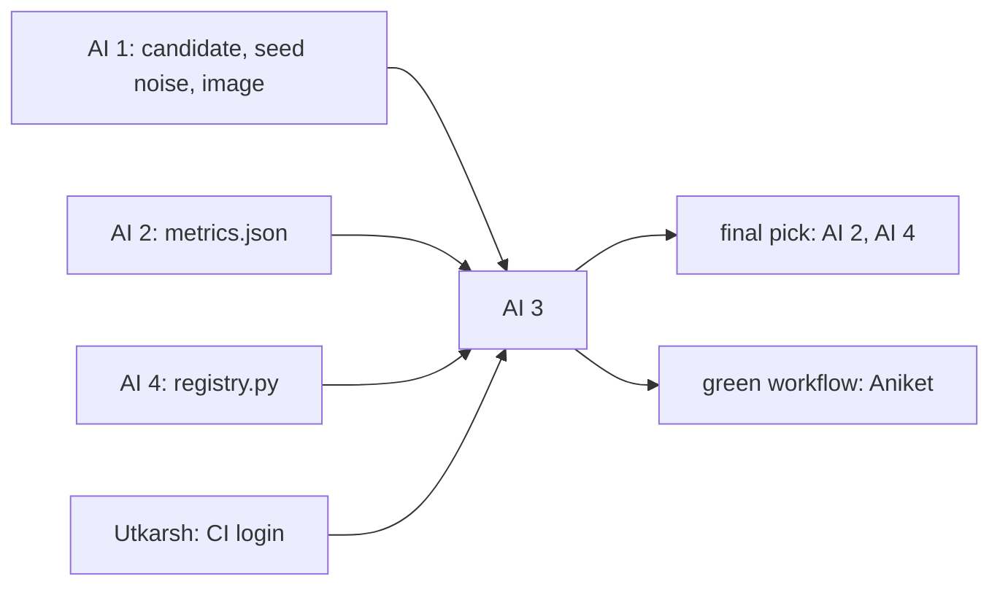

# AI engineer 3: bias, final pick, gates, CI workflow

> Check that the model doesn't serve some modules, teams or newcomers worse, fix it where it does, and make the final pick. Then build the CI workflow that trains, checks and gates every change, and tells Slack.

| | |
|---|---|
| Steps | F, `gate.py`, alerts, the `model.yml` workflow |
| Code | `model/bias.py`, `model/gate.py`, `.github/workflows/model.yml`, `tests/test_bias.py`, `tests/test_gate.py` |
| Terraform | none. Utkarsh gives you the CI login |
| Waits on | AI 1's candidate (Nov 6) and `seed_noise.json` (Nov 8), AI 2's `metrics.json` (Nov 7), AI 4's `registry.py` (Nov 9) |
| Hands to | AI 2 and AI 4: the final pick. Aniket: a green workflow on main (Nov 10) |



| Date | Due |
|---|---|
| Wed Nov 4 | Pass bars drafted with AI 1 and AI 2, including the bias bar |
| Sun Nov 8 | Bias on the first candidate |
| Mon Nov 9 | Final pick, `bias_report.json`, `gate.py` working locally |
| Tue Nov 10 | `model.yml` green on main, end to end. Code freeze |
| Thu Nov 12 | Your report section |

## Read first

- [BIAS.md](../../../Data-Pipeline/BIAS.md) and [meridian/bias.py](../../../Data-Pipeline/meridian/bias.py): the phase 1 method. Reuse its Wilson interval and flag rule
- [REPORT §3](../../../Data-Pipeline/report/REPORT.md#3-data-bias-detection-using-data-slicing): how phase 1 wrote up detection, mitigation and trade-offs
- [meridian/alert.py](../../../Data-Pipeline/meridian/alert.py) and [tests/alert_sinks.py](../../../Data-Pipeline/tests/alert_sinks.py): alerts, and local Slack and SMTP servers for tests
- [packets/README.md](../README.md): Contract 4

## What to build

`bias.py`: slices by `module`, `component`, `exp_bucket`, `size_bucket` with Fairlearn's `MetricFrame`. Per slice: recall, false-positive rate, PR-AUC with a bootstrap interval. Thresholds in `model.toml [bias]`. Writes `reports/bias_report.json`.

`gate.py`: reads `metrics.json`, `bias_report.json`, `seed_noise.json`. Checks them against `model.toml [gate]`. Exits 1 on any fail, with one Slack message through `meridian.alert.send(subject, lines, event="error")`. A broken Slack channel never fails the gate.

`model.yml`: on pushes and PRs touching `Model-Pipeline/**`.

```
auth (Utkarsh's CI login) → build and push image (AI 1) → train (AI 1) → evaluate (AI 2)
                          → bias → gate → registry (AI 4, main only) → Slack: done or failed
```

`MERIDIAN_SLACK_WEBHOOK` as a repo secret. The guideline also wants a message on training done and on registry push. `[alerts] on` lists `failure`, `error`, `warn`, so check whether `alert.py` takes an `info` event or needs a small change, and tell Aniket if it touches `Data-Pipeline/`.

## Decisions

Write the test and the rule that picks before you run it, in `decisions.md` in this folder. Tag each run `decision=ai3-<n>`.

| # | Decision | Options | Test that decides | Why it matters |
|---|---|---|---|---|
| 1 | Which slices | `module`, `component`, `exp_bucket`, `size_bucket`; merge rare components into `other` | Rows and positives per slice in `val` and `test`. A slice under 30 rows is merged or left unjudged, and the report says which | A slice under 30 gives an interval too wide to flag anything. Too many tiny slices mean many tests and false flags |
| 2 | Metric per slice | recall, false-positive rate, PR-AUC | Compute all three. Show where they disagree | The two harms differ. A missed risky commit reaches users; a false alarm costs a reviewer's time. A team can suffer one without the other |
| 3 | Flag rule | phase 1's (N ≥ 30, Wilson interval 0.10 below overall), a stricter one | Plant a synthetic slice with a known 0.15 gap and one with none. Does the rule flag the first and not the second? Count flags under Bonferroni too | Keeping phase 1's rule lets the report compare the model with the rules it replaces. Changing it needs a reason |
| 4 | Newcomers | | Recall for `exp_bucket = 0` from the model and from lines × files | Newcomers have no history, so the model has less to go on for them. If the old rule treats them better, that's a real cost of shipping the model |
| 5 | Mitigation | none, re-weighting the flagged slice (with AI 1), per-group thresholds (`ThresholdOptimizer`) | Each on the same `val` rows: overall PR-AUC, the slice's recall, the worst gap. Choose by a rule written down first, for example "closes half the gap for at most 0.01 PR-AUC" | Also check that the group is known at push time. `module` is. `component` comes from a ticket a commit may not have yet. A per-group threshold on a group CI can't see can't ship |
| 6 | Gate tolerance | below champion at all, below by more than 2 standard deviations of seed noise | Run the gate on AI 1's 5 same-config seeds: all must pass. Run it on planted bad models (shuffled labels, a size-only model, one with half the features): all must fail | Too strict and the gate blocks honest retrains on seed noise. Too loose and a worse model ships. The seed-noise number decides it, not taste |
| 7 | What CI trains | the full Optuna search, best params from `model.toml` only | Time both on a GitHub runner | Feedback on a PR should take minutes. Tuning belongs to AI 1's runs, and CI retrains the chosen config |
| 8 | When CI runs | every push, PRs only, PRs plus main | Count how many pushes touch `Model-Pipeline/**` in a normal day, times the run length | Every push eats free runner minutes and fills Slack. Main must always run, since it registers |

## Tests

- [ ] `test_bias.py`: the planted 0.15 gap is flagged; a slice with N = 29 isn't judged; the Wilson interval matches phase 1's `bias.py` on the same numbers
- [ ] `test_gate.py`: a passing set of files exits 0; each failure kind (PR-AUC below the bar, below champion, bias fail, a missing file) exits 1 and alerts once
- [ ] The alert reaches the local Slack and SMTP servers in `tests/alert_sinks.py`, with no mocks
- [ ] A broken webhook URL: the gate still decides, the error is logged, the run isn't marked failed for that reason alone
- [ ] On a PR the workflow stops at the gate and never registers. On main it registers
- [ ] A PR from a fork gets no GCP token and no Slack secret, and the workflow says so in the job summary
- [ ] A planted bad model on a branch: the workflow fails at the gate and Slack gets the message

## Done when

- [ ] `bias_report.json` for the final pick, and the pick announced with its reasons
- [ ] Decisions 1–8 written down with their numbers
- [ ] `model.yml` green on main end to end by Nov 10, and red on a planted bad model
- [ ] Slack got a fail message and a done message from real CI runs
- [ ] Your report section: slices, findings, mitigation and its trade-off, the gate, CI
