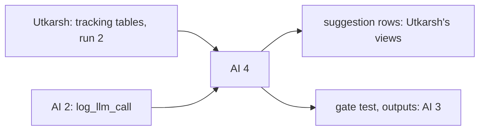

# AI engineer 4: Jev, the agents, the cache, the gate

> Build the LLM stage of the product: the gate that stops any made-up fact, the writer and diff-drafter agents, Jev who routes each task, and the cache that makes every rerun free. Facts come from the block; the LLM only writes.

| | |
|---|---|
| Steps | N (the gate, first), M (Jev, writer, diff drafter, cache). The policy writer only if time allows |
| Code | `Data-Pipeline/meridian/fact_gate.py`, `jev.py`, `agents.py`, `llm_cache.py`, `Data-Pipeline/llm_cache/`, `meridian.toml [llm]`, their tests |
| Waits on | nothing for the gate (the fixture is in the repo). Utkarsh's tracking tables (Nov 7) and run 2 (Nov 8). AI 2's `log_llm_call` (Nov 5) |
| Hands to | Utkarsh: `suggestion` rows for the views. AI 3: the gate test and agent outputs for CI and the LLM bias check |

| Date | Due |
|---|---|
| Thu Nov 5 | Gate started on the fixture. Pass bars drafted with the team |
| Sat Nov 7 | Gate passes 200 + 200 |
| Sun Nov 8 | Writer agent and cache |
| Mon Nov 9 | Jev |
| Tue Nov 10 | Diff drafter. Code freeze |
| Thu Nov 12 | Your report section |

## Read first

- [04-architecture §6–7](../../../docs/04-architecture.md): the LLM stage and the gate, the whole design
- [02-product](../../../docs/02-product.md): what each text looks like ("Before / After" for CHK-311, the consumer view)
- [06-dead-ideas](../../../docs/06-dead-ideas.md): no LLM deciding facts, no stripping bad numbers, no rewrites adding intent or priority, no LLM on every push
- [KNOWLEDGE-BASE.md](../../../Data-Pipeline/KNOWLEDGE-BASE.md): `manager_facts`, `maker_drafts`, `stall_*`, the fixture
- [packets/README.md](../README.md): Contract 5 is yours

## N. The gate (first)

`fact_gate.check(text, facts)`: every number, path, SHA, ticket ID, person and team in the text must be a fact value. Any miss and the whole text becomes the template. Never strip the bad part: it leaves broken sentences (06-dead-ideas).

- [ ] Extractors for each kind: numbers (with commas and `%`), `path:line`, SHAs, ticket keys, team names from `team_map`
- [ ] A template per task kind, filled only from facts
- [ ] The fallback rate per run, published in the run's output

## M. Agents, Jev, cache

| Agent | Writes | Models (small → mid → large) | Retry on |
|---|---|---|---|
| Writer | ticket rewrites (`manager_facts`), maker drafts (`maker_drafts`), stall-reason text, consumer-view prose | general: `claude-haiku-5-5` → `claude-sonnet-5-5` → `claude-opus-5-5` | bad JSON, a gate miss |
| Diff drafter | one-line swaps for removed or removable call sites | codemod first; LLM only with 2+ same-shape examples and not inside `except` | the diff doesn't apply, parse, touch only its site, or resolve |
| Policy writer (if time allows) | candidate auditor policies for AI 2 | coding: mid → large | policy tests fail |

- [ ] Facts per task from the block (Contract 5). No person's name is ever a fact
- [ ] Jev, the router: a general model that reads the task and picks the agent and model from this table only. On a failed check, the next model up, or stop. Jev down: rules pick (by task kind). Top model fails: the template, or no diff
- [ ] Models, prompt versions and a top-model spend cap pinned in `meridian.toml [llm]`
- [ ] Cache: key sha256(model, prompt version, sorted facts JSON), one JSON file per entry in `Data-Pipeline/llm_cache/`, committed. A rerun makes 0 calls
- [ ] Every call through AI 2's `log_llm_call`: agent, model, tokens, cost, cache hit, gate pass
- [ ] Every offer written as a `suggestion` row
- [ ] The push check stays templates only. No LLM there

## Decisions

Write the test and the rule that picks before you run it, in `decisions.md`. Tag each run `decision=ai4-<n>`.

| # | Decision | Options | Test that decides | Why it matters |
|---|---|---|---|---|
| 1 | What the gate counts as a fact token | numbers only, plus paths and IDs, plus team names | The 200 injected errors (a wrong number, a made-up path, a swapped team, a fake ticket key, a real fact from another task) and 200 clean texts. Catch rate and false rejects for each | 05-test: 100% caught, at most 5% false rejects. Checking too little lets made-up facts through; checking too much rejects good text over "2" in "two calls" |
| 2 | Number matching | exact, with formatting (1,526 = 1526), with rounding (71% from 0.712) | Count false rejects on clean texts for each | The writer will say "71%" when the fact is 0.712. Too strict and good text falls back; too loose and a wrong number passes |
| 3 | Writer model ladder start | small, mid | On the fixture's tasks: gate pass rate and cost for each start | Starting small is cheap if it passes the gate. Measure it rather than guess |
| 4 | Jev against rules | Jev picks, rules pick by task kind | Same tasks both ways: pass rate and cost (05-test: Jev must beat rules on cost at an equal pass rate) | If rules do as well for less, Jev isn't worth its call, and the report says so |
| 5 | Jev's determinism | | The same problem twice: same pick. Jev forced down: rules pick, the run completes | Determinism is a product rule (04 §1). A router that picks differently on a rerun breaks byte-identical runs |
| 6 | Codemod or LLM for diffs | codemod only, codemod then LLM | Django, drafted from the parent of `c651331b34`: share of drafts matching the real after-line, whitespace ignored (05-test: ≥ 90%). Then the packages | `ugettext` → `gettext` is a rename a codemod gets right. If the codemod alone clears 90%, the LLM path is cut first (PLAN §9) |
| 7 | Prompt format | facts as JSON, facts as a bullet list | Gate pass rate and JSON validity on 50 fixture tasks each way | The format changes how often the model invents. Measure, don't assume |
| 8 | Template quality | | Read 20 template outputs next to 20 gated LLM outputs from the fixture. Write what the LLM adds | If the template says the same thing, the LLM costs money for nothing. That's a real result for the report |
| 9 | Cache scope | per run, committed across runs | Rerun the fixture twice: calls made, and diffs between outputs | A committed cache makes CI free and runs byte-identical. It must never serve text for different facts: the key covers that |

## Tests

- [ ] `test_fact_gate.py`: the 200 injected errors, 100% caught; 200 clean, at most 5% rejected; a miss gives the template, never a stripped text
- [ ] `test_agents.py`: with the LLM off (no key), every task returns a template and the run completes; with the cache warm, 0 calls; an agent's bad JSON retries one model up, then falls back
- [ ] `test_jev.py`: same problem twice, same pick; Jev down, rules pick; a pick outside the table is refused
- [ ] `test_diffs.py`: Django drafts match the real after-lines ≥ 90%; a draft that touches another line is refused; a site inside `except` gets no LLM diff
- [ ] No fact or prompt ever contains an email or a person's name (scan every cache entry)
- [ ] The maker property: each untracked site in exactly one draft (05-test)

## Done when

- [ ] The gate passes 200 + 200 and runs on every LLM output
- [ ] The writer and the diff drafter write `suggestion` rows on the fixture and the real block, with the cache committed
- [ ] Jev routes, falls back to rules, and the cost comparison is measured
- [ ] Every call is in MLflow `meridian-agents`
- [ ] Decisions 1–9 written down with their numbers
- [ ] Your report section: the gate, the agents, Jev, the cache, validation and tracking of the pretrained models
