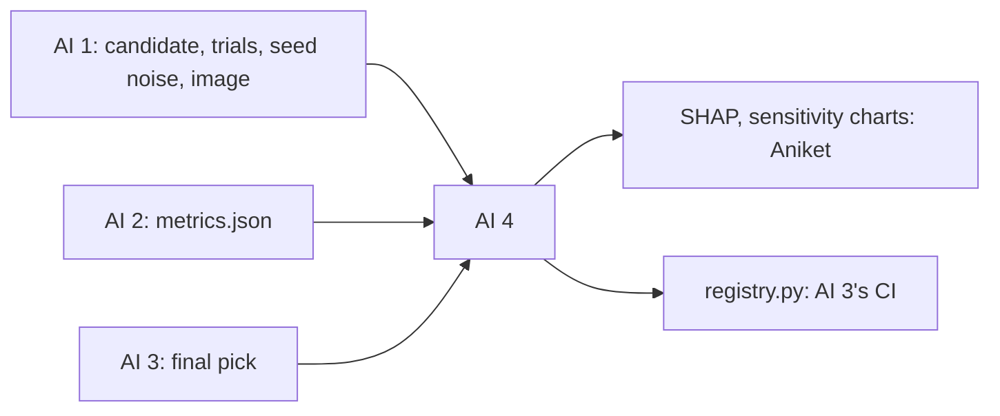

# AI engineer 4: sensitivity, registry, rollback

> Explain what the model learned and which settings matter. Then own where models live: the registry, the champion, the rollback, and the copy on GCP.

| | |
|---|---|
| Steps | E (sensitivity), G (registry and rollback), I (duplicate-ticket model, only if time allows) |
| Code | `model/sensitivity.py`, `model/registry.py`, `tests/test_registry.py` |
| Terraform | none |
| Waits on | AI 1's candidate (Nov 6), trials and seed noise (Nov 8), AI 2's `metrics.json` (Nov 7), AI 3's final pick (Nov 9) |
| Hands to | AI 3: `registry.py` for the workflow (Nov 9). Aniket: charts and the rollback drill |

| Date | Due |
|---|---|
| Sun Nov 8 | SHAP on the first candidate. `registry.py` against a local MLflow |
| Mon Nov 9 | `registry.py` handed to AI 3 |
| Tue Nov 10 | Sensitivity charts final. Vertex upload tried once. Code freeze |
| Thu Nov 12 | Champion registered after the 2024 run. Your report section |

## Read first

- [PLAN.md §4](../../PLAN.md#4-what-we-do-now), steps E and G
- [packets/README.md](../README.md): Contracts 3 and 4
- MLflow's model registry docs on aliases, and Vertex AI's `Model.upload`

## What to build

`sensitivity.py`: SHAP on the candidate on `val` (beeswarm, dependence plots for the top 5, SHAP per slice AI 3 flags). Hyperparameter sensitivity from AI 1's Optuna study (parameter importance, slice plots) and a one-at-a-time sweep of the top 2 parameters.

`registry.py`, `python -m model.registry --run <id>`, called by CI after the gate:

- Registers the model as a new version of `defect-risk`
- Moves `champion` to it only if it wins by the rule (decision 5) and `bias_report.json` passes. Otherwise it stays registered with the reason as a tag
- Keeps `previous` on the old champion. `--rollback` moves `champion` back
- Uploads each new champion to Vertex AI Model Registry, artifacts from GCS. Never creates an endpoint (about $70+ a month)

Stretch, only if everything else is done by Nov 10: the duplicate-ticket model. 2,094 linked Spark duplicates, a pretrained sentence embedder against title similarity, split by time, its own experiment `meridian-duplicates`. If it's not done by Nov 10, it's cut and the report says so.

## Decisions

Write the test and the rule that picks before you run it, in `decisions.md` in this folder. Tag each run `decision=ai4-<n>`.

| # | Decision | Options | Test that decides | Why it matters |
|---|---|---|---|---|
| 1 | SHAP sample size | all of `val`, 5,000 rows, 2,000 rows | Rank correlation of the top 10 features between the sample and all of `val`. Pick the smallest with Spearman ≥ 0.9 | SHAP on everything is slow. A sample is fine only if it tells the same story |
| 2 | Is the model mostly size? | | SHAP share of `la`, `ld`, `nf`, `nd`, `ns`, `entropy` together, set against AI 1's decision 2 ablation | If size carries most of the weight, the model is close to lines × files under another name. The report must say which it is |
| 3 | Correlated features | SHAP alone, SHAP plus grouped permutation importance | Permutation importance with `la`/`ld` and `nf`/`nd`/`ns` permuted as groups. Do the rankings agree with SHAP? | SHAP splits credit between correlated features, so each can look minor while the group matters. Grouped permutation shows the group |
| 4 | Sweep range | ±25%, ±50%, the full search range | PR-AUC across the sweep for the top 2 parameters. Flat inside ±50% means the result doesn't hang on tuning | A model that only works at one exact setting breaks on the next retrain. A flat curve is what lets CI retrain safely |
| 5 | Promotion rule | any gain, a gain above 2 standard deviations of seed noise | Feed the registry AI 1's 5 same-config seeds one after another. With "any gain" count how often `champion` flips; with the noise rule it should flip 0 times | A champion that flips on noise makes rollback meaningless and the registry history unreadable |
| 6 | What to compare on | the champion's stored metrics, re-scoring the champion on today's `val` | Rebuild the table with one decision changed (say, Utkarsh's start year), then compare both ways | If the table changes, stored metrics describe different rows. Compare on the same rows or the comparison is wrong |
| 7 | Serving container for the Vertex upload | a prebuilt Vertex container, AI 1's image | Upload once each way. LightGBM has no prebuilt container | The upload needs a container even if we never serve. Our own image is the one we know runs the model |

## Tests

`tests/test_registry.py`, against a local MLflow in a temp folder:

- [ ] A better model takes `champion`, and `previous` points at the old one
- [ ] A worse model is registered, not promoted, and tagged with the reason
- [ ] A model better only within seed noise isn't promoted
- [ ] A failed bias report blocks promotion even with a better PR-AUC
- [ ] `--rollback` puts `champion` back, and a second rollback with no `previous` fails with a clear message
- [ ] The first model ever, with no champion, is promoted if it passes the gate

On the real registry, once before Nov 11:

- [ ] Rollback drill: promote a planted worse model by hand, roll back, check `champion` in MLflow and Vertex
- [ ] No Vertex endpoint exists afterwards (check the console and the billing page)

## Done when

- [ ] SHAP and sensitivity charts in `reports/` and MLflow, with the size question answered
- [ ] Decisions 1–7 written down with their numbers
- [ ] `registry.py` runs in AI 3's workflow, and the rollback drill is done
- [ ] The champion is visible in Vertex AI Model Registry
- [ ] Your report section: sensitivity, registry, promotion rule, rollback
