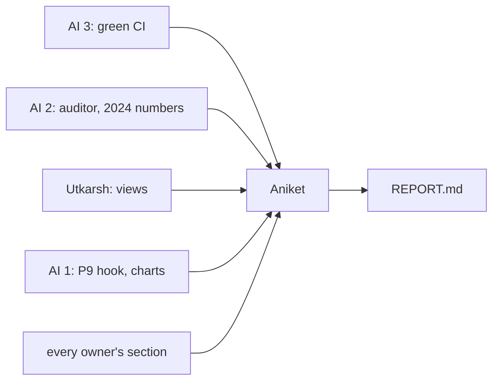

# Aniket: lead, integration and final runs

> You sit at the end of the graph. Until code freeze you only review and merge. From Nov 10 you put the model and the product together, break them on purpose, run the final runs, make the go or no-go call, and write the report with Utkarsh.

| | |
|---|---|
| Owns | adding the team to the GCP project (once), reviews and merges, integration, simulated faults, final runs, go or no-go, the report |
| Code | `Model-Pipeline/tests/faults/`, the fault scripts. `Model-Pipeline/golden/` |
| Waits on | everyone's pieces by code freeze, Tue Nov 10 |
| Hands to | the course: `Model-Pipeline/report/REPORT.md` on Nov 15 |

| Date | Due |
|---|---|
| Wed Nov 4 | Add the team to the GCP project |
| Fri Nov 6 | Review the pass bars before AI 3 merges them |
| Nov 5–10 | Reviews and merges only |
| Mon Nov 9 | Join AI 3's cut-order check-in |
| Tue Nov 10 | Code freeze at the end of the day |
| Wed Nov 11 | Integration and simulated faults. Go or no-go for 2024 |
| Thu Nov 12 | Final runs. Every section in |
| Nov 13–15 | Report, with Utkarsh |

## 1. The one early action (Nov 4)

- [ ] Add AI 2 to the $300 trial project with Artifact Registry Admin, so AI 2 can make the model repo and its service account. The credits are on your account, so only you can do this
- [ ] Note the trial's end date. Phase 3 moves the repo into Terraform

## 2. Until freeze (Nov 5–10)

- [ ] Review the pass bars. AI 3 merges them by Nov 6, before anyone trains
- [ ] Review PRs for the contracts in [packets/README.md](../README.md): tags on runs, no names in the table or the facts, nothing hard-coded outside the two config files
- [ ] On Nov 9, at AI 3's check-in, agree the cut order in [§9](../../PLAN.md#9-open-risks) if anything on the critical paths in [§6](../../PLAN.md#6-dependency-graph) has slipped. Cut from the end, don't move the freeze

## 3. Integration (Nov 10–11)

From a clean clone, nothing cached except the committed LLM cache:

- [ ] `python -m model.run_all` on your machine, then in AI 1's Docker image
- [ ] The same through `model.yml` on a branch, then on main, ending in a real push
- [ ] All three give the same `metrics.json` (the same numbers to 4 decimals). If not, it's a reproducibility bug and goes back to its owner the same day
- [ ] The product on the fixture, the real block and run 2: views, agents, gate, auditor, P9. Every page loads, 0 LLM calls with the warm cache
- [ ] Walk [PLAN.md §12](../../PLAN.md#12-guideline-coverage) row by row: each item has its evidence file

## 4. Simulated faults (Nov 11)

Phase 1 broke things on purpose (27 faults, 42 scenarios), and the report was stronger for it. Each fault has its expected result written down before you run it.

| # | Fault | Expected | Why |
|---|---|---|---|
| 1 | Shuffled labels | PR-AUC near the positive rate; gate fails; Slack alert | Proves the gate catches a model that learned nothing |
| 2 | A size-only model | Gate fails, or passes only if it really beats lines × files | The bar can't be beaten by a renamed baseline |
| 3 | A feature column missing | `train.py` fails with a clear message | A silent NaN model is worse than a crash |
| 4 | A column's type changed | `data.py` or `train.py` refuses it | Schema drift is the most common real break |
| 5 | Feature table from the wrong `run_id` | Refused, or tagged so it can't be mistaken | Every number traces to one block |
| 6 | The same config twice | Same predictions, same metrics | Reproducibility, like phase 1's golden hashes |
| 7 | A model worse than the champion | Registered, not promoted, not pushed | Rollback starts with not promoting |
| 8 | Better only within seed noise | Not promoted | The champion mustn't flip on noise |
| 9 | Bias fails, PR-AUC better | Gate fails | Bias is part of the pick |
| 10 | Rollback | `champion` back to `previous`, locally and in Artifact Registry | The guideline asks for it |
| 11 | No GCP credentials | Everything runs; the push is skipped and says so | Local work never needs GCP |
| 12 | Slack webhook broken | Gate still decides; the error is logged | An alert channel must never break the run it reports on |
| 13 | A PR from a fork | No secrets; stops before the push | Security of the one key |
| 14 | `--split test` before the go | Refused | The one look at 2024 stays one |
| 15 | LLM off (no key, empty cache) | Every view renders with templates | A product rule |
| 16 | An LLM text with a made-up number | The gate replaces it with the template; the fallback rate counts it | The gate's whole job |
| 17 | Jev down | Rules pick; the run completes | 04-architecture's fallback |
| 18 | A cache entry deleted | That one task calls the LLM again; everything else is a hit | The cache key is right and nothing else depends on it |
| 19 | A fact containing an email | Refused before any prompt is built | No people in facts |
| 20 | Auditor replay with a future row | The row is ignored | No `known_at` leak |
| 21 | A broken champion file in the push check | P9 falls back to lines × files and says so | A push check must never break on our model |

- [ ] Each fault in `Model-Pipeline/tests/faults/` as a script, its result in a table for the report
- [ ] Anything that doesn't behave goes to its owner the same day, with the script to reproduce it

## 5. Go or no-go (Nov 11)

- [ ] All faults behave, CI is green on main, the pass bars are unchanged since Nov 6
- [ ] Then flip `model.toml [split] test_allowed` to `true` and tell AI 2 to run 2024. If not, fix first

## 6. Final runs (Nov 12)

- [ ] AI 2 runs 2024 once, with you watching. Note the time and the git SHA
- [ ] The model ships if it meets the pass bars on 2024. If not, lines × files stays, and that's the result we report
- [ ] The champion pushed to Artifact Registry. Check the version there
- [ ] The final product run on the real block, run 2 and the fixture
- [ ] Every chart regenerated from the final runs
- [ ] md5 of `features.parquet`, `metrics.json`, `bias_report.json`, `llm_bias.json` and `champion.json` in `Model-Pipeline/golden/`, like phase 1's golden file
- [ ] Billing page checked: only the registry repo exists

## 7. The report (Nov 13–15, with Utkarsh)

- [ ] `Model-Pipeline/report/REPORT.md`, in the order of [PLAN.md §12](../../PLAN.md#12-guideline-coverage), in the style of the phase 1 report
- [ ] Each owner's section edited for one voice. Every number has its N and a source (a run, a decision tag, a file)
- [ ] The decision tables from each `decisions.md`: what was tested, what was picked, why
- [ ] The fault table from section 4
- [ ] What was cut, and why. What phase 3 deploys

## Done when

- [ ] Every row of PLAN.md §12 has its evidence
- [ ] A push to main trains, evaluates, checks bias, gates and pushes with no hands on it
- [ ] The product runs end to end on the fixture and the real block
- [ ] The report is merged by Nov 15
