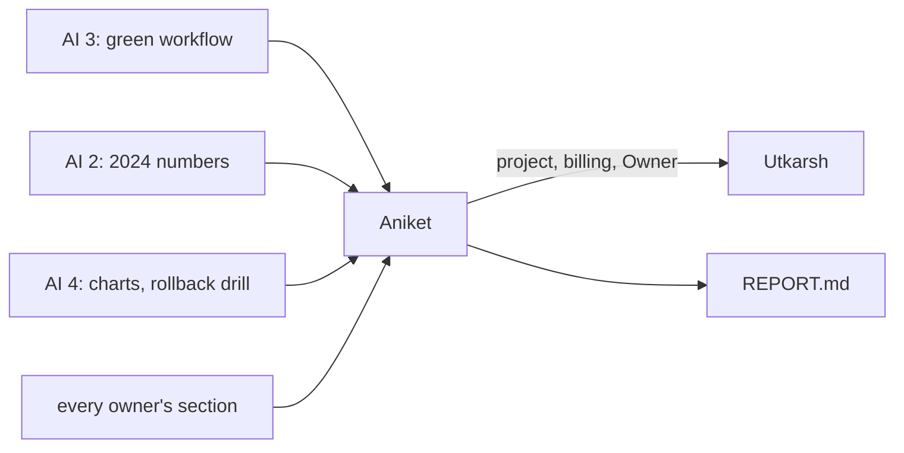

# Aniket: lead, integration and final runs

> Get the project open on day 1, then stay out of the way until code freeze. From Nov 10 you put the pieces together, break them on purpose, run the final runs, make the go or no-go call, and write the report.

| | |
|---|---|
| Owns | the GCP project and billing (once), reviews and merges, integration, simulated faults, final runs, the go or no-go call, the report |
| Code | `tests/faults/`, the fault scripts |
| Terraform | none. Utkarsh applies everything |
| Waits on | everyone's pieces by code freeze, Tue Nov 10 |
| Hands to | the course: `Model-Pipeline/report/REPORT.md` on Nov 15 |

| Date | Due |
|---|---|
| Tue Nov 3 | Project made, billing linked, Utkarsh Owner and Billing Account Costs Manager |
| Thu Nov 5 | Pass bars merged |
| Nov 5–9 | Reviews and merges. A short check-in each day against PLAN.md §10 |
| Tue Nov 10 | Code freeze at the end of the day |
| Wed Nov 11 | Integration and simulated faults. Go or no-go for 2024 |
| Thu Nov 12 | Final runs. Every section in |
| Fri Nov 13 – Sun Nov 15 | Report |

## 1. Day 1 (Nov 3)

- [ ] Project `meridian-mlops` on the $300 trial billing account. Write down the trial's end date; move the project to the $50 education account before then
- [ ] Utkarsh as Owner on the project, and Billing Account Costs Manager on the billing account (for the budget). Nothing more on billing for anyone

## 2. Until freeze (Nov 4–10)

- [ ] Merge the pass bars by Nov 5. They go in before anyone trains, and changing one after needs a commit saying why
- [ ] Review PRs for the contracts in [packets/README.md](../README.md): tags on runs, no names in the table, nothing hard-coded outside `model.toml`
- [ ] Each day, check the critical path in [PLAN.md §6](../../PLAN.md#6-dependency-graph). If something on it slips, cut from the end (the duplicate model first), don't push the freeze

## 3. Integration (Nov 10–11)

From a clean clone, nothing cached:

- [ ] `dvc pull`, then `python -m model.data`, train, evaluate, bias, gate, registry, in order, on your machine
- [ ] The same in AI 1's Docker image
- [ ] The same through `model.yml` on a branch, then on main
- [ ] All three give the same `metrics.json` (byte for byte, or the same numbers to 4 decimals if JSON ordering differs). If not, it's a reproducibility bug and goes back to its owner the same day

## 4. Simulated faults (Nov 11)

Phase 1 broke things on purpose (27 faults, 42 scenarios) and the report was stronger for it. Do the same here. Each fault has an expected result written down before you run it.

| # | Fault | Expected | Why |
|---|---|---|---|
| 1 | Shuffled labels | Trains; PR-AUC near the positive rate; gate fails; Slack alert | Proves the gate catches a model that learned nothing |
| 2 | A size-only model | Gate fails, or passes only if it really beats lines × files | Proves the bar isn't beaten by a renamed baseline |
| 3 | A feature column missing | `train.py` fails with a clear message | A silent NaN model is worse than a crash |
| 4 | A column's type changed (int to string) | `data.py` or `train.py` refuses it | Schema drift is the most common real break |
| 5 | Feature table from the wrong `run_id` | Refused, or the run is tagged with that `run_id` so it can't be mistaken | The report's numbers must trace to one block |
| 6 | The same config twice | Same predictions, same metrics | Reproducibility, as phase 1's golden hashes did |
| 7 | A model worse than the champion | Registered, not promoted | Rollback starts with not promoting |
| 8 | A model better only within seed noise | Not promoted | The champion mustn't flip on noise |
| 9 | Bias fails, PR-AUC better | Gate fails, not promoted | Bias is part of the pick, not a footnote |
| 10 | Rollback | `champion` back to `previous`, in MLflow and Vertex | The guideline asks for it, and it's never been run under pressure |
| 11 | MLflow server down | Training fails clearly or logs locally, as AI 2 designed; no half-registered model | A dead tracking server must not leave a half state |
| 12 | GCS permission denied | `dvc pull` fails with a clear message; nothing trains on stale data | Stale data looks like real data |
| 13 | Slack webhook broken | Gate still decides; the error is logged | An alert channel must never break the run it reports on |
| 14 | A PR from a fork | No GCP token, no secrets, stops before registry | Security of the CI login |
| 15 | `--split test` before the go | Refused | The one look at 2024 stays one |

- [ ] Each fault in `tests/faults/` as a script, its result in a table for the report
- [ ] Anything that doesn't behave as expected goes to its owner the same day, with the script to reproduce it

## 5. Go or no-go (Nov 11)

- [ ] All faults behave, the workflow is green on main, the pass bars are unchanged since Nov 5
- [ ] Then tell AI 2 to run 2024. If not, fix first. The 2024 run waits; it doesn't happen early

## 6. Final runs (Nov 12)

- [ ] AI 2 runs 2024 once, with you watching. Note the time and the git SHA
- [ ] The model ships if it meets the pass bars on 2024. If not, lines × files stays, and that's the result we report
- [ ] AI 4 registers the champion. Check it in MLflow and Vertex
- [ ] Every chart regenerated from the final runs, not earlier ones
- [ ] Record the md5 of `features.parquet`, `metrics.json` and `bias_report.json` in `Model-Pipeline/golden/`, like phase 1's golden file
- [ ] Billing page checked. No endpoint, no VM left running besides MLflow

## 7. The report (Nov 13–15)

- [ ] `Model-Pipeline/report/REPORT.md`, in the guideline's order, in the style of the phase 1 report
- [ ] Each owner's section edited for one voice. Every number has its N and a source (MLflow run, decision tag, file)
- [ ] The decision tables from each `decisions.md`: what was tested, what was picked, why
- [ ] The fault table from section 4
- [ ] What was cut, and why

## Done when

- [ ] Everything in the fault table behaved, or the report says what didn't
- [ ] A push to main trains, evaluates, checks bias, gates and registers with no hands on it
- [ ] The report is merged by Nov 15
