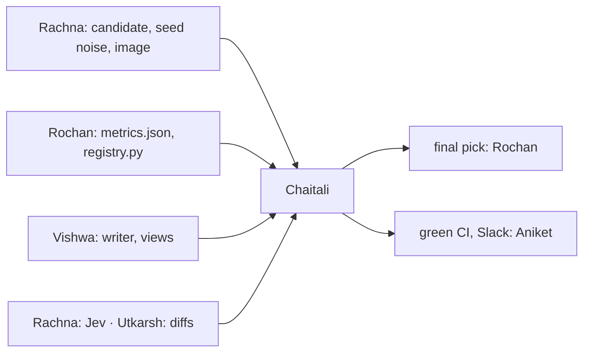

# Chaitali: bias, final pick, gates, all CI

> Check that the model and the agents don't serve some modules, teams or newcomers worse, fix it where they do, and make the final pick. Then build the CI that trains, checks and gates every change to the model and the product, and tells Slack.

| | |
|---|---|
| Steps | the pass-bars file, F (bias, final pick), `gate.py`, alerts, `model.yml`, the product CI jobs, the LLM bias check. About 5 days |
| Code | `Model-Pipeline/PASS-BARS.md`, `model/bias.py`, `model/gate.py`, `.github/workflows/model.yml`, product jobs in `.github/workflows/ci.yml`, their tests |
| Waits on | Rachna's candidate (Nov 6) and `seed_noise.json` (Nov 8), Rochan's `metrics.json` (Nov 6) and `registry.py` (Nov 9), Vishwa's writer and views, Rachna's Jev, Utkarsh's diffs (Nov 8–10) |
| Hands to | Rochan: the final pick. Aniket: green CI on main (Nov 10) |



| Date | Due |
|---|---|
| Thu Nov 5 | `PASS-BARS.md` drafted: PLAN §4's table plus everyone's rows |
| Fri Nov 6 | Pass bars signed off by everyone, reviewed by Aniket, merged |
| Sat Nov 7 | Bias code on the first candidate |
| Sun Nov 8 | Bias on the tuned candidate |
| Mon Nov 9 | Final pick, `bias_report.json`, bias charts, `gate.py` working locally. Run the cut-order check-in (PLAN §9) |
| Tue Nov 10 | `model.yml` green on main end to end. Product CI jobs. LLM bias check. Code freeze |
| Thu Nov 12 | Your report section |

## Read first

- [BIAS.md](../../../Data-Pipeline/BIAS.md) and [meridian/bias.py](../../../Data-Pipeline/meridian/bias.py): the phase 1 method. Reuse its Wilson interval and flag rule
- [REPORT §3](../../../Data-Pipeline/report/REPORT.md#3-data-bias-detection-using-data-slicing): how phase 1 wrote up detection, mitigation and trade-offs
- [meridian/alert.py](../../../Data-Pipeline/meridian/alert.py) and [tests/alert_sinks.py](../../../Data-Pipeline/tests/alert_sinks.py): alerts, and local Slack and SMTP servers for tests
- [.github/workflows/ci.yml](../../../.github/workflows/ci.yml): the existing CI, to extend
- [packets/README.md](../README.md): Contract 4

## The pass bars

`Model-Pipeline/PASS-BARS.md`, like phase 1's `notes/PASS-BARS-2026-10-26.md`. Start from PLAN §4's table. Each owner adds their own rows (a number and how it's measured), everyone signs off, Aniket reviews, you merge by Nov 6. After that, changing a bar needs a commit saying why.

## F. Bias and the final pick

`bias.py`: slices by `module`, `component`, `exp_bucket`, `size_bucket` with Fairlearn's `MetricFrame`. Per slice: recall, false-positive rate, PR-AUC with a bootstrap interval. Thresholds in `model.toml [bias]`. Writes `reports/bias_report.json` and bias charts (per-slice bars with intervals, the overall line, the flag line, as phase 1's [appendix B §5](../../../Data-Pipeline/report/appendix-quality.md#5-bias-data-slicing)).

The final pick is the best `val` model that passes bias. If the best fails and fixing it costs too much PR-AUC, say which you picked and why.

## LLM bias check

The guideline says pretrained models still need bias detection. The agents' outputs get sliced the same way:

- [ ] Gate fallback rate per repo and per owner team (a team whose text always falls back to the template gets a worse product)
- [ ] Diff match rate per repo, from Utkarsh's Django and package checks
- [ ] Same flag rule, N ≥ 30. Results in `reports/llm_bias.json` and the charts

## The gate and alerts

`gate.py` reads `metrics.json`, `bias_report.json`, `seed_noise.json`, `registry/champion.json`, checks them against `model.toml [gate]`, and exits 1 on a fail with one Slack message through `meridian.alert.send(subject, lines, event="error")`. A broken Slack channel never fails the gate.

The guideline also wants a message on training done and on registry push. `[alerts] on` lists `failure`, `error`, `warn`, so check whether `alert.py` takes an `info` event or needs a small change, and tell Aniket if it touches `Data-Pipeline/`.

## CI

`model.yml`, on pushes and PRs touching `Model-Pipeline/**`:

```
build image (Rachna) → run_all in it: data → train → evaluate → bias → gate
                   → registry and GCP push (Rochan, main only) → Slack: done or failed
```

Product jobs in `ci.yml`, on every PR:

- [ ] LLM off: every view renders (Utkarsh's test with an empty `suggestion` table)
- [ ] Warm cache: the product run on the fixture makes 0 LLM calls, with no API key in the job
- [ ] The fact gate's 200 + 200 test (Vishwa), Jev's tests (Rachna), the 90% diff test (Utkarsh)
- [ ] The auditor's simulation tests (Rochan)

Secrets: `MERIDIAN_SLACK_WEBHOOK`, and the Artifact Registry key for main only. No LLM key in CI: the committed cache covers it.

## Decisions

Write the test and the rule that picks before you run it, in `decisions.md`. Tag each run `decision=chaitali-<n>`.

| # | Decision | Options | Test that decides | Why it matters |
|---|---|---|---|---|
| 1 | Which slices | `module`, `component`, `exp_bucket`, `size_bucket`; merge rare components into `other` | Rows and positives per slice in `val` and `test`. Under 30 rows: merged or unjudged, and the report says which | A slice under 30 gives an interval too wide to flag anything. Many tiny slices mean many tests and false flags |
| 2 | Metric per slice | recall, false-positive rate, PR-AUC | All three. Show where they disagree | The two harms differ. A missed risky commit reaches users; a false alarm costs a reviewer's time |
| 3 | Flag rule | phase 1's (N ≥ 30, Wilson interval 0.10 below overall), a stricter one | Plant a synthetic slice with a known 0.15 gap and one with none. Flags the first and not the second? Count flags under Bonferroni too | Keeping phase 1's rule lets the report compare the model with the rules it replaces |
| 4 | Newcomers | | Recall for `exp_bucket = 0` from the model and from lines × files | Newcomers have no history, so the model has less to go on. If the old rule treats them better, that's a real cost of shipping |
| 5 | Mitigation | none, re-weighting, re-sampling the flagged slice (both with Rachna), per-group thresholds (`ThresholdOptimizer`) | Each on the same `val` rows: overall PR-AUC, the slice's recall, the worst gap. Pick by a rule written first, for example "closes half the gap for at most 0.01 PR-AUC" | Also check the group is known at push time. `module` is; `component` comes from a ticket a commit may not have yet. A threshold on a group CI can't see can't ship |
| 6 | Gate tolerance | below champion at all, below by more than 2 standard deviations of seed noise | The gate on Rachna's 5 same-config seeds: all pass. On planted bad models (shuffled labels, size-only, half the features): all fail | Too strict blocks honest retrains on noise. Too loose ships a worse model. Seed noise decides it |
| 7 | What CI trains | the full Optuna search, best params from `model.toml` | Time both on a GitHub runner | PR feedback should take minutes. Tuning belongs to Rachna's runs |
| 8 | When CI runs | every push, PRs only, PRs plus main | Pushes touching `Model-Pipeline/**` in a normal day, times the run length | Every push eats runner minutes and fills Slack. Main must always run, since it registers |
| 9 | LLM slices | repo, owner team, task kind | Rows per slice in the fixture and the real block | A slice the agents rarely see can't be judged. Say which are unjudged |

## Tests

- [ ] `test_bias.py`: the planted 0.15 gap is flagged; a slice with N = 29 isn't judged; the Wilson interval matches phase 1's `bias.py` on the same numbers
- [ ] `test_gate.py`: a passing set exits 0; each failure (below the bar, below champion, bias fail, a missing file) exits 1 and alerts once
- [ ] The alert reaches the local Slack and SMTP servers in `tests/alert_sinks.py`, with no mocks
- [ ] A broken webhook: the gate still decides, the error is logged
- [ ] On a PR the workflow stops at the gate and never pushes. On main it pushes
- [ ] A PR from a fork gets no secrets, and the job summary says so
- [ ] A planted bad model on a branch fails at the gate and Slack gets the message
- [ ] The product jobs fail when they should: a view that breaks with the LLM off, a cache miss in CI

## Done when

- [ ] `bias_report.json` and bias charts for the final pick, announced with its reasons
- [ ] `llm_bias.json` for the agents
- [ ] `model.yml` green on main and red on a planted bad model, by Nov 10
- [ ] The product jobs run on every PR
- [ ] Slack got a fail, a done and a push message from real CI runs
- [ ] Decisions 1–9 written down with their numbers
- [ ] Your report section: slices, findings, mitigation and its trade-off, LLM bias, the gate, CI
