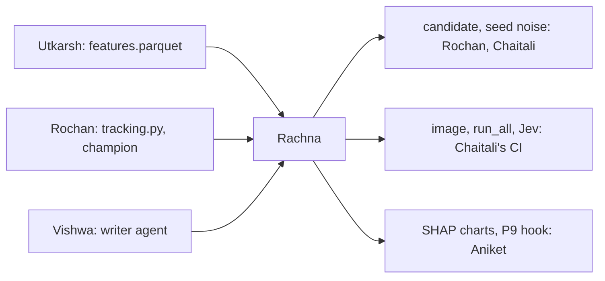

# Rachna: models, sensitivity, Docker, Jev, P9

> Train the baselines and the models, tune them, pick the best candidate on 2023, measure seed noise, explain what the model learned, package everything in one Docker command, build Jev (the router that picks which agent and model handle each LLM task), and put the champion into the push check. You never look at 2024.

| | |
|---|---|
| Steps | C (models), E (sensitivity), the Docker image and `run_all`, Jev, Q (P9 hook). About 5.5 days |
| Code | `model/train.py`, `model/sensitivity.py`, `model/run_all.py`, `Dockerfile`, `requirements.txt`, `Data-Pipeline/meridian/jev.py`, the P9 part of `Data-Pipeline/meridian/pushcheck.py`, their tests |
| Waits on | Utkarsh's v1 table (Nov 5), Rochan's `tracking.py` (Nov 5), Vishwa's writer agent (Nov 8) for Jev, Rochan's champion (Nov 9) for Q |
| Hands to | Rochan, Chaitali: the candidate, `seed_noise.json`. Chaitali's CI: the image, Jev. Aniket: charts, P9 |

| Date | Due |
|---|---|
| Thu Nov 5 | Your pass-bar rows to Chaitali |
| Fri Nov 6 | Baselines and a first untuned candidate on `val`, from the v1 table |
| Sun Nov 8 | Tuned candidate on the c5118 table, `seed_noise.json`, the image |
| Mon Nov 9 | SHAP and sensitivity. Jev started |
| Tue Nov 10 | Jev and the P9 hook. Code freeze |
| Thu Nov 12 | Your report section |

## Read first

- [PLAN.md §4.1](../../PLAN.md#41-the-model-the-course-guideline): the label problem and the split
- [04-architecture §6 and §10](../../../docs/04-architecture.md): Jev, and P9
- [appendix C §7](../../../Data-Pipeline/report/appendix-real-data.md): today's P9 rule flags lines × files above 2,000, catching 32% of bug-inducing Spark commits and 9% of the rest
- [meridian/pushcheck.py](../../../Data-Pipeline/meridian/pushcheck.py): where `p9_defect_risk` fires
- [packets/README.md](../README.md): Contracts 1–5

## C. Models and tuning

Baselines are scores, no training: lines × files `(la + ld) * nf`, churn `la + ld`, bug fixes `prior_bug_fixes`.

Models: logistic regression (`log1p` on counts, scaled), random forest, LightGBM. Features: the numeric columns plus `ticket_type` one-hot. The slice columns stay out unless Chaitali agrees.

Tuning: Optuna, TPE sampler, seed from `model.toml`, folds by time inside train, objective mean PR-AUC over folds. Search space in `model.toml [search.*]`. Every trial a nested MLflow run.

The candidate is logged with `mlflow.<flavor>.log_model`, with its scores on every `val` row as an artifact. Chaitali makes the final pick after the bias check.

## E. Sensitivity

- [ ] SHAP on the candidate on `val`: a beeswarm of all features, dependence plots for the top 5, and SHAP per slice for what Chaitali flags
- [ ] Hyperparameters: Optuna's parameter importance and slice plots, and a one-at-a-time sweep of the top 2 parameters

## Docker and `run_all`

- [ ] `Model-Pipeline/Dockerfile`: `python:3.11-slim`, pinned `requirements.txt`
- [ ] `python -m model.run_all` runs data load → train → evaluate → bias → gate → registry, in order, stopping at the first failure. It's the guideline's "entire process in Docker" (§8.1), and the command Aniket runs at integration

## Jev

`meridian/jev.py`. From [04-architecture §6](../../../docs/04-architecture.md):

| Agent | Models (small → mid → large) | Retry on |
|---|---|---|
| Writer (Vishwa) | `claude-haiku-5-5` → `claude-sonnet-5-5` → `claude-opus-5-5` | bad JSON, a fact-gate miss |
| Diff drafter (Utkarsh) | coding small → mid → large, only when the codemod can't | the diff doesn't apply, parse or resolve |
| Policy writer (if time allows) | coding mid → large | policy tests fail |

- [ ] A general model reads the task and picks the agent and model from this table only. A pick outside it is refused
- [ ] On a failed check, the next model up, or stop. Top model fails: the template, or no diff
- [ ] Jev down or over the spend cap: rules pick, by task kind. The run completes
- [ ] Models, prompt versions and the top-model budget pinned in `meridian.toml [llm]`. Jev's own calls go through Vishwa's cache, so a rerun picks the same way with 0 calls
- [ ] Every pick logged with Rochan's `log_llm_call`, with `route = jev` or `rules`

## Q. P9 hook

- [ ] `p9_defect_risk` scores with the champion when `registry/champion.json` names one and the model file's md5 matches. Otherwise lines × files, as today
- [ ] The note still says which rule fired and why, templates only, $0 a push. No LLM on the push check
- [ ] A model that fails to load falls back to lines × files and says so in the note

## Decisions

Write the test and the rule that picks before you run it, in `decisions.md`. Tag each run `decision=rachna-<n>`.

| # | Decision | Options | Test that decides | Why it matters |
|---|---|---|---|---|
| 1 | Model family | logistic regression, random forest, LightGBM | `val` PR-AUC for each with a paired bootstrap interval (Rochan's helper). The best wins; inside a simpler one's interval, the simpler wins | A simpler model that ties is easier to explain, faster in CI, harder to overfit |
| 2 | Does it beat lines × files for a real reason? | | Ablation: the winner on (a) all features, (b) without size features (`la`, `ld`, `nf`, `nd`, `ns`, `entropy`), (c) size features only. All three against lines × files | SZZ blames changed lines, so big commits are blamed by construction. If (c) matches (a), the model is lines × files with extra steps, and the report says so |
| 3 | Class imbalance | none, `class_weight="balanced"`, LightGBM `scale_pos_weight` | `val` PR-AUC and Brier score for each | PR-AUC barely moves with weighting, but probabilities do. Keep PR-AUC, get honest probabilities |
| 4 | Calibration | raw, isotonic, Platt, fitted on the last train year | Reliability curve and Brier score on `val` | The push check shows developers a risk. A "0.8" that's right 30% of the time kills trust |
| 5 | Training window | 2015–2022, the last 4 years (2019–2022) | `val` PR-AUC for each, and the fold-to-fold spread | Spark's code and team changed over ten years. Old commits may teach patterns that no longer hold |
| 6 | How many trials | 50, 100, 200 | The best-so-far curve. Stop when the last 30 trials improve PR-AUC by less than 0.002 | Trials cost time you don't have after Nov 8. Stop when the curve is flat, and show the curve |
| 7 | Seed noise | | The chosen config with 5 seeds: mean and standard deviation of `val` PR-AUC, into `seed_noise.json` | Any gap smaller than seed noise isn't real. Chaitali's gate and Rochan's promotion rule are built on this number |
| 8 | Ticket features | keep `fix`, `ticket_type`, `has_ticket`; drop them | `val` PR-AUC with and without | Ticket type is as of the Jira pull, not the commit's time, so it can leak a little. If dropping costs nothing, drop |
| 9 | Determinism | | Train twice in the image and once on a laptop. Same predictions? LightGBM `deterministic=true`, fixed `num_threads` | LightGBM can differ across thread counts. CI and laptops must agree, or the gate checks a different model |
| 10 | SHAP sample size | all of `val`, 5,000, 2,000 rows | Spearman correlation of the top 10 between each sample and all of `val`. The smallest with ≥ 0.9 | SHAP on everything is slow. A sample is fine only if it tells the same story |
| 11 | Correlated features | SHAP alone, plus grouped permutation importance | Permutation with `la`/`ld` and `nf`/`nd`/`ns` permuted as groups. Do the rankings agree? | SHAP splits credit between correlated features, so each can look minor while the group matters |
| 12 | Sweep range | ±25%, ±50%, the full search range | PR-AUC across the sweep for the top 2 parameters | A flat curve inside ±50% means CI can retrain safely. A peak means the result hangs on tuning |
| 13 | Jev against rules | Jev picks, rules pick by task kind | The same fixture tasks both ways: pass rate and cost (05-test: Jev must beat rules on cost at an equal pass rate) | If rules do as well for less, Jev isn't worth its call, and the report says so |
| 14 | Jev's model | `claude-haiku-5-5`, `claude-sonnet-5-5` | Pick accuracy against a hand-labelled set of 30 tasks (which agent and model a person would choose), and cost | The router runs on every task, so it should be the cheapest model that picks right |
| 15 | P9 threshold with the model | keep 05-test's alert budget, tune for F1 | Replay the 21 migration commits and `val`: alerts per push, precision | 05-test asks for at most a median of 1 alert per push and precision ≥ 0.80. A threshold tuned for F1 could flag a third of all pushes |

## Tests

- [ ] `test_train.py`: same seed, same predictions. No `test` row reaches any fit, transformer or calibrator. No time fold trains on a year it scores
- [ ] Baseline scores on a hand-made 5-row table match a hand calculation
- [ ] A missing feature column fails with a clear message, not a silent NaN model
- [ ] On shuffled labels, `val` PR-AUC lands near the positive rate: the pipeline can't learn from noise
- [ ] `test_sensitivity.py`: SHAP values on a tiny tree model sum to the prediction minus the base value
- [ ] `run_all` stops at the first failing step and says which
- [ ] `test_jev.py`: same problem twice, same pick; Jev down, rules pick; a pick outside the table is refused; over the spend cap, rules pick; a warm cache makes 0 calls
- [ ] `test_pushcheck.py` additions: P9 with a champion, without one, and with a corrupt model file (falls back, says so). The 16 existing push-check tests still pass

## Done when

- [ ] Baselines, three tuned models and the candidate have `val` PR-AUC with N; `seed_noise.json` exists
- [ ] SHAP and sensitivity charts in `reports/`, with the size question answered
- [ ] `run_all` works in the image
- [ ] Jev routes, falls back to rules, and the cost comparison is measured
- [ ] P9 uses the champion, with the fallback tested
- [ ] Decisions 1–15 written down with their numbers
- [ ] Your report section: models, tuning, sensitivity, Docker, Jev, P9, each decision and its test
