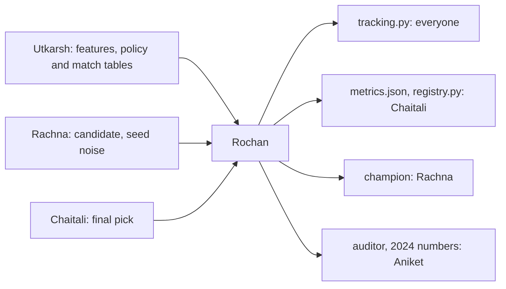

# Rochan: tracking, evaluation, registry, auditor

> Set how everyone logs, make the numbers everyone trusts, own where models live (the registry, the GCP push, rollback), and build the auditor that learns where to look. You also run the one look at 2024, on Nov 12.

| | |
|---|---|
| Steps | tracking, D (evaluation), G (registry, the GCP repo, rollback), P (auditor learning), the 2024 run. About 5 days |
| Code | `model/tracking.py`, `model/evaluate.py`, `model/registry.py`, `Data-Pipeline/meridian/auditor.py`, their tests |
| Waits on | the v1 table (Nov 5), Rachna's candidate (Nov 6), Chaitali's final pick (Nov 9), Utkarsh's `policy` and `match` tables (Nov 7), Aniket adding you to the GCP project (Nov 4) |
| Hands to | everyone: `tracking.py`, the bootstrap helper. Chaitali: `metrics.json`, `registry.py`. Rachna: the champion. Aniket: the auditor, the 2024 numbers |

| Date | Due |
|---|---|
| Thu Nov 5 | `tracking.py` merged. Your pass-bar rows to Chaitali |
| Fri Nov 6 | `evaluate.py` and `metrics.json` on `val`, charts |
| Sat Nov 7 | Auditor: policy v0, Elo |
| Sun Nov 8 | Auditor stall job, simulation tests |
| Mon Nov 9 | The Artifact Registry repo, `registry.py` with the GCP push and rollback |
| Tue Nov 10 | Auditor explore job, replay. Code freeze |
| Thu Nov 12 | The 2024 run, once. Champion pushed. Your report section |

## Read first

- [PLAN.md §4](../../PLAN.md#4-what-we-build): pass bars
- [04-architecture §9](../../../docs/04-architecture.md): auditor learning, the whole design
- [05-test](../../../docs/05-test.md): bars fixed before the run, every metric with its N; the Auditor row
- [packets/README.md](../README.md): Contracts 2–4

## Tracking

- [x] `tracking.py`: `start_run(name, owner)` sets the Contract 3 tags and experiment, on the local store `sqlite:///mlflow.db`
- [x] A short how-to in [packets/README.md](../README.md)
- [x] `log_llm_call(...)` for Vishwa: agent, model, prompt version, tokens, cost, cache hit, gate pass, into `meridian-agents`

## D. Evaluation

`python -m model.evaluate --run <id> --split val|test` writes `reports/metrics.json` and charts. For the model and each baseline: PR-AUC, ROC-AUC, precision, recall and F1 at the threshold, recall at 20% of changed lines, N and positive rate. A paired bootstrap for the PR-AUC difference against lines × files. Charts: PR-AUC bars with intervals, a confusion matrix, PR curves against lines × files. `--split test` refuses unless `model.toml [split] test_allowed = true`.

## G. Registry, GCP push, rollback

The GCP repo, once, on the trial project (no Terraform until phase 3):

- [ ] `gcloud artifacts repositories create meridian-models --repository-format=generic --location=us-east1`
- [ ] A service account that can only write to that repo (Artifact Registry Writer on it, nothing else). Its key as the repo secret Chaitali's workflow reads, main only. Never committed

`python -m model.registry --run <id>`, called by CI after the gate:

- [x] Registers the model as a new version of `defect-risk` in the local MLflow registry
- [x] Moves `champion` only if it wins by the rule (decision 6) and `bias_report.json` passes. Otherwise it stays registered with the reason as a tag
- [x] On promotion: uploads the model and `champion.json` to the Artifact Registry repo `meridian-models` as version `<git sha>` (`gcloud artifacts generic upload`), then writes `registry/champion.json`
- [x] Keeps `previous` on the old champion. `--rollback` moves `champion` back and uploads a `champion.json` pointing at the previous version
- [x] `--push` is skipped without credentials, and says so. Local work never needs GCP

## P. Auditor learning

`python -m meridian.auditor --run-id <id> --config meridian.toml`, settings in `meridian.toml [auditor]`. From [04-architecture §9](../../../docs/04-architecture.md):

- [x] Policy v0 as code: the stall-reason table (#1–8), ranked by number, then evidence. No probabilities
- [x] Explore job v0: nominate deprecation-marked symbols with callers (`radar_deprecated_with_callers`). The fan-in and twin signals wait for gaps G3 and G4
- [x] ε-greedy: the champion with 1 − ε, else a random challenger. Seed hash(run_id, task_id). ε = 0.2, then 0.1 after 30 matches
- [x] Elo: start 1500, K 32, then 16 after 30 matches. Recomputed from the `match` log every run
- [x] Verdict rules: block removed ≤ 7 days before resumption, ticket created ≤ 14 days before, new author resumed, ticket reopened. Else a person picks. None: no match
- [x] Replay matches: past stalls, rows with `known_at` ≤ stall time only, half K
- [x] Promotion guard: ≥ 30 live matches, +50 Elo, beats v0. LLM-written policies are never promoted without a person
- [x] Runs on the fixture and on replay. With no users there are no live matches, and the output says so

## Decisions

Write the test and the rule that picks before you run it, in `decisions.md`. Tag each run `decision=rochan-<n>`.

| # | Decision | Options | Test that decides | Why it matters |
|---|---|---|---|---|
| 1 | Main metric | PR-AUC, ROC-AUC | Both on the baselines and a random score on `val`. How far each sits above chance | With few positives, ROC-AUC looks good even for weak scores. The pass bar must use the metric that shows the difference |
| 2 | Effort-aware metric | recall at 20% of lines, ranking by risk, by risk per line | A hand-made 10-commit example with known answers checks the code. Then both rankings on the candidate | A reviewer's time goes by lines read. A model that flags only big commits has good recall and costs the most review time |
| 3 | Threshold | best F1 on `val`, a fixed precision, a fixed alert rate | Alerts per push on `val` (one push = one commit here) and precision for each | 05-test asks for at most a median of 1 alert per push and precision ≥ 0.80. An F1 threshold might flag a third of commits, and people mute the check |
| 4 | Bootstrap resamples | 500, 1,000, 2,000 | Three seeds at each size. The smallest where the interval ends move less than 0.005 | Too few and the pass bar rests on noise. Too many and CI is slow |
| 5 | Paired or unpaired | | Both on the candidate against lines × files. Compare widths | Both scores are on the same commits. Paired is the right test and much tighter, so the bar can be met |
| 6 | Promotion rule | any gain, a gain above 2 standard deviations of seed noise | Feed the registry Rachna's 5 same-config seeds in a row. With "any gain" count how often `champion` flips; the noise rule should flip 0 times | A champion that flips on noise makes rollback meaningless and the history unreadable |
| 7 | What to compare on | the champion's stored metrics, re-scoring it on today's `val` | Rebuild the table with one of Utkarsh's decisions changed, then compare both ways | If the table changes, stored metrics describe different rows |
| 8 | MLflow store | file store (`mlruns/`), SQLite | Register a model and move an alias on each | The model registry needs a database store. The file store can't hold aliases reliably |
| 9 | Auditor ε schedule | 04's 0.2 then 0.1, a fixed 0.1 | Simulation: 3 policies with known skill, 200 matches, 20 seeds. Matches until the best is champion, and how often a worse one is | Too little exploration and a better policy never gets tried. Too much and the team sees worse rankings for longer |
| 10 | Elo K | 04's 32 then 16, 24 flat | Same simulation: rank error after 30, 60, 100 matches | K sets how fast Elo moves. Too high and one lucky match promotes a policy |
| 11 | Replay weight | half K (04), full K, no replay | Simulation with replay matches that are noisier than live ones | Replay is cheap but its verdicts are weaker. It should speed learning without steering it |

## Tests

- [x] `test_evaluate.py`: PR-AUC, F1 and recall at 20% match a hand calculation. Same seed, same interval. Every number in `metrics.json` has an N. A perfect score gives 1.0, a random one about the positive rate. `--split test` refuses unless allowed
- [x] `test_registry.py`, against a temp local store: a better model takes `champion` and `previous` points at the old one; a worse one is registered, not promoted; one better only within seed noise isn't promoted; a failed bias report blocks promotion; `--rollback` restores; the first model ever is promoted if it passes; `--push` without credentials skips and says so
- [ ] `test_auditor.py`, the 05-test Auditor bars: the Elo simulation with known skill ranks right; recomputing from the log twice gives the same ratings; seeded ε within ±2% over 1,000 draws; a replay never reads a row with `known_at` after the stall; the promotion guard blocks at 29 matches and at +49 Elo
- [ ] Once on the real repo: push, roll back, and check the versions in Artifact Registry

## Done when

- [ ] The team logs through `tracking.py`, and Vishwa logs agent calls through it
- [ ] `metrics.json` on `val`, then on `test` once on Nov 12
- [ ] `registry.py` in CI on main, with a real push and a rollback tried
- [ ] The auditor passes its simulation tests and runs on the fixture
- [x] Decisions 1–11 written down with their numbers
- [ ] Your report section: tracking, metrics, results, registry and rollback, auditor
