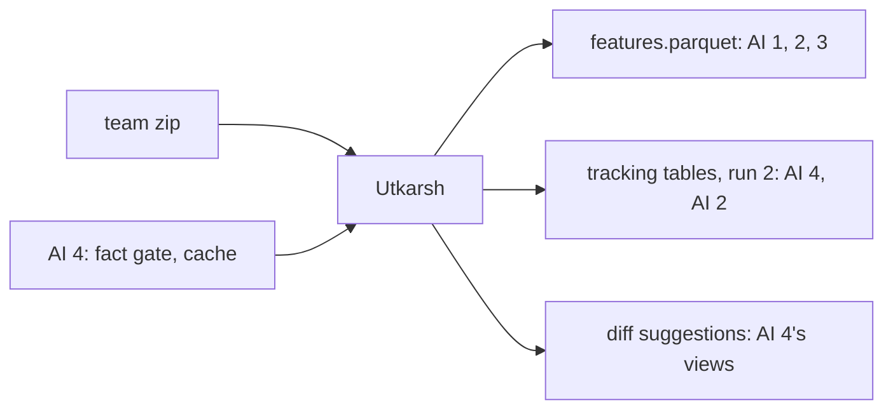

# Utkarsh: data engineer

> Rebuild the team run, hand the AI engineers a feature table whose labels mean the same thing in every year, and finish the data side of the product: the tracking tables, a second real run with real burndown, and the diff drafter that turns its removals into one-line swaps.

| | |
|---|---|
| Steps | A (team run), B (feature table), K (tracking tables), L (second real run), the diff drafter. About 5.5 days |
| Code | `Model-Pipeline/model/data.py`, `Data-Pipeline/schema.sql` (tracking tables), `meridian.next.toml`, `Data-Pipeline/meridian/diffs.py`, their tests |
| Waits on | the team zip (A). AI 4's fact gate and cache (Nov 7–8) for the diff drafter's LLM path. The codemod path needs nothing |
| Hands to | AI 1–3: `features.parquet`. AI 4: tracking tables, run 2, `suggestion` rows of kind `diff` for the views. AI 2: `policy`, `match` tables |

| Date | Due |
|---|---|
| Thu Nov 5 | v1 feature table in git, with its md5. Your pass-bar rows to AI 3 |
| Fri Nov 6 | Decision 1 (label window) settled. c5118 rebuild running |
| Sat Nov 7 | c5118 table in git, label checks done. Tracking tables in `schema.sql` |
| Sun Nov 8 | Second real run done |
| Mon Nov 9 | Diff drafter: the codemod |
| Tue Nov 10 | Diff drafter: the LLM path and the 90% test. Code freeze |
| Thu Nov 12 | Your report section |
| Nov 13–15 | Report, with Aniket |

## Read first

- [Data-Pipeline/README.md](../../../Data-Pipeline/README.md): how to run each part
- [CONTRACTS.md](../../../Data-Pipeline/CONTRACTS.md), [schema.sql](../../../Data-Pipeline/schema.sql), [JOIN.md](../../../Data-Pipeline/JOIN.md): `--prev-run` and `removed` rows
- [KNOWLEDGE-BASE.md](../../../Data-Pipeline/KNOWLEDGE-BASE.md): the tracking-table DDL
- [04-architecture §6](../../../docs/04-architecture.md): the diff rules
- [week1/pair1](../../../week1/pair1/README.md), [week1/pair2](../../../week1/pair2/README.md), [week1/pair3](../../../week1/pair3/README.md): Django's edit set, Spark's quirks, the package migrations
- [packets/README.md](../README.md): Contract 1 is yours; Contract 5 for the diff drafter

## A. Rebuild the team run

From `Data-Pipeline/`, in the `meridian` conda env (Python 3.11), about 6 GB of disk and 8 GB of RAM. Put the team zip in `shared-snapshot/` and run `reproduce.py` Option 2. It rebuilds every part and checks the golden hashes.

- [ ] collect's last line says `run_id=c5118b019d642a9b`
- [ ] `MERIDIAN_RUN_ID=c5118b019d642a9b python -m unittest tests.test_golden` passes 24 of 24
- [ ] `dvc commit` from Linux, Mac or the Docker image, so `dvc.lock` matches

## B. The feature table

`python -m model.data --config model.toml` reads `published/latest.json`, opens that block, writes `data/features.parquet` and `data/features.schema.json`. Both go in git.

- Spark only, first-parent commits, from the start year (decision 2).
- Label = 1 if a `bug_inducing` row has this commit as `inducing_sha` and its `fix_sha` (joined to `git_commit` for its time) was authored within the window (decision 1).
- `split = none` after `follow_up_end`.
- Every history feature uses only commits before this one. `file_bug_fixes` is counted at the snapshot and sees the future: never a feature. Compute `prior_bug_fixes` as of each commit.
- No email, name or person id in the parquet.

## K. Tracking tables

- [ ] Move `suggestion`, `outcome`, `push_alert` from KNOWLEDGE-BASE.md's tested DDL into `schema.sql`. Add `agent`, `model`, `route` to `suggestion` (03-data names them; Contract 5 needs them)
- [ ] Draft `policy` (policy_id, job, version, author, created_at) and `match` (match_id, task_id, policy_a, policy_b, result, verdict_source, decided_by, decided_at) from [03-data](../../../docs/03-data.md), with AI 2
- [ ] `meridian/writer.py` and `validate.py` accept them. Empty tables validate
- [ ] KNOWLEDGE-BASE.md's `outcome_*` queries still pass in `tests/test_kb.py`

## L. Second real run

`meridian.next.toml` is `meridian.toml` with Django at its conversion commit `c651331b34` and each package at its migration commit (refs in [week1/pair3](../../../week1/pair3/README.md)). Run it with `--prev-run c5118b019d642a9b`.

- [ ] join marks the Django call sites `removed`. Expect all 267 lines; the 4 `test_legacy_aliases` calls come back as new on purpose ([appendix C §2](../../../Data-Pipeline/report/appendix-real-data.md))
- [ ] Packages: 1,160 of 1,236 lines removed where the migration commit finished the job
- [ ] `owner_done` and `owner_eta` give real numbers

## The diff drafter

`python -m meridian.diffs --run-id <id> --config meridian.toml` drafts a one-line swap for each present call site, and writes each as a `suggestion` row of kind `diff` (Contract 5).

- [ ] The codemod first: a rename rule per symbol from `meridian.toml` (`ugettext` → `gettext`, `url` → `re_path` or `path`), learned from the owner's earlier migrations where there are any ([04-architecture §6](../../../docs/04-architecture.md))
- [ ] The LLM path only when the codemod can't, there are 2 or more same-shape examples, and the site isn't inside `except`. It goes through AI 4's cache and fact gate, and AI 2's `log_llm_call`
- [ ] Every draft must apply, parse, touch only its own line, and resolve to the new symbol (the resolver from phase 1). Otherwise no diff
- [ ] Tested against run 2: drafted from c5118's lines, compared with the real after-lines at the migration commits

## Decisions

Write the test and the rule that picks before you run it, in `decisions.md` in this folder.

| # | Decision | Options | Test that decides | Why it matters |
|---|---|---|---|---|
| 1 | Label window | 180, 365, 730 days | Plot the days from each inducing commit to the fix that blames it (a CDF) over all SZZ pairs. Then, per window, the positive share per year 2015–2024 and the positives in 2024. Pick the shortest window that catches 80% or more of blames and leaves a full 2024 | Too short and real bugs count as clean. Too long and 2024 has no full follow-up, so there's no test year. And if the share still slides by year, the model learns "old means buggy" |
| 2 | Start year | 2014, 2015, 2016 | Fix commits per year (SZZ starts in 2015), and the positive share in 2015 against 2016–2018. Hand-check 10 positives from 2015 and 10 from 2022: is the fix really about the blamed lines? | v1 shows 38% blamed in 2015, far above later years. If early labels are noisier, keeping 2015 teaches the model noise |
| 3 | Author identity for `exp`, `sexp` | raw email, merged person | Count train commits whose author has 2+ emails. Compare the `exp` distribution both ways | 330 Spark people have 2+ emails and wrote 65% of commits. Raw emails make regulars look like newcomers, and AI 3's newcomer slice would be wrong |
| 4 | `[MINOR]` commits | keep with `is_minor`, drop | Their share among positives and negatives | They skip the ticket key, so they never count as fixes, but they can still cause bugs. Dropping them hides real risk |
| 5 | Module for slices | top-level directory, second level inside `sql/` | Rows per module in `val` and `test`. Over 40% of rows or under 30 changes the split | `sql/` holds 38% of Spark tickets. One giant slice hides gaps, and slices under 30 can't be judged |
| 6 | Time column | `authored_at`, merge time | The gap between author and merge time (median, p90), and how many commits cross a split boundary because of it | Spark's merge script makes the merger the committer. A weeks-long gap could leak a 2024 commit into 2023 |
| 7 | Binary files | 0 lines and still counted, dropped | How many commits touch one, and whether they're blamed | NULL lines break `la`, `ld` and entropy. A silent NaN breaks AI 1's models with no error |
| 8 | Feature table in git | full table, a sample | File size. Under 10 MB, commit the full table | CI and every teammate should train on the real distribution. A sample means the CI gate checks a different problem |
| 9 | Second run's scope | Django only, Django plus packages | Run Django first (one repo, fast). Add the packages if the run takes under an hour | Packages add 1,160 removed lines across 20 teams, which makes burndown and per-team ETA meaningful. Django alone is one team's story |
| 10 | Codemod or LLM for diffs | codemod only, codemod then LLM | Django, drafted from the parent of `c651331b34`: share of drafts matching the real after-line, whitespace ignored (05-test: ≥ 90%). Then the packages | `ugettext` → `gettext` is a rename a codemod gets right. If the codemod alone clears 90%, the LLM path is cut first (PLAN §9), and that's a result |
| 11 | `url()` replacement | always `re_path`, `path` when the pattern has no regex | On the packages, which one each migration commit actually used, per line | The real migrations chose per line. A codemod that always picks one fails the 90% bar on the packages |

## Tests

Data, in `Model-Pipeline/tests/test_data.py`, on a tiny made-up history (copy a fixture from `Data-Pipeline/tests/`):

- [ ] A commit blamed by a fix just after the window is a 0, and one just inside is a 1
- [ ] `prior_bug_fixes` doesn't count a fix that comes after the commit
- [ ] `exp` counts a person's commits across both of their emails
- [ ] No column contains an `@`, and there's no name column
- [ ] Every split holds only its years; `none` holds only commits after `follow_up_end`
- [ ] The same block and config give the same file md5

Labels, in the schema file's notes:

- [ ] Positives per year and per split, with N
- [ ] 20 random positives checked by hand: does the fix's diff touch lines the inducing commit wrote?
- [ ] v1 and c5118 tables compared: row counts, positives, and any column whose mean moved more than 1%

Tables and run 2, in `Data-Pipeline/tests/`:

- [ ] A suggestion row with a `source` outside the allowed values is refused
- [ ] An `outcome` row for an unknown `suggestion_id` is refused
- [ ] Run 2 against c5118: removed count equals the answer keys (Django 267, packages per repo); `known_at` of a removed row is run 2's snapshot

Diffs, in `Data-Pipeline/tests/test_diffs.py`:

- [ ] Django drafts match the real after-lines ≥ 90%, reported with N
- [ ] A draft that touches another line is refused
- [ ] A site inside `except` gets no LLM diff
- [ ] A draft whose new name doesn't resolve is refused
- [ ] With the LLM off, the codemod still drafts and the run completes

## Done when

- [ ] The c5118 table is in git, its schema and label numbers written down
- [ ] Tracking tables in `schema.sql`, tested
- [ ] Run 2 done with real removals
- [ ] Diff suggestions written on the real block, with the 90% test reported
- [ ] Decisions 1–11 written down with their numbers
- [ ] Your report section: data, labels, the label window, the tables, run 2, the diff drafter, each decision and its test
