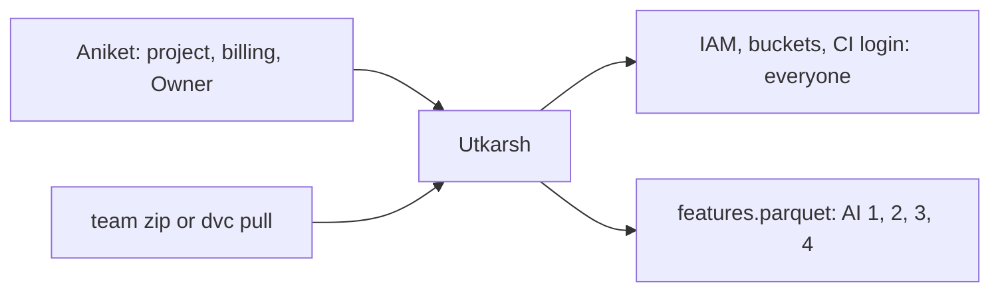

# Utkarsh: data engineer, GCP base

> Set up GCP so the whole team can work from Nov 4, rebuild the team run, and hand the AI engineers a feature table whose labels mean the same thing in every year. Everyone waits on you, so ship a rough table on day 1 and the right one by Nov 6.

| | |
|---|---|
| Steps | GCP base, A (team run), B (feature table) |
| Code | `model/data.py`, `tests/test_data.py` |
| Terraform | `backend.tf`, `apis.tf`, `iam.tf`, `wif.tf`, `budget.tf`, `storage.tf`. You run every `terraform apply`, including AI 1's and AI 2's files after review |
| Waits on | Aniket: the project, billing linked, you as Owner (Nov 3) |
| Hands to | everyone: access, buckets, `features.parquet`, `features.schema.json`. AI 3: the CI login |



| Date | Due |
|---|---|
| Wed Nov 4 | Terraform base and buckets applied, team can log in. v1 feature table posted with its md5 |
| Thu Nov 5 | CI login (`wif.tf`) works from a workflow. Decision 1 (label window) settled |
| Fri Nov 6 | c5118 rebuilt, final feature table in DVC, label checks written down |
| Thu Nov 12 | Your report section |

## Read first

- [Data-Pipeline/README.md](../../../Data-Pipeline/README.md): how to run each part
- [CONTRACTS.md](../../../Data-Pipeline/CONTRACTS.md), [schema.sql](../../../Data-Pipeline/schema.sql): `git_commit`, `commit_file`, `bug_inducing`, `commit_ticket`, `ticket`, `person_alias`
- [week1/pair2/README.md](../../../week1/pair2/README.md): Spark's quirks
- [PLAN.md §8](../../PLAN.md#8-gcp-with-terraform): the GCP design and what never goes in Terraform
- [packets/README.md](../README.md): Contract 1 is yours

## 1. GCP base (Nov 4)

- [ ] State bucket `meridian-tfstate`, made once by hand (Terraform can't create its own backend), with object versioning on
- [ ] `apis.tf`: storage, compute, artifactregistry, aiplatform, iam, iamcredentials, sts, billingbudgets, iap
- [ ] `iam.tf`: a Google Group for the team, with Storage Object Admin, Artifact Registry Writer, Vertex AI User, IAP-secured Tunnel User. Owner stays with you and Aniket
- [ ] `budget.tf`: $25, emails at 50, 90 and 100%
- [ ] `storage.tf`: `meridian-pipeline-snapshots` (the DVC remote `.dvc/config` already names) and `meridian-mlflow-artifacts`. `us-east1`, uniform access, public access prevention enforced
- [ ] `wif.tf`: Workload Identity pool and provider, limited to the repo `Itsme-aniketghosh/Meridian`. Service account `ci-trainer` with only what CI needs: the buckets, Artifact Registry push, Vertex model upload, the IAP tunnel
- [ ] `terraform.tfvars.example` in git. Real emails and the billing id only in your local `terraform.tfvars`
- [ ] AI 1's `registry.tf` and AI 2's `mlflow.tf`: review the PR, paste `terraform plan` in it, apply

## 2. Step A: rebuild the team run (Nov 6)

From `Data-Pipeline/`, in the `meridian` conda env (Python 3.11). About 6 GB of disk, 8 GB of RAM. `reproduce.py` Option 2 does all of it and checks the golden hashes. By hand:

```
python -m meridian.collect  --run-id c5118b019d642a9b --config meridian.toml
python -m meridian.history  --run-id c5118b019d642a9b --config meridian.toml
python -m meridian.scan     --run-id c5118b019d642a9b --config meridian.toml
python -m meridian.resolve  --run-id c5118b019d642a9b --config meridian.toml
python -m meridian.owners   --run-id c5118b019d642a9b --config meridian.toml
python -m meridian.join     --run-id c5118b019d642a9b --config meridian.toml
python -m meridian.graph    --run-id c5118b019d642a9b --config meridian.toml
python -m meridian.validate --run-id c5118b019d642a9b --config meridian.toml
python -m meridian.publish  --run-id c5118b019d642a9b --config meridian.toml
```

- [ ] collect's last line says `run_id=c5118b019d642a9b`
- [ ] `MERIDIAN_RUN_ID=c5118b019d642a9b python -m unittest tests.test_golden` passes 24 of 24
- [ ] `dvc push` puts the raw pulls and c5118's `out/` in the bucket, so nobody needs the Drive zip again

## 3. Step B: the feature table (v1 Nov 4, c5118 Nov 6)

`python -m model.data --config model.toml` reads `published/latest.json`, opens that block, writes `data/features.parquet` and `data/features.schema.json`.

- Spark only, first-parent commits, from the start year (decision 2).
- Label = 1 if a `bug_inducing` row has this commit as `inducing_sha` and its `fix_sha` (joined to `git_commit` for its time) was authored within the window (decision 1).
- `split = none` after `follow_up_end`. Those commits can't have a full window.
- Every history feature uses only commits before this one. `file_bug_fixes` is counted at the snapshot, so it sees the future: never use it as a feature. Compute `prior_bug_fixes` as of each commit.
- The parquet holds no email, name or person id.

## Decisions

Write the test and the rule that picks before you run it, in `decisions.md` in this folder.

| # | Decision | Options | Test that decides | Why it matters |
|---|---|---|---|---|
| 1 | Label window | 180, 365, 730 days | Plot the days from each inducing commit to the fix that blames it (a CDF), over all SZZ pairs. Then, for each window, the positive share per year 2015–2024 and the positives in 2024. Pick the shortest window that catches most blames (aim for 80% or more) and leaves a full 2024 | Too short and real bugs count as clean. Too long and 2024 has no full follow-up, so there's no test year. And if the share still slides by year, the model learns "old means buggy" |
| 2 | Start year | 2014, 2015, 2016 | Fix commits per year (SZZ starts in 2015), and the positive share in 2015 against 2016–2018. Hand-check 10 positives from 2015 and 10 from 2022: is the fix really about the blamed lines? | v1 shows 38% blamed in 2015, far above later years. If early labels are noisier, keeping 2015 teaches the model noise |
| 3 | Author identity for `exp`, `sexp` | raw email, merged person (`person_alias`) | Count train commits whose author has 2+ emails. Compare the `exp` distribution both ways | 330 Spark people have 2+ emails and wrote 65% of commits (week-1 pair 2). Raw emails make regulars look like newcomers, and AI 3's newcomer slice would be wrong |
| 4 | `[MINOR]` commits | keep with `is_minor`, drop | Their share among positives and negatives, and how many are blamed at all | They skip the ticket key, so they're never counted as fixes, but they can still cause bugs. Dropping them hides real risk |
| 5 | Module for slices | top-level directory, second level inside `sql/` | Rows per module in `val` and `test`. Any module over 40% of rows, or under 30, changes the split | `sql/` holds 38% of Spark tickets. One giant slice hides gaps inside it, and slices under 30 can't be judged (AI 3) |
| 6 | Time column | `authored_at`, merge time | The gap between author and merge time (median, p90), and how many commits cross a split year boundary because of it | Spark's merge script makes the merger the committer. If the gap is weeks, a "2023" commit could have been merged in 2024 and leak across the split |
| 7 | Binary files | 0 lines and still counted, dropped | How many commits touch a binary file, and whether those commits are blamed | NULL lines break `la`, `ld` and entropy. A silent NaN breaks AI 1's models without an error |
| 8 | CI copy of the table | full table in git, a sample | File size. Under 10 MB, commit the full table | CI should train on the real distribution, or its gate checks a different problem |
| 9 | Where `dvc push` runs | Windows, Mac or Linux, Docker image | Push once from Windows, then `dvc status` from Linux | The README says to commit `dvc.lock` from Linux or Mac only. A hash mismatch makes `dvc pull` fail for everyone |

## Tests

Infrastructure, before you tell the team it's ready:

- [ ] `terraform plan` right after `apply` shows no changes (no drift)
- [ ] An object URL in each bucket, fetched with no login, gives 403
- [ ] A teammate in the group can read and write the DVC bucket. An account outside the group can't
- [ ] A workflow run on this repo gets a GCP token through Workload Identity. Check the provider's attribute condition: a fork or another repo must not get one
- [ ] The budget exists, with the three alert thresholds

Data, in `tests/test_data.py`, on a tiny made-up history (copy a fixture from `Data-Pipeline/tests/`):

- [ ] A commit blamed by a fix after the window is a 0, and one just inside it is a 1
- [ ] `prior_bug_fixes` doesn't count a fix that comes after the commit
- [ ] `exp` counts a person's commits across both of their emails
- [ ] No column contains an `@`, and there's no name column
- [ ] Every split holds only its years, and `none` only commits after `follow_up_end`
- [ ] The same block and config give the same file md5

Labels, written into the schema file's notes:

- [ ] Positives per year and per split, with N
- [ ] 20 random positives checked by hand: does the fix's diff touch lines the inducing commit wrote?
- [ ] v1 and c5118 tables compared: row counts, positives, and any column whose mean moved more than 1%

## Done when

- [ ] The team has used GCP since Nov 4, and CI can log in
- [ ] The c5118 table is in DVC, its schema in git, decisions 1–9 written down with their numbers
- [ ] Your report section: GCP setup, data, labels, each decision and its test
