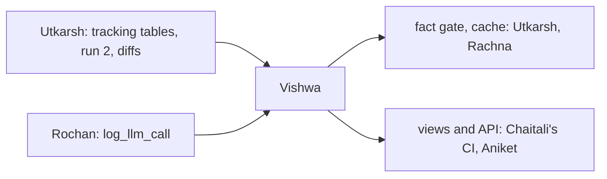

# Vishwa: fact gate, writer agent, cache, views

> Build the parts of the product people see and the check that keeps them honest: the fact gate that stops any made-up number, the writer agent and its cache, and the views and API that show the whole map. Facts come from the block; the LLM only writes.

| | |
|---|---|
| Steps | N (the fact gate, first), the writer agent and the cache, O (views and API). The policy writer only if time allows. About 5 days |
| Code | `Data-Pipeline/meridian/fact_gate.py`, `agents.py`, `llm_cache.py`, `views.py`, `Data-Pipeline/llm_cache/`, `meridian.toml [llm]`, their tests |
| Waits on | nothing for the gate (the fixture is in the repo). Utkarsh's tracking tables (Nov 7) and run 2 (Nov 8). Rochan's `log_llm_call` (Nov 5) |
| Hands to | Utkarsh: the gate and cache for the diff drafter. Rachna: the writer for Jev. Chaitali: views and agent outputs for CI and the LLM bias check. Aniket: the views |

| Date | Due |
|---|---|
| Thu Nov 5 | Fact gate started on the fixture. Your pass-bar rows to Chaitali |
| Sat Nov 7 | Fact gate passes 200 + 200 |
| Sun Nov 8 | Writer agent and cache |
| Mon Nov 9 | Views and API |
| Tue Nov 10 | Views and API done. Code freeze |
| Thu Nov 12 | Your report section |

## Read first

- [04-architecture §6–8](../../../docs/04-architecture.md): the LLM stage, the gate, the views
- [02-product](../../../docs/02-product.md): what each view and text looks like ("Before / After" for CHK-311, the four screens)
- [06-dead-ideas](../../../docs/06-dead-ideas.md): no LLM deciding facts, no stripping bad numbers, no rewrites adding intent or priority, no LLM on every push
- [KNOWLEDGE-BASE.md](../../../Data-Pipeline/KNOWLEDGE-BASE.md): every named query the views run, and the fixture
- [tests/dashboard.py](../../../Data-Pipeline/tests/dashboard.py): the pattern the views build on
- [packets/README.md](../README.md): Contracts 5 and 6 are yours

## N. The fact gate (first)

`fact_gate.check(text, facts, teams=..., people=...)`: every number, path, SHA, ticket ID, person and team in the text must be a fact value. Any miss and the whole text becomes the template. Never strip the bad part: it leaves broken sentences (06-dead-ideas).

- [ ] Extractors for each kind: numbers (with commas and `%`), `path:line`, SHAs, ticket keys, team names from `team_map`
- [ ] A template per task kind, filled only from facts
- [ ] The fallback rate per run, published in the run's output
- [ ] Utkarsh's diff drafter and Rachna's Jev use it too: keep the interface to `check(text, facts, teams=..., people=...)`

## The writer agent and cache

- [ ] Tasks: ticket rewrites (`manager_facts`), maker drafts (`maker_drafts`), stall-reason text, consumer-view prose
- [ ] Facts per task from the block (Contract 5). No person's name is ever a fact
- [ ] Output JSON `{"text", "used"}`; bad JSON or a gate miss retries one model up (Jev decides which), then the template
- [ ] Cache: key sha256(model, prompt version, sorted facts JSON), one JSON file per entry in `Data-Pipeline/llm_cache/`, committed. A rerun makes 0 calls
- [ ] Every call through Rochan's `log_llm_call`: agent, model, tokens, cost, cache hit, gate pass
- [ ] Every offer written as a `suggestion` row
- [ ] The push check stays templates only. No LLM there

## O. Views and API

`python -m meridian.views` (Contract 6), read-only, built on `tests/dashboard.py`.

- [ ] The four views and the ticket tools, from KNOWLEDGE-BASE.md's named queries, laid out as in [02-product](../../../docs/02-product.md)
- [ ] LLM text and diffs from `suggestion` rows where they exist, the template where they don't
- [ ] `run_id`, `snapshot_at` and coverage on every page. A banner when the numbers come from the fixture
- [ ] Runs on the real block, run 2 and the fixture `acme/shop`

## Decisions

Write the test and the rule that picks before you run it, in `decisions.md`. Tag each run `decision=vishwa-<n>`.

| # | Decision | Options | Test that decides | Why it matters |
|---|---|---|---|---|
| 1 | What the gate counts as a fact token | numbers only, plus paths and IDs, plus team names | The 200 injected errors (a wrong number, a made-up path, a swapped team, a fake ticket key, a real fact from another task) and 200 clean texts. Catch rate and false rejects for each | 05-test: 100% caught, at most 5% false rejects. Checking too little lets made-up facts through; checking too much rejects good text over "2" in "two calls" |
| 2 | Number matching | exact, with formatting (1,526 = 1526), with rounding (71% from 0.712) | False rejects on clean texts for each | The writer will say "71%" when the fact is 0.712. Too strict and good text falls back; too loose and a wrong number passes |
| 3 | Writer model ladder start | small, mid | On the fixture's tasks: gate pass rate and cost for each start | Starting small is cheap if it passes the gate. Measure it rather than guess |
| 4 | Prompt format | facts as JSON, facts as a bullet list | Gate pass rate and JSON validity on 50 fixture tasks each way | The format changes how often the model invents. Measure, don't assume |
| 5 | Template quality | | Read 20 template outputs next to 20 gated LLM outputs from the fixture. Write what the LLM adds | If the template says the same thing, the LLM costs money for nothing. That's a real result for the report |
| 6 | Cache scope | per run, committed across runs | Rerun the fixture twice: calls made, and diffs between outputs | A committed cache makes CI free and runs byte-identical. It must never serve text for different facts: the key covers that |
| 7 | Views' stack | standard library like `dashboard.py`, a web framework | Build the staff view the `dashboard.py` way first. Switch only if a view can't be built that way | `dashboard.py` already runs every KB query and serves HTML. A framework adds a dependency phase 3 has to deploy |
| 8 | Real block or fixture per view | real where its tables have rows, fixture otherwise | For each view, the row counts its queries return on the real block | No real dataset has tickets and tracked code together (G7). A view showing zeros looks broken; a fixture view with a banner tells the true story |
| 9 | Writer model: hosted or quantized local | the hosted ladder (decision 3), an open instruct model run locally at 4-bit (GGUF through llama.cpp or Ollama), the same model at 8-bit | Gate pass rate, JSON validity, cost and p95 latency on decision 4's 50 fixture tasks, on a CPU runner | A local model is $0 a call and needs no API key in CI. It's picked only if its gate pass rate is within 2 points of the hosted small model's and its p95 latency fits the run's budget. The gate still checks every word, so a weaker model costs fallbacks, never wrong facts |
| 10 | How small the hosted model can be | the small model, the mid model, as the writer's first rung | Gate pass rate and cost per accepted text on the 50 tasks: what each accepted text really costs, counting the retries | The cheapest model whose accepted texts cost least wins, not the cheapest per call |

## Tests

- [ ] `test_fact_gate.py`: the 200 injected errors, 100% caught; 200 clean, at most 5% rejected; a miss gives the template, never a stripped text
- [ ] `test_agents.py`: with the LLM off (no key), every task returns a template and the run completes; with the cache warm, 0 calls; bad JSON retries, then falls back
- [ ] No fact or prompt ever contains an email or a person's name (scan every cache entry)
- [ ] The maker property: each untracked site in exactly one draft (05-test)
- [ ] `test_views.py`: every number on every page traces to a row (05-test: 100%), by parsing the page and looking each one up
- [ ] With the `suggestion` table empty (the LLM off), every page renders with templates
- [ ] `run_id`, `snapshot_at` and coverage on every page and JSON response
- [ ] The fixture `acme/shop` renders 02-product's examples: "31 of 52 done", Checkout "STALLED", Fulfillment "blocked"

## Done when

- [ ] The gate passes 200 + 200 and runs on every LLM output, including Utkarsh's diffs and Jev's picks
- [ ] The writer writes `suggestion` rows on the fixture and the real block, with the cache committed
- [ ] The views run on the real block, run 2 and the fixture
- [ ] Every call is in MLflow `meridian-agents`
- [ ] Decisions 1–8 written down with their numbers
- [ ] Your report section: the gate, the writer, the cache, the views, validation and tracking of the pretrained models
