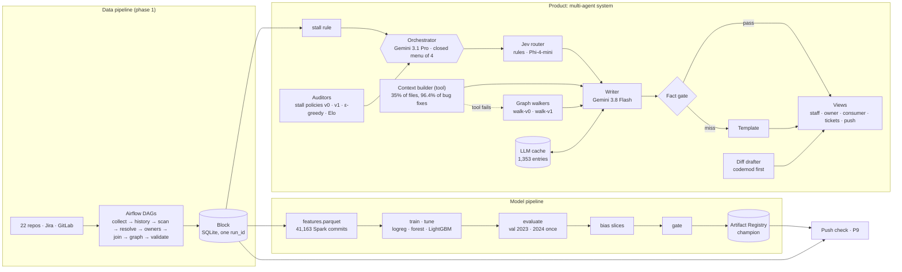

# Meridian phase 2: the model and the product

Phase 1 built the data: one SQLite block from Django, 20 Django packages, Spark and their tickets. Phase 2 trains a defect-risk model on it through the course's model-pipeline guideline, and builds the product around it: views, LLM agents, a fact gate and a learning auditor. Sections follow the guideline's order (PLAN §12). Every number has its N and a source, and each owner's full section is linked at the end.

## 1. Overview

When a team retires an API, someone has to find every call to it, work out who owns each call, judge which ones are risky and see which teams are waiting on each other. Meridian does that from the code, git history and tickets.

Phase 2 adds two things.

- **A defect-risk model** for the push check's P9 ("is this commit likely to introduce a bug?"). Today's rule is lines × files.
- **A multi-agent product.** An orchestrator plans for each stalled team. Auditors rank why the team stalled. A router picks a model, writers turn facts into text, and graph walkers dig when the tools come up empty. A fact gate checks every word an LLM writes.

The tools exist to cut the noise. The context builder hands the LLM 35% of a team's files and still keeps 96.4% of its bug fixes, so the model reads what matters and nothing else. And when a tool comes back empty, the agents don't stop: the graph walkers go straight to the code graph and bring back what they find, through the same fact gate.

**Results in one place:**

| | Result | Source |
|---|---|---|
| 2024, scored once on frozen code | Forest PR-AUC **0.268** vs lines × files 0.214, paired **+0.054 [+0.028, +0.081]**, N = 3,762. The model ships | `reports/2024/metrics.json` |
| Val 2023 | Champion 0.4067 [0.365, 0.451] vs 0.319, paired +0.088 [+0.061, +0.113], N = 4,113 | `registry/champion.json` |
| Simulated faults | 21 of 21 behave, on frozen main and again on `57adef0` | `python -m tests.faults.table` |
| Product rerun | 68 stalls planned, 205 LLM texts, 19 templates, **0 LLM calls, $0** | `reports/final/RUN-LOG.md` |
| Fact gate | 200 of 200 planted errors caught; 2,000 of 2,000 over 10 seeds, 0 false rejects | Vishwa's decisions 1, 11 |
| Live LLM spend, the whole run | 247 calls, $1.10 | `packets/utkarsh-data/gaps.md` |

### Architecture

The full page, with every agent, tool, guardrail and the number behind each, is [architecture.html](architecture.html) (open it in a browser; also published at https://claude.ai/artifact/3vHhQ9ZBdH2TQQqNoKQd7n).



## 2. Model development (§2, §8)

### 2.1 Data from the pipeline (§2.1, §8.2) · Utkarsh

- `model/data.py` reads `published/latest.json`, checks that it names the same run as `model.toml`, and writes `data/features.parquet`.
- **Rows:** 41,163 first-parent Spark commits from 2015 on, no merges.
- **Columns:** the Kamei et al. (2013) just-in-time set (`la`, `ld`, `nf`, `nd`, `ns`, `entropy`, `ndev`, `age`, `nuc`, `exp`, `sexp`), `prior_bug_fixes`, the ticket fields and four slice columns.
- **No future:** each history feature reads only earlier commits; `prior_bug_fixes` is counted as of each commit.
- **No people:** authors are merged persons; `data.check()` refuses any value with `@`.
- **Versioned:** md5 `9c0ab220…`, the same over two rebuilds and checked again before 2024. Every run is tagged with `block_run_id` and `features_md5`.
- **Label:** SZZ, with a 365-day window. No window met the rule as written (80% of blames needs about 988 days, and a full 2024 allows at most 638), so the fallback picked 365 (decision 1).

| Split | Commits | Bug-inducing |
|---|---:|---:|
| train, 2015–2022 | 26,050 | 5,038 (19.3%) |
| val, 2023 | 4,113 | 486 (11.8%) |
| test, 2024 | 3,762 | 283 (7.5%) |

### 2.2 Training and selection (§2.2, §8.3) · Rachna

Three baselines, three model families, all on val 2023 with paired bootstrap intervals against lines × files:

| Val 2023, N = 4,113 | PR-AUC | vs lines × files |
|---|---:|---|
| Chance | 0.118 | |
| **Lines × files** (today's rule) | **0.319** | |
| Churn | 0.316 | −0.003 [−0.015, +0.009], tied |
| Prior bug fixes | 0.222 | −0.097 [−0.130, −0.063] |
| Logistic regression, tuned | 0.382 | +0.063 [+0.043, +0.085] |
| **Random forest, tuned (champion)** | **0.4067** | +0.088 [+0.061, +0.113] |
| LightGBM, tuned | 0.413 | +0.094 [+0.064, +0.122] |

- All three families beat lines × files, even untuned.
- **Forest over LightGBM:** they tie (difference interval [−0.005, +0.019] contains 0), and a tie goes to the simpler model (decision 1).
- **Seed noise:** five seeds of the forest give SD 0.0021. A gap under about 0.004 is noise; the gate and the registry both use that number.
- **Accuracy is useless here:** 88.5% for the forest, 88.2% for always saying "no bug". Every number is PR-AUC.

### 2.3 Validation on held-out data (§2.3, §8.4) · Rochan

- **Split by time:** train 2015–2022, choose on 2023, test on 2024 once. Nothing is picked after 2024 is seen.
- **Choices made on val:** PR-AUC as the main metric, recall at 20% of changed lines as the effort metric, 2,000 paired bootstrap resamples (41% narrower than unpaired).
- **2024 stayed sealed:** `evaluate.py --split test` refuses unless `test_allowed` is true and the code is committed (fault 14). The champion first had to reproduce its val PR-AUC of 0.4067.

**2024, once** (Nov 14, 01:57 UTC, commit `df12728`, Utkarsh ran it, Aniket watched; `reports/2024/RUN-LOG.md`):

| 2024, N = 3,762 | Value |
|---|---|
| Forest PR-AUC | **0.268** [0.224, 0.320] |
| Lines × files PR-AUC | 0.214 [0.179, 0.259] |
| Paired difference | **+0.054 [+0.028, +0.081]** |
| ROC-AUC (lines × files 0.770) | 0.808 |
| Recall at 20% of lines (smallest commits first: 0.608) | 0.625 |

- The pass bar, written before any run: 2024 PR-AUC beats lines × files with the paired interval above 0. **It does. The model ships.**
- It's 3.6× chance on a year nothing was tuned on.
- **The edge is small.** At 20% of lines read, it finds 62.5% of bugs; reading the smallest commits first finds 60.8%. 63% of the model's attention is on commit size (§5).
- PR-AUCs drop from 2023 because 2024's labels are thinner: 7.5% positive, against 11.8%. Bugs from 2024 haven't all been found yet.
- Golden md5s of every input and output are in `golden/2024.json`.

### 2.4 Bias detection and mitigation (§2.4–2.5, §6) · Chaitali

- **Slices:** module, component, author experience and commit size (quarters). Fairlearn `MetricFrame`.
- **Rule (phase 1's, kept for comparison):** judged when the slice has 30 positives (for recall) or negatives (for false positives); flagged when its whole Wilson interval is more than 0.10 worse than overall. 62 judged tests.
- **Result: 5 flags, all on commit size.** No module, component or experience slice is flagged.

| Size quarter | Bug-inducing | Recall | False-positive rate |
|---|---:|---:|---:|
| Q2 | 51 | **0.000**, flagged | 0.000 |
| Q3 | 114 | **0.096**, flagged | 0.034 |
| Q4 (largest) | 299 | 0.806 | **0.485**, flagged |

- Small commits get their bugs missed; large ones get the false alarms. Bugs are 1.9% of Q1 and 29.0% of Q4, so a fixed alert budget goes to large commits.
- **Lines × files is worse** at the same alert rate: Q2 0.000, Q3 0.018, Q4 FPR 0.540, plus a sixth flag.
- **Newcomers** (16 positives, too few to judge): the model catches 9, lines × files 7.
- **Are Q2's labels right?** Hand check, blind, 20 commits: 7 wrong (0.35, Wilson 0.18–0.57). An LLM audit agreed with the person on only 10 of 20, so it wasn't used.

**Mitigation.** Rule: adopt a fix that closes at least half the worst gap for at most 0.01 PR-AUC and 0.02 precision.

| Option | Q2 recall | Gap closed | Verdict |
|---|---:|---:|---|
| Thresholds, equal recall by size | 0.294 | 92% | no: −0.121 precision |
| Thresholds, Fairlearn TPR parity | 0.667 | 103% | no: −0.203 precision, 2.6× alerts |
| Re-sampling ×2 | 0.059 | 14% | no: closes too little |
| Re-sampling ×4 | 0.255 | 68% | no: −0.061 PR-AUC |

- **No fix qualifies; the model ships unmitigated.** The five flags are accepted in `model.toml [bias] accepted`, each pointing at this table.
- Equal recall by size would cost a third of all bugs caught (recall 0.52 → 0.34).
- The precision limit came after the first results (Nov 8). A threshold fix leaves PR-AUC unchanged by construction, so the PR-AUC limit alone couldn't see its cost.

### 2.5 Final selection (§8.6) · Chaitali

The tuned forest. It beats lines × files, ties LightGBM (the simpler wins), and both have the same five size flags, so bias doesn't reopen the tie. Its bias report passes with the five accepted.

### 2.6 Registry on GCP (§2.6, §8.7) · Rochan

- **GCP Artifact Registry** `meridian-models` (us-east1). Each promoted model is a version named by its git SHA, with `champion.json` beside it; a `champion` pointer names the one in force.
- **The champion:** version `85b4684…`, `model.joblib` md5 `2a0c9cc6…`, confirmed in the registry on Nov 14.
- **Promotion rules, written before any model was registered:** a gain above 2 SD of seed noise (fed five same-config seeds, the champion moved 0 times); the champion is re-scored when the table changes.
- **Checked on the real repo:** two drill models pulled back with matching md5s (Nov 9); eight steps on Nov 10, all passing, including a rollback and a conflicting file stopped.
- **Billing:** only `meridian-models`, 40 MB, on education credit.

## 3. Hyperparameter tuning (§3) · Rachna

- **Optuna** on three expanding time folds inside train (2020–2022), search space in `model.toml [search.*]`.
- **Stopping rule:** 50 trials at a time while the last 30 still improve by at least 0.002. Logistic regression stopped at 50, the forest and LightGBM at 100.
- **Tuning doesn't touch val.** Tuned logistic regression came out below untuned (0.382 vs 0.390), and we didn't re-tune on val, because that would leak it.
- **CI doesn't re-search.** The full search took 27.7 minutes on a GitHub runner; CI retrains with the committed best parameters instead (§6).

## 4. Experiment tracking and model comparison (§4) · Rachna, Rochan

- **MLflow,** three experiments: `meridian-defect-risk`, `meridian-agents` (every LLM call), `meridian-auditor`.
- **Every run carries the same tags:** `owner`, `block_run_id`, `git_sha`, `git_dirty`, `config_sha256`, `features_md5`, and `decision` on decision runs. 26 of 26 runs checked.
- **Any number traces back** to its commit, its block and its feature table.
- **Comparison charts** from `evaluate.py`: PR-AUC with intervals per model, confusion matrix, PR curves; on val in `reports/`, on 2024 in `reports/2024/`.

## 5. Sensitivity analysis (§5) · Rachna

Charts redrawn on Nov 15 from the champion itself (`registry/model.joblib`), on val, N = 4,113 (`reports/sensitivity.json`).

- **SHAP** (exact here: additivity error 1.7e-15). Top five: lines added, files, prior bug fixes, directories, lines deleted.
- **63% of the model's attention is on commit size.** SZZ blames the lines a fix changed, so big commits look risky partly by construction. The model beats lines × files, but much of what it uses is size, measured better.
- **Permutation importance**, correlated features shuffled together: lines added and deleted cost 0.136 PR-AUC, files and directories and subsystems 0.070. It agrees with SHAP (Spearman 0.77).
- **500 rows** already give SHAP's full ranking (Spearman 0.988 against all of val, decision 10).
- **Hyperparameters:** `max_features` carries 0.91 of fANOVA's importance, `max_depth` 0.07.
- **One-at-a-time sweeps** (decision 12; bar: 2 × seed SD = 0.0043):
  - `min_samples_leaf` ±50% moves val PR-AUC by 0.0028: safe to retrain.
  - `n_estimators` ±50% moves it 0.0062, over the bar by the rule. fANOVA gives it no importance, and five noisy points span about 0.005 by chance alone, so we read it as noise near the bar, not a real dependence.
  - The choices of `max_features` spread 0.0075; of `max_depth`, 0.0026.

## 6. CI/CD (§7) · Chaitali, Rochan

`model.yml` runs on every PR and push that touches `Model-Pipeline/`:

```
build image → data check → train → seed noise → evaluate → bias → gate → LLM bias → (main only) register → push to Artifact Registry
```

- **§7.1 Trigger:** PRs plus main, at most about 40 runs a day, on free public-repo runners.
- **§7.2 Validation:** `gate.py` runs five checks and exits 1 on any fail. Its tolerance is 2√2 seed SDs: 20 of 20 same-config seed pairs pass, 3 of 3 planted bad models fail. Two of those bad models beat lines × files, so the bar alone wouldn't stop them; the champion check does.
- **§7.3 Bias:** a failed bias report blocks the push.
- **§7.4 Push:** main only, after the gate. CI signs in through Workload Identity, trusted for this repo's main branch; the university blocks service-account keys.
- **§7.5 Notifications:** one alert per fail through `meridian/alert.py`, tested against local Slack and SMTP servers. A broken channel is logged and never changes the verdict.
- **§7.6 Rollback:** the champion moves only on a real gain; `registry.py --rollback` puts `previous` back, locally and in Artifact Registry (fault 10, and the Nov 10 drill).
- **Speed:** a PR's run takes 4.0 minutes (median; 3.4–5.3 over 24 runs), against a 15-minute bar.
- **Shown red when it should be:** a shuffled-label model on a draft PR failed at 0.174 vs 0.319 and failed bias. Three product faults planted on a draft PR each turned `ci.yml` red on Linux and Windows.

## 7. Docker (§8.1) · Rachna

`python -m model.run_all` runs data check, training, seed noise, evaluation and bias in order inside the model's image, and stops at the first failing step. Its fake mode runs every step on a synthetic table in 22 seconds on every PR.

## 8. The LLMs: validation, bias and tracking (note on pretrained models)

Every LLM in Meridian sits behind three checks: the fact gate validates its text, the fallback rate is sliced for bias, and every call is logged in MLflow.

### 8.1 The agents

| Agent or tool | What it does | Model | How it was tested and picked | Result |
|---|---|---|---|---|
| **Orchestrator** · Aniket | Plans for each stalled team from a closed menu of 4 writer steps. Always ends | Gemini 3.1 Pro | The strongest model our billing can buy. Not compared: every answer is checked, and a failed check gets the rules plan | 68 stalls: 49 plans used, 19 to the rules (6 not JSON, 13 refused by the gate) |
| **Auditors** · Rochan | Rank why a team stalled. Policies v0 and v1, ε-greedy (0.2), Elo | rules | Promotion guard picked from a sweep of 27 over 2,000 simulated seeds, rule committed first | Luck promotes a no-better policy 4.0% of the time (was 87%) |
| **Jev** · Rachna | Picks which model starts each task | rules; Phi-4-mini | 60 tasks labelled by hand before any model ran; rules vs 3 models on the 30 held out | Rules 29 of 30, $0. No router beats them |
| **Writer** · Vishwa | Turns facts into stall reasons, ticket drafts, consumer text, rewrites | Gemini 3.8 Flash | 4 models on 204 real tasks; cheapest within 2 points of the best | Flash 80.4%, then 100% after fixing the facts |
| **Context builder** (tool) · Chaitali | Keeps the files holding 90% of a team's bug fixes, counts the rest | rules | Switched on by a rule written first: ≥ 90% of bug fixes kept, ≥ 10 points over random | 96.4% of fixes with 35% of files (random 72.7%); facts 46% shorter |
| **Graph walkers** · Utkarsh | When the context builder fails, query the code graph: named queries only, read-only, capped | rules; walk-v0, walk-v1 | Fixture with the tool made to fail and the cause outside its context: found. walk-v1 on 20% of stalls, in shadow | Ran for 20 real stalls; a rerun makes 0 queries |
| **Diff drafter** · Utkarsh | Drafts the replacement line, codemod first | codemod; LLM ladder | 3 models on the 12 lines the codemod refuses, same rule as the writer | 0 of 12 each: codemod only. Django 95.1%, packages 73.2% |
| **Fact gate** · Vishwa | Every number, path, ticket, SHA, date and team in LLM text must be in the facts; any miss ships the template | code | 400 planted texts, 4,000 over 10 seeds, then 816 real answers with every rejection read by hand | All planted errors caught; 23 of 27 real rejects were right, fixed in the facts |
| **LLM cache** · Vishwa | sha256(model, prompt version, facts), committed | | Fault 18: delete one entry, only that task calls again | Reruns: 0 calls, 1,353 entries before and after |

### 8.2 Validation: the fact gate

- **What counts as a fact** (decision 1): numbers, dates, paths, SHAs, ticket keys and team names. Only adding team names catches the swapped-team errors: 200 of 200 caught.
- **Team names as words** (decision 11): "across the platform" isn't the team. Fixed by context: 2,000 of 2,000 caught, 0 false rejects over 10 seeds.
- **On real text** the gate was too strict, not too loose: 23 of its 27 rejections were right. Each cause was fixed in the facts, not by loosening the gate: Gemini 80.4% → 98.0% → **100%** (204 of 204), with every wrong text still rejected.
- **The #6921 fix (#122, after the freeze):** GitHub fix keys were read as numbers, so consumer texts fell back 41 of 68. A `#N` key is now checked as a ticket. Consumer texts: 27 → 68 passing, 0 regressions, 200 of 200 planted errors still caught.

### 8.3 How we tested the LLMs

Every model choice had its rule written and committed before its run, and every answer is cached, so each test reruns for $0.

| Test | On | Models and scores | Rule, written first | Picked | Cost |
|---|---|---|---|---|---:|
| Writer model | 204 real tasks | Gemini 3.8 Flash 80.4% · Llama 4 Maverick 74.0% · Gemma 4 65.2% · Llama 4 Scout 54.4% | Cheapest within 2 points of the best | Gemini 3.8 Flash | under $1 |
| Jev router | 30 held-out tasks, hand-labelled | Rules 29 · Phi-4-mini 29 · Gemma 4 29 · Gemini 3.8 Flash 26 | A model routes only if it beats the rules | Rules; Phi-4-mini when a router runs | $0.055 |
| Diff drafter | 12 refused package lines | Flash 0 · Pro 0 · Gemma 4 0 · Llama 4 unreachable | Cheapest within 2 points; ties go to open weights | None clears the checks: codemod only | $0.003 |
| Label audit | 20 commits, judged blind by a person | Gemini 3.1 Pro agreed on 10 of 20 | Use the LLM only at ≥ 15 of 20 | Not used | $2.52 |
| Gate, planted errors | 400 texts; 4,000 over 10 seeds | 3 definitions of a fact, 3 team-name rules | Smallest option at 100% caught, ≤ 5% false rejects | Team names in: 2,000 of 2,000, 0 false rejects | $0 |
| Gate, real text | 816 answers, 4 models | 23 of 27 rejects were right | Fix the facts, never loosen the gate | 80.4% → 98.0% → 100%, wrong texts still caught | $0 |
| Orchestrator, live | 68 real stalls | Gemini 3.1 Pro plans, Flash writes | A plan is used only if every check passes | 49 plans; 19 to the rules | $1.10 |
| LLM bias | 224 live texts | Fallback by task kind, repo, team | Flag at > 0.10 worse, N ≥ 30 | Consumer 41 of 68 flagged → gate fix → 0 | $0 |

- Claude and Mistral weren't run: they're Marketplace products, which credit-only billing can't buy.
- Gemini Flash's thinking is set low: at the default it spent 3,064 tokens a task, and 3 of 10 replies ran out of room before the JSON.
- The Jev test barely tests routing: 29 of the 30 tasks were small. It shows a router does no harm here, not that it helps.

### 8.4 Bias

- **Gate fallback,** sliced by task kind, repo and team on the live run's 224 texts:

| Task kind | Texts | Fell back, as run | After #122 |
|---|---:|---:|---:|
| Stall reason | 68 | 0 | 0 |
| Ticket draft | 68 | 0 | 0 |
| Consumer | 68 | 41, flagged | **0** |
| Walk | 20 | 19 | 19 (N < 30, not judged) |

- **Diff match** by repo: 866 of 1,503 (0.576). `django-oscar` and the pooled small packages are flagged and accepted: no single `url()` style closes the gap, since each real migration chose its own.
- Most slices are under 30, and the judged ones have power 0.23–0.34. A pass here says little.

### 8.5 Tracking and cost

- Every answer, cached or called, goes to MLflow: agent, model, prompt version, tokens, cost, cache hit, gate verdict, route. Never a person, never the prompt text.
- **Live spend:** orchestrator live run 247 calls, $1.10; writer comparison under $1; Q2 label audit $2.52; Jev comparison $0.055; diff model comparison $0.003.
- **Every rerun since is free:** 0 calls, the same plans and texts, byte for byte.

## 9. Simulated faults

21 faults, each a script in `tests/faults/` with its expected result written first. **21 of 21 behave** on frozen main and again on `57adef0`.

| # | Fault | Expected |
|---|---|---|
| 1 | Shuffled labels | PR-AUC near the positive rate; gate fails; alert |
| 2 | Size-only model | Gate fails, or passes only if it really beats lines × files |
| 3 | Feature column missing | `train.py` fails with a clear message |
| 4 | Column type changed | Refused |
| 5 | Table from the wrong run_id | Refused |
| 6 | Same config twice | Same predictions, same metrics |
| 7 | Worse than the champion | Registered, not promoted, not pushed |
| 8 | Better only within seed noise | Not promoted |
| 9 | Bias fails, PR-AUC better | Gate fails |
| 10 | Rollback | Champion back to previous, locally and in Artifact Registry |
| 11 | No GCP credentials | Everything runs; the push is skipped and says so |
| 12 | Slack webhook broken | Gate still decides; error logged |
| 13 | PR from a fork | No secrets; stops before the push |
| 14 | `--split test` before the go | Refused |
| 15 | LLM off | Every view renders with templates |
| 16 | LLM text with a made-up number | Template ships; fallback rate counts it |
| 17 | Jev down | Rules pick; the run completes |
| 18 | One cache entry deleted | Only that task calls the LLM again |
| 19 | Email in a fact | Refused before any prompt is built |
| 20 | Auditor replay, future row | Row ignored |
| 21 | Broken champion in the push check | P9 falls back to lines × files and says so |

Faults 4 and 17 failed the first time; both were fixed before the freeze.

## 10. The push check: why P9 stays lines × files

- P9's bar: precision ≥ 0.80 on at least 30 alerts. **The model can't reach it** on val (best 0.62 on 42 alerts), and neither can model-and-rule together (decision 15b, 900 cutoff pairs).
- **Measured on 60 real 2023 Spark pushes:** P9 is right on 15 of 45 alerts, precision 0.333 (Wilson 0.21–0.48). It misses its bar too.
- **On the 21 real migration commits:** 7 P9 alerts on 19 checked pushes, median 0 per push, which meets the ≤ 1 bar.
- So the model ranks better than lines × files but can't alert at the bar. P9 keeps lines × files, and the model's value shows as a ranking.

## 11. What didn't work

- **The labels cap everything.** SZZ picks the right commit 44% of the time (130 hand-verified Defects4J and Fonte commits). An AI read of 20 random positives found 9 real (45%). Three model families stop within 0.004 ROC-AUC of each other: the limit is the data.
- **Package diffs: 73.2%, under the 90% bar,** and frozen. 230 of the 244 misses are owners choosing line by line (`path` here, `re_path` there), which nothing at the parent commit shows. Decision 14 drafts whole statements; PASS-BARS §2.5 changed from "line" to "statement" after the drafts ran, and says so.
- **The diff LLM path drafts nothing** on the real packages: Flash, Pro and Gemma each drafted 0 of 12. Its only lines need an import change in the same commit.
- **Walker texts mostly fall back:** 19 of 20, each naming a team its facts don't hold. Their findings reach the team as templates, not prose.
- **Two gate gaps,** left for after the freeze: a number with letters glued on (`6921a`), and 14 correct line lists written without their path.
- **No live matches:** the auditor's policies and walk-v1 have never been scored, because nobody uses the product yet. Promotion needs 30 matches.
- **Slack:** no webhook secret on the repo, so CI's alerts go to the run summary, not a real channel.

## 12. What was cut, and what phase 3 deploys

**Cut** (PLAN §9's order, from the top):
- **The policy writer agent** (gap 22): an LLM that writes new stall policies from the champion's losses. The guard it needed is in place; the agent isn't.
- **The explore job's fan-in and twin signals:** they need a whole-repo call graph (gaps G3, G4).
- Never cut: the guideline, the gate, the LLM-off fallback, determinism.

**Phase 3** (PLAN §11):
- Views and API on Cloud Run, the pipeline on a schedule, the champion served to the push check.
- The registry, CI identity and storage moved into Terraform.
- Monitoring: gate fallback rate, Jev's success, push alert precision, suggestion outcomes, spend.
- Live auditor matches, which finally score the stall policies and walk-v1.
- Batch LLM calls for bulk runs; the orchestrator, walkers and Jev stay live.

## 13. Guideline coverage

| Guideline | Item | Where | Status |
|---|---|---|---|
| §2.1, §8.2 | Data from the pipeline, versioned | §2.1 | ✅ |
| §2.2, §8.3 | Several models, selected by metrics | §2.2 | ✅ |
| §2.3, §8.4 | Hold-out validation | §2.3 | ✅ 2024 once, model ships |
| §2.4, §6.1–6.2 | Bias by slicing | §2.4 | ✅ 62 judged tests, 5 size flags |
| §2.5, §8.5 | Bias code, reports, charts, mitigation | §2.4 | ✅ |
| §6.3–6.4 | Mitigation and trade-offs | §2.4 | ✅ none qualifies, trade-offs measured |
| §8.6 | Final pick after validation and bias | §2.5 | ✅ |
| §2.6, §8.7 | Registry on GCP | §2.6 | ✅ Artifact Registry |
| §3 | Hyperparameter tuning | §3 | ✅ Optuna |
| §4 | Experiment tracking | §4 | ✅ MLflow, 26 of 26 runs tagged |
| §4 | Comparison charts, why the pick | §4, §2.2 | ✅ |
| §5 | Feature importance (SHAP) | §5 | ✅ |
| §5 | Hyperparameter sensitivity | §5 | ✅ |
| §7.1 | CI on push | §6 | ✅ |
| §7.2 | Automated validation | §6 | ✅ |
| §7.3 | Automated bias check | §6 | ✅ |
| §7.4 | Automatic registry push | §6 | ✅ |
| §7.5 | Notifications | §6 | ◐ tested on local servers; no Slack secret on the repo |
| §7.6 | Rollback | §6 | ✅ |
| §8.1 | Docker | §7 | ✅ |
| Pretrained models | LLM validation, bias, tracking | §8 | ✅ |

## Appendices

Each owner's full section, with every decision table:

- [Data, labels, the diff drafter, the walkers](../packets/utkarsh-data/report-section.md) · Utkarsh
- [The model, tuning, sensitivity, Jev](../packets/rachna-models/report-section.md) · Rachna
- [Validation, tracking, the registry, the auditor](../packets/rochan-tracking/REPORT-SECTION.md) · Rochan
- [Bias, the final pick, the gate, CI](../packets/chaitali-bias/report-section.md) · Chaitali
- [The fact gate, the writer, the cache, the views](../packets/vishwa-agents/report-section.md) · Vishwa
- [Integration, faults, the go, the final runs, the orchestrator](../packets/aniket-lead/report-section.md) · Aniket

Run logs and fingerprints: [2024 run](../reports/2024/RUN-LOG.md) · [final runs](../reports/final/RUN-LOG.md) · [golden md5s](../golden/2024.json) · [end-to-end check](../reports/checks/E2E-CHECK-2026-11-14.md) · [open gaps](../GAPS.md) · [pass bars](../PASS-BARS.md)
